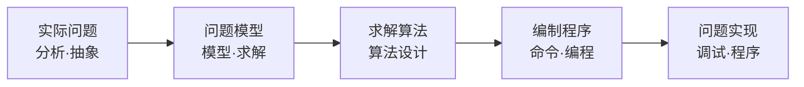
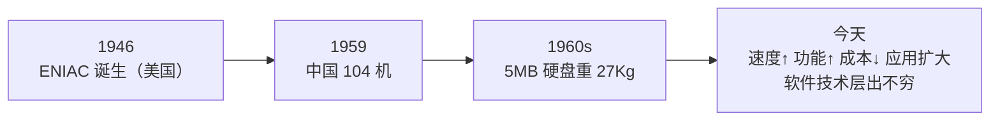
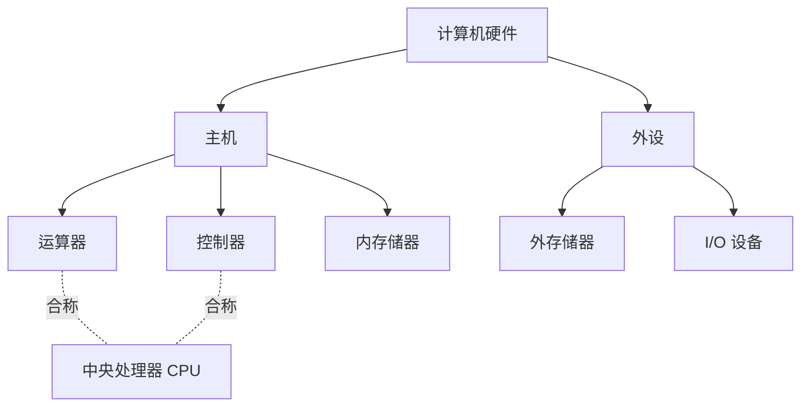
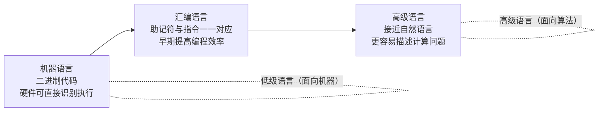
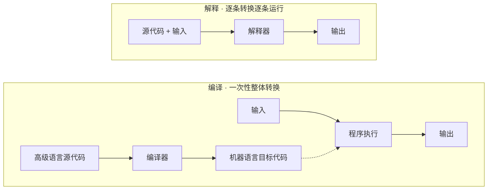
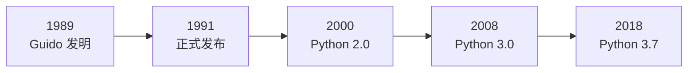
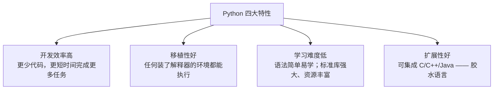
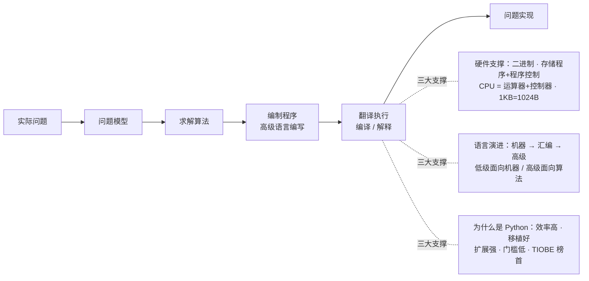

# Python 程序设计 · 第 1 讲

> 计算机概述 · 程序设计语言 · Python 入门
> 整理自 26 页课件照片

---

## 一、课程信息与成绩评定

| 项目 | 内容 |
|---|---|
| 学分 / 课时 | 3 学分 · 上课 48 学时（上机：课内上机含教师辅导 24 学时 + 自主上机） |
| 答疑时间 | 上机时间 · 课间 · 课后（期末考试前另安排集中答疑） |
| 复习资料 | FTP://10.33.12.220 |
| 总评成绩 | 平时 + 期中 + 期末 |
| 平时构成 | 出勤 + 课堂作业 + 课后作业（学习通）+ 上机 |

> [!tip] 注意
> 平时成绩占四块——出勤、课堂作业、课后作业（学习通提交）、上机，任何一块掉链子都会直接拉低总评。

---

## 二、全国计算机等级考试（NCRE）

- **全称** National Computer Rank Examination，由**教育部教育考试院**主办，面向社会，用于考查非计算机专业应试人员的计算机应用知识与技能。
- **考试时间**：上半年 3 月底 ｜ 下半年 9 月中下旬。
- **对口科目**：二级「Python 语言程序设计」（科目代码 **66**，机考 120 分钟）。

| 级别 | 代表科目 | 方式 | 时间 | 获证条件 |
|---|---|---|---|---|
| 一级 | 计算机基础及 WPS / MS Office / Photoshop 应用、网络安全素质教育 | 机考 | 90 分钟 | 科目 14/15/16/17 合格 |
| **二级** | **Python 语言程序设计（科目 66）**｜C / VB / Java / Access / C++ / MySQL / Web / MS Office | 机考 | 120 分钟 | 科目 66 合格（对口本课程） |
| 三级 | 网络 / 数据库 / 信息安全 / 嵌入式系统开发技术 | 机考 | 120 分钟 | 科目 35–39 合格 |
| 四级 | 网络 / 数据库 / 信息安全 / 嵌入式系统开发工程师 | 机考 | 90 分钟 | 需先获三级对应证书 |

**合格证书规则**：百分制计分，但以**等第**通知成绩——优秀 100–90 ｜ 良好 89–80 ｜ 及格 79–60 ｜ 不及格 59–0。90 分及以上颁发「合格」证书；成绩优秀的证书注明「优秀」；**证书上没有「良好」字样**，按合格对待。

---

## 三、计算机能做什么

计算机能做很多事——前提是把实际问题抽象、制作成计算机可求解的程序。

### AI 已经能写程序了，还学什么？

1. **AI 不会自动理解需求**——需要分析问题、精准描述并提问。
2. **能写 ≠ 正确**——生成的代码不一定对，更不一定符合要求；看得懂，才能纠错。
3. **编程的本质是逻辑训练 + 解决问题的能力**，工具会迭代，能力不会过时。

> [!quote] AI 是超强辅助，但你才是指挥者。

---

## 四、计算机发展简史

- **世界第一台 · ENIAC（1946，美国宾夕法尼亚大学）**：18 000 个电子管 · 6 000 个开关 · 占地 150 ㎡ · 重 30 吨 · 功耗 140 KW · 运算 5 000 次/秒。
- **中国第一台大型 · 104 机（1959）**：22 个机柜 · 占地 200 ㎡ · 4 200 个电子管 + 4 000 个晶体二极管 · 容量 4K · 每秒运算 1 万次 · 首道题目「五一」节天气预报。
- **存储器容量单位（必考）**：1 KB = 1024 B；1 MB = 1024 KB；1 GB = 1024 MB；1 TB = 1024 GB。相邻单位进率都是 **1024（2¹⁰）**，不是 1000。

---

## 五、硬件结构与工作原理

**工作原理（两条核心）**：
1. **采用二进制**——数据和指令都采用二进制存储。
2. **存储程序 + 程序控制**——编好的程序存放在存储器里，计算机自动按程序工作。**这是「自动执行」的关键**。

---

## 六、程序设计语言

语言是桥：一头是「不懂 0 和 1 的人」，另一头是「听不懂人话的硬件」。

### 同一个任务（15 + 10 并输出），两种写法

| 汇编语言（面向机器） | 高级语言（面向算法） |
|---|---|
| `MOV A, 15` // 把 15 放入累加器 A | `A = 15 + 10` // 结果放入 A |
| `ADD A, 10` // 与 A 中的值相加 | `PRINT A` // 输出 A |
| `HLT` // 结束，停机 | `END` // 程序结束 |

### 程序如何被执行：编译 vs 解释

- **编译**：把高级语言源代码转换成机器语言目标代码的过程；执行编译的程序称为**编译器**。
- **解释**：把源代码逐条转换成目标代码、同时逐条运行目标代码的过程；执行解释的程序称为**解释器**。

> [!tip] 记忆口诀
> 编译像「全文翻译成册后出版」；解释像「同声传译」——边说边译。Python 的翻译模式为「解释」。

---

## 七、Python 语言

> [!quote] Life is short, you need Python.

- **流行度**：TIOBE 编程语言流行趋势榜，课件时点（2025 年 2 月）Python 位列**第 1 名**，份额约 23.88%。
- **应用**：**通用编程语言**——科学计算、数据处理、人工智能、网络爬虫、机器人等都能发挥重要作用，而且很出色。

---

## 八、全课总结 · 一图流

### 考前自查清单

- [ ] 解题五步：实际问题 → 问题模型 → 求解算法 → 编制程序 → 问题实现
- [ ] 容量换算：1KB = 1024B，1MB = 1024KB，1GB = 1024MB，1TB = 1024GB
- [ ] 硬件组成：主机 = 运算器 + 控制器（合称 CPU）+ 内存储器；外设 = 外存储器 + I/O 设备
- [ ] 工作原理：二进制存储；存储程序 + 程序控制（自动执行的关键）
- [ ] 语言分层：机器 / 汇编 = 低级语言（面向机器）；高级语言面向算法
- [ ] 编译 vs 解释：先整体翻译再执行 vs 逐条翻译逐条运行；编译器 vs 解释器
- [ ] Python：1989 发明、1991 发布；四大特性；胶水语言；TIOBE 第一
- [ ] NCRE：对口科目 66（二级 Python）；等第 100-90 优秀 / 89-80 良好 / 79-60 及格；证书无「良好」字样
- [ ] 成绩构成：总评 = 平时 + 期中 + 期末；平时含出勤、课堂作业、课后作业（学习通）、上机

---
*整理自《Python 程序设计》第 1 讲课堂课件（26 页照片） · 2026 年 10 月 · 仅供个人学习复习使用*
