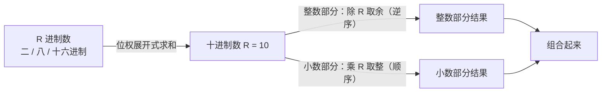
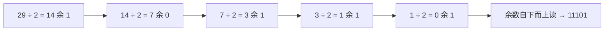
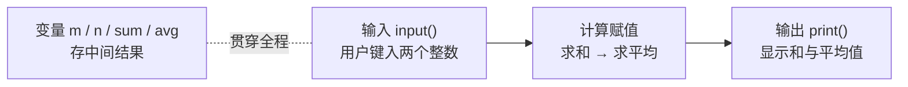
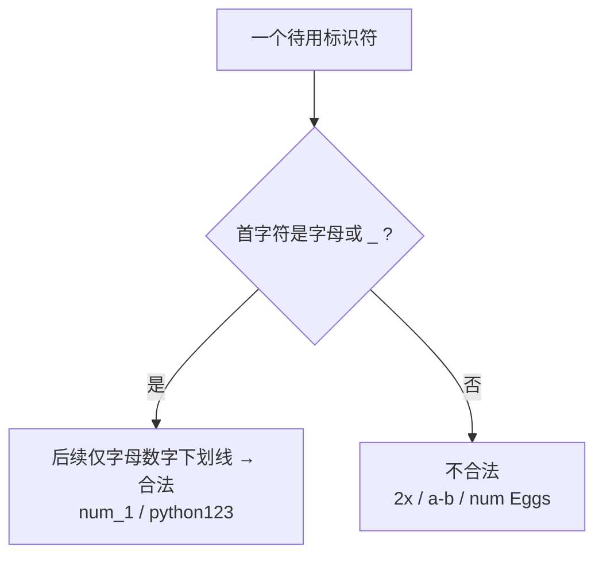
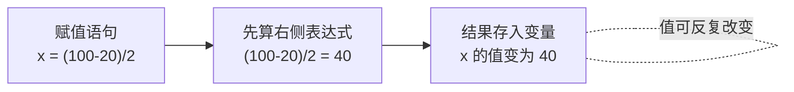
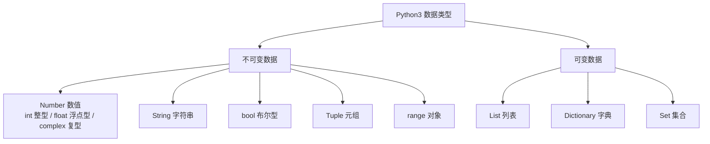

# Python 程序设计 · 第 2 讲

> 进制 · 第一个 Python 程序 · 标识符 · 变量 · 标准数据类型
> 整理自 17 页笔记照片（手写笔记 + 课堂课件）

---

## 一、进制

计算机只认 0 和 1；八进制和十六进制是二进制的「压缩写法」，十进制是给人看的。

### 1. 四种进制与 Python 书写规则

| 进制 | 英文 | 数码 | Python 前缀 | 示例 |
|---|---|---|---|---|
| 二进制 | Binary | 0、1 | `0b` 或 `0B` | `0b101`、`0B101` |
| 八进制 | Octonary | 0–7 | `0o` 或 `0O` | `0o711`、`0O711` |
| 十进制 | Decimal | 0–9 | 默认，无前缀 | `123` |
| 十六进制 | Hexadecimal | 0–9、a–f（A–F） | `0x` 或 `0X` | `0xABC` |

### 2. 四种进制的四大要素

| 要素 | 十进制 | 二进制 | 八进制 | 十六进制 |
|---|---|---|---|---|
| 数码（基本符号） | 0,1,2,3,4,5,6,7,8,9 | 0,1 | 0,1,2,3,4,5,6,7 | 0,1,2,3,4,5,6,7,8,9,A,B,C,D,E,F |
| 基数 R | 10 | 2 | 8 | 16 |
| 位权 R^k | 10^k | 2^k | 8^k | 16^k |
| 计数原则 | 逢十进一 | 逢二进一 | 逢八进一 | 逢十六进一 |

### 3. 进制之间的相互转换



**① R 进制 → 十进制：位权展开式求和**

```
(1101.011)₂ = 1×2³ + 1×2² + 0×2¹ + 1×2⁰ + 0×2⁻¹ + 1×2⁻² + 1×2⁻³
            = 8 + 4 + 0 + 1 + 0 + 0.25 + 0.125
            = (13.375)₁₀

(234.56)₈   = 2×8² + 3×8¹ + 4×8⁰ + 5×8⁻¹ + 6×8⁻²
            = 128 + 24 + 4 + 0.625 + 0.09375
            = (156.71875)₁₀

(3C5)₁₆     = 3×16² + 12×16¹ + 5×16⁰ = 768 + 192 + 5
            = (965)₁₀
```

**② 十进制 → R 进制：整数、小数分别转换，再组合**

| 部分 | 方法 | 排列顺序 | 例 |
|---|---|---|---|
| 整数 | 除以 R 取余，商为 0 止 | 余数**逆序**（自下而上） | 29 → 二进制：÷2 连取余 → `11101` |
| 小数 | 乘以 R 取整，小数为 0 止 | 整数**顺序**（自上而下） | 0.125 → 二进制：×2 连取整 → `.001` |
| 组合 | 用小数点拼起来 | —— | 35.125 → 二进制：整数 35 → `100011`，小数 0.125 → `.001` → **(100011.001)₂** |



> [!tip] 易错点
> ① 整数取余是**逆序**（最后除的余数排最前），小数取整是**顺序**；② 十六进制中 12 要写成 `C`，如 (3C5)₁₆ = 3×16² + **12**×16¹ + 5×16⁰ = 965；③ 位权指数：小数点往左依次 0、1、2…，往右依次 −1、−2、−3…。

---

## 二、第一个 Python 程序：求和与平均值

```python
m = eval(input("输入第一个整数: "))
n = eval(input("输入第二个整数: "))
sum = m + n    # 求和
avg = sum / 2  # 求平均
print("和为: ", sum)
print("平均值为: ", avg)
```



- `input()` 弹出提示、等待输入；`eval()` 把输入字符串转成数值；`print()` 输出结果。
- `#` 后面是**注释**，给人看的，程序不执行。

---

## 三、标识符

> **定义**：一个字符序列，用来标识操作、变量、函数等。标识符是 Python 的基本语法单位。

### 命名规则（两条硬约束）

1. 每个标识符必须**以字母或下划线 `_` 开头**，后跟字母、数字、下划线的序列。
   - 合法：`x`、`num`、`num_1`、`numEggs`、`python123`
   - 不合法：`2x`（数字开头）、`a-b`（含连字符）、`num Eggs`（含空格）
2. **区分大小写**：`int` 和 `Int`、`INT` 是不同的标识符。



### 标识符的类别

| 类别 | 说明与示例 |
|---|---|
| 关键字 | Python 语言保留、有特殊含义的词（如 `if`、`for`、`def`），不能另作他用 |
| 预定义的标识符 | Python 预先定义的字符，一般为语言内置或标准库中的函数名、属性或方法，如 `input`、`print` |
| 用户自定义的标识符 | 用户自己创建的用于命名数据和函数的标识符。应遵守：① 命名规则；② 不能用系统所有的关键字和预定义标识符 |

---

## 四、变量与赋值

### 4.1 变量的定义（2.3.1）

> 变量（Identifier）：用来**标识数据对象**，是指**程序中值可以改变的量**。

### 4.2 变量的赋值（2.3.2）

语法格式：`变量 = 表达式`

- 最简单的表达式就是一个数据，如 `x = 100`
- 表达式也可以更复杂，如 `x = (100-20)/2`——Python 会**先求表达式的值，再返回给变量**。



---

## 五、Python3 中的标准数据类型



- **不可变数据**：Number 数值（int / float / complex）、String 字符串、bool 布尔型、Tuple 元组、range 对象
- **可变数据**：List 列表、Dictionary 字典、Set 集合
- 本讲先建立框架，各类型用法在后续章节（4.1、4.4、4.5、5.1–5.4 节）展开

---

## 六、全课总结 · 一图流


### 考前自查清单

- [ ] 四种进制：二 0/1、八 0–7、十 0–9、十六 0–9A–F；Python 前缀 `0b`、`0o`、（默认）、`0x`
- [ ] 四大要素：数码、基数 R、位权 R^k、计数原则（逢 R 进一）
- [ ] R 进制 → 十进制：位权展开式求和，如 (1101.011)₂ = (13.375)₁₀
- [ ] 十进制 → R 进制：整数除 R 取余（逆序）、小数乘 R 取整（顺序），再组合
- [ ] 标识符规则：字母或 _ 开头；区分大小写；不占用关键字和预定义标识符（如 input、print）
- [ ] 变量与赋值：变量是值可改变的量；「=」先算右侧表达式、再存入左侧变量
- [ ] 程序三要素：输入 → 处理 → 输出；`eval()` 把输入转数值；`#` 后面是注释
- [ ] 数据类型：不可变（Number / String / bool / Tuple / range）vs 可变（List / Dictionary / Set）

---
*整理自《Python 程序设计》第 2 讲课堂笔记（17 页照片） · 2026 年 10 月 · 仅供个人学习复习使用*
