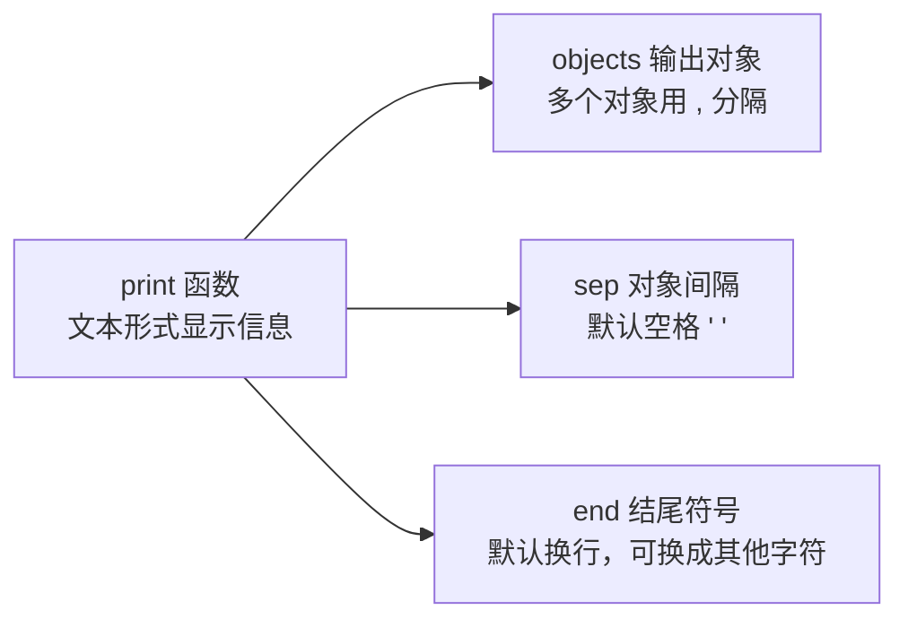
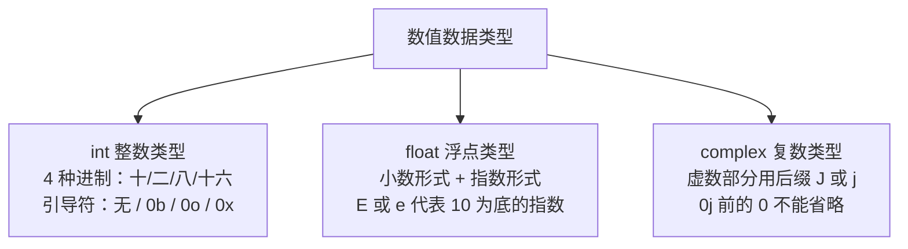
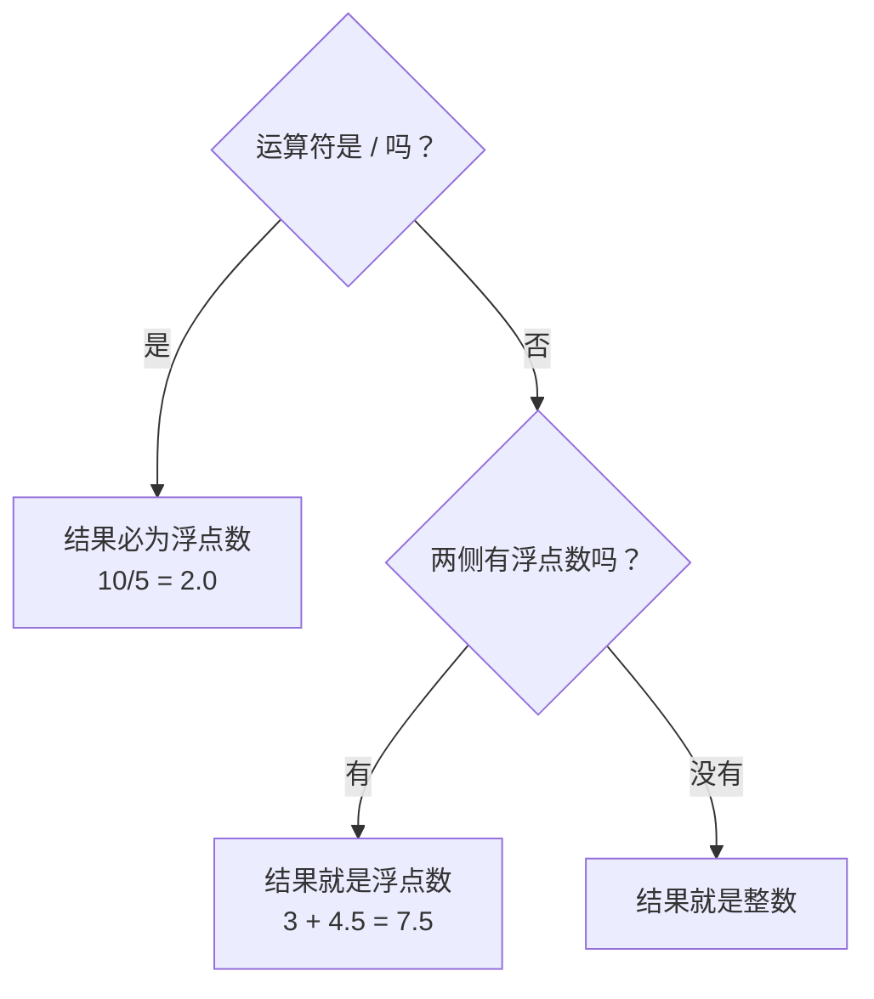
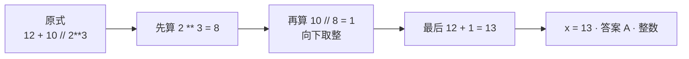
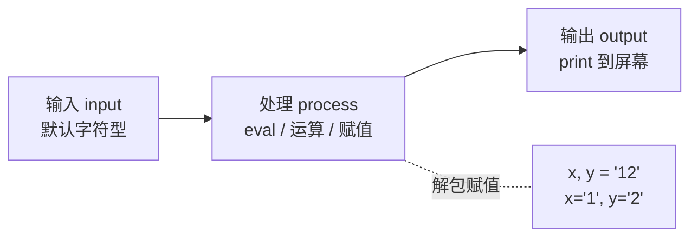
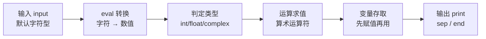

# Python 程序设计 · 第 3 讲

> print 函数 · 数值数据类型 · 内置数值操作
> 整理自 7 页笔记照片（课堂课件 + 手写笔记）

---

## 一、print 函数：格式化输出

print 函数以文本形式在屏幕上显示信息。

```
print (objects [ ,sep=' ' , end='\n' ])
```

| 参数 | 含义 | 默认值 |
|---|---|---|
| `objects` | 表示输出的对象。输出多个对象时，需要用 **,** 分隔 | — |
| `sep` | 用来间隔多个对象 | 空格 `' '` |
| `end` | 用来设定以什么符号结尾，可以换成其他字符 | 换行符 `'\n'` |



- print 可输出**常数、常量变量、表达式**。
- 改 `sep` 可自定义分隔符（如 `sep='-'`）；改 `end` 可让输出不换行（如 `end=''`）。

---

## 二、数值数据类型（2.5.1）



### 1. 整数类型（int）

表示整数的数据类型，与数学中整数的概念一致。Python 中整数类型共有 **4 种进制表示**：

| 进制种类 | 引导符号 | 描述 |
|---|---|---|
| 十进制 | 无 | 默认情况，如 `10`、`-2` |
| 二进制 | `0b` 或 `0B` | 由数字 0 和 1 组成，如 `0b1010`、`0B10101` |
| 八进制 | `0o` 或 `0O` | 由数字 0~7 组成，如 `0o701`、`0O0701` |
| 十六进制 | `0x` 或 `0X` | 由数字 0~9、字符 a~f 或 A~F 组成，如 `0xa2f`、`0X0ff` |

> 二进制数以 0b 引导，八进制以 0o 引导，十六进制以 0x 引导，**大小写字母均可**。

### 2. 浮点类型（float）

表示实数的数据类型，表示带有小数的数值。两种表示方法：

| 形式 | 示例 |
|---|---|
| 小数形式 | `+3.4　-0.4　+0.　-.　.56　-.2　0.00456`（由数字、+、- 号和小数点组成） |
| 指数形式 | `123.6e9　-213.87e-10　1E-27　.345e9　0e0　.E0　10e4`（E 或 e 代表 10 为底的指数） |

### 3. 复数类型（complex）

表示数学的复数。Python 语言中，复数的**虚数部分通过后缀「J」或「j」**来表示。

```
12.3+4j　　-3.1+7j　　1.23e+3j　　1.23+0j
```

> [!warning] 特别注意
> 虚数部分 `'0j'` 前面的 `'0'` **不能省略**——必须写成 `1.23+0j`。

---

## 三、内置数值操作（2.5.2）

| 运算符 | 描述 | 实例 | 结果 | 备注 |
|---|---|---|---|---|
| `+` | 加法 | 3 + 4.5 | 7.5 | |
| `-` | 减法 | 12 - 4.8 | 7.2 | |
| `*` | 乘法 | 2 * 5.0 | 10.0 | |
| `/` | 实数除法 | 10 / 5 | 2.0 | **结果是浮点数** |
| `//` | 整数除法 | 10 // 4 | 2 | 采用**向下取整**方式，-10 // 4 = -3 |
| `%` | 取余 | 10 % 3 | 1 | 操作数可以为实数，3.5 % 3 = 0.5 |
| `**` | 乘方 | 2 ** 3 | 8 | 操作数可以为实数，4.0 ** 0.5 = 2.0 |



> [!tip] 两条规则（做题直接套）
> ① 6 个算术运算符两侧只要**有一个浮点数，结果就是浮点数**，否则就是整数；② `/` 运算符**无论两边什么类型，结果都是浮点数**。

---

## 四、课堂练习

**1. 若 x = 12 + 10 // 2 ** 3，则 x 的值为（　）。**
A. 13　B. 13.0　C. 137　D. 1

> [!success] 答案：A（13）
> 优先级：** 高于 // 高于 +。先 2**3 = 8，再 10//8 = 1（向下取整），最后 12+1 = 13。全程整数运算，无浮点数参与 → 整数 13。



**2. 若 a = 3.0, b = 2，则表达式 a // b 的值为（　）。**
A. 1　B. 1.5　C. 2.0　D. 1.0

> [!success] 答案：D（1.0）
> // 是向下取整：3.0 // 2 = 1（取整部分）。但 a 是浮点数，两侧有浮点数 → 结果必为浮点数 1.0。若选 A（1）就栽在类型规则上。

---

## 五、手写笔记要点（Chapter 2）

### 1. eval：把输入字符串当代码执行

- `eval` 可以直接将输入的字符串**作为代码执行**：输入 `12` → 得到整数 12；输入 `12.5` → 得到浮点数 12.5；输入 `2+3` → eval 直接得 5。
- **兼容性更强**，但**不安全**——输入危险代码会被直接执行，正式程序中慎用。

### 2. 变量使用铁律

- 变量在访问之前**必须先赋值**。
- 只支持该类型**允许的运算**。

### 3. 解包赋值与变量交换

```python
x, y = "12"      # 解包后赋值
print(x, y)      # 输出：1 2
x, y = y, x      # 一步完成交换，无需临时变量
```



- `input("提示字符串")` → 直接输入的数据，Python 系统默认按**字符型**处理。
- print 可输出常数、常量变量、表达式。

---

## 六、全课总结 · 一图流



### 考前自查清单

- [ ] print 三参数：objects（逗号分隔多个对象）、sep（默认空格）、end（默认换行 \n）
- [ ] int 四种进制：十进制无前缀；二进制 0b/0B；八进制 0o/0O；十六进制 0x/0X，大小写均可
- [ ] float 两种写法：小数形式（.56、-.2）；指数形式（E 或 e 代表 10 为底的指数，如 1E-27）
- [ ] complex：虚数部分用后缀 J 或 j；0j 前面的 0 不能省略
- [ ] 运算符表：+ − * / // % **；// 向下取整（-10//4 = -3）；% 和 ** 操作数可为实数
- [ ] 类型规则：两侧有浮点数结果就是浮点数，否则整数；/ 无论类型永远返回浮点数
- [ ] 优先级：** 高于 // 高于 +（12+10//2**3 = 13）
- [ ] eval：把输入字符串当代码执行，兼容强但不安全；变量先赋值再用
- [ ] 解包赋值：x, y = "12" 得 x='1'、y='2'；x, y = y, x 交换两变量

---
*整理自《Python 程序设计》第 3 讲课堂笔记（7 页照片） · 2026 年 10 月 · 仅供个人学习复习使用*
