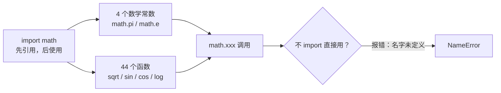
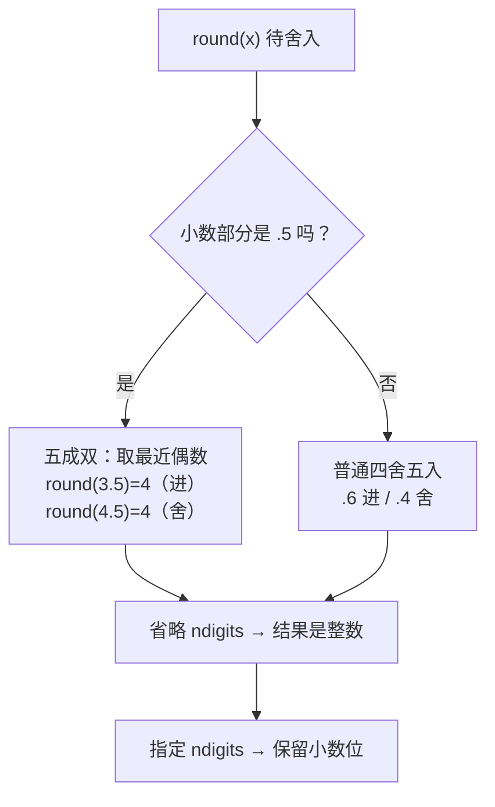
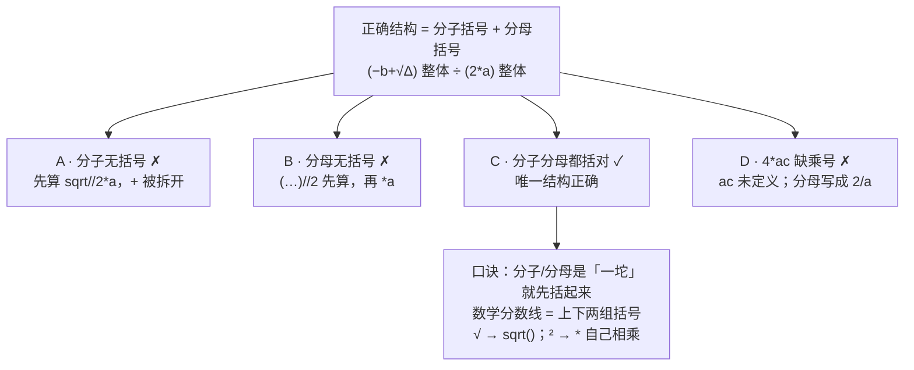
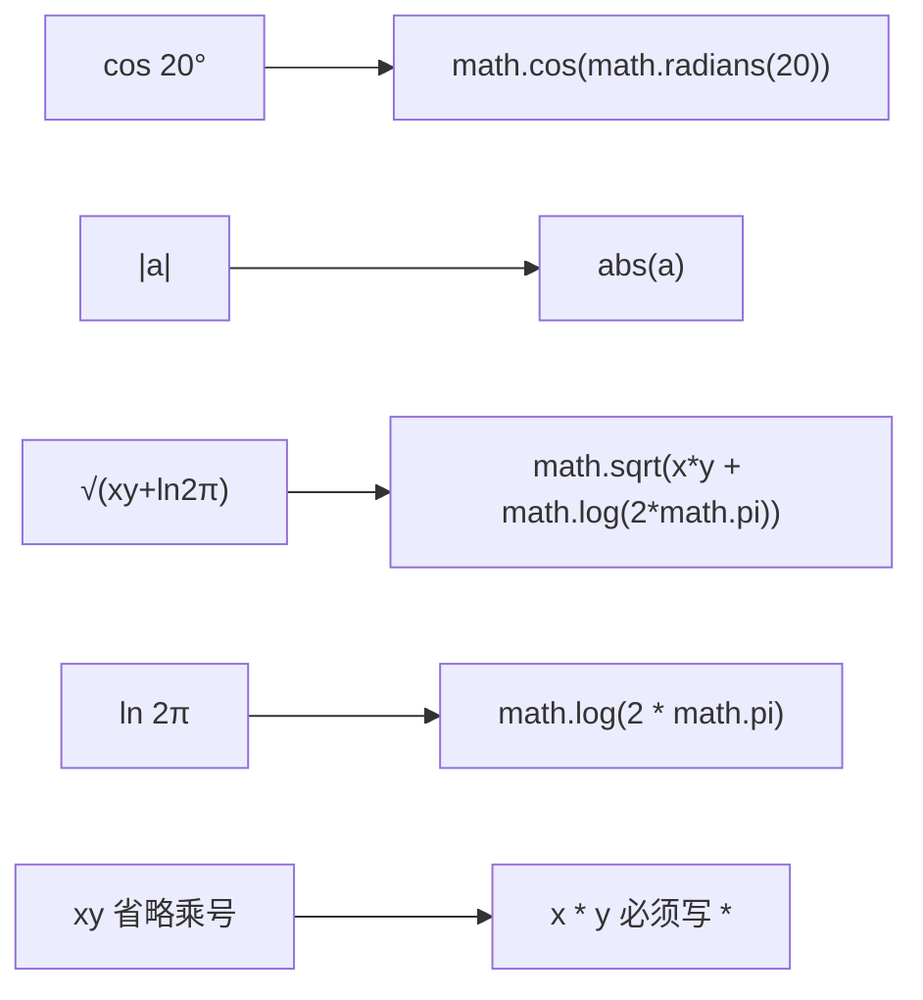
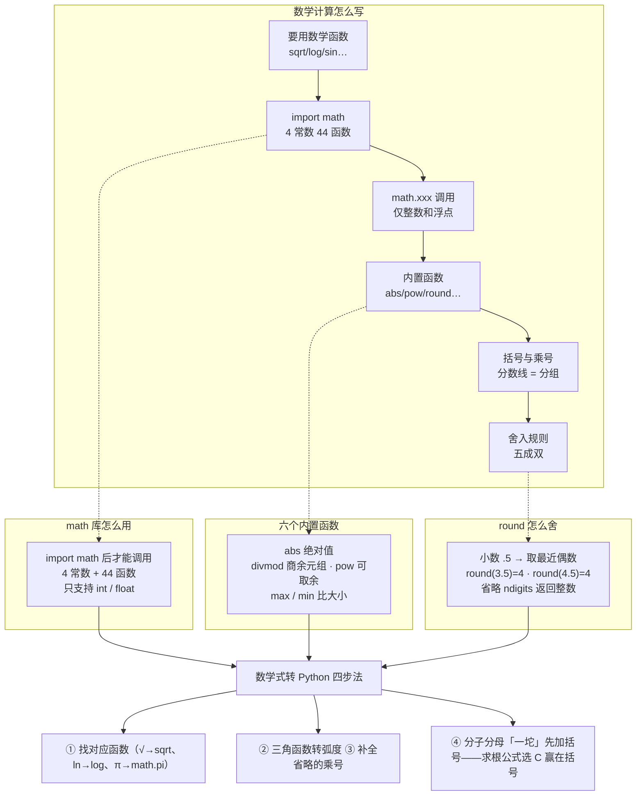

# Python 程序设计 · 第 4 讲整理笔记

> 整理自 4 页课堂课件照片 · 2026 年 10 月
> 主题：math 库 · 内置数值函数 · round 舍入规则 · 数学式转 Python

---

## 01 使用 math 库（2.5.3）

**一句话要点：math 是 Python 数学计算的标准函数库——但不能直接用，先 import。**

- math 提供 **4 个数学常数** 和 **44 个函数**
- 常数和函数**不能直接使用**，需 `import` 引用后才可使用
- math **仅支持整数和浮点数运算**（不支持复数 complex）

**引用方式：**

```python
import math                  # 方式一：math.xxx 调用
from math import sqrt, pi    # 方式二：只引需要的，直接写 sqrt()、pi
```

**常用 math 函数速查（补充）：**

| 写法 | 作用 | 示例 |
|---|---|---|
| `math.sqrt(x)` | 平方根 | `math.sqrt(9)` → 3.0 |
| `math.pow(x, y)` | 幂运算，结果总是浮点数 | `math.pow(2, 3)` → 8.0 |
| `math.sin/cos/tan(x)` | 三角函数，参数是**弧度** | `math.sin(0)` → 0.0 |
| `math.radians(x)` | 角度 → 弧度 | `math.radians(180)` → π |
| `math.log(x[, base])` | 对数，默认自然对数 ln | `math.log(math.e)` → 1.0 |
| `math.floor / ceil(x)` | 向下 / 向上取整 | `math.floor(3.7)` → 3 |
| `math.factorial(n)` | 阶乘 | `math.factorial(5)` → 120 |

**调用链：**



> [!note] 适用范围
> math 库只认整数和浮点数，复数运算不在它的管辖范围。

---

## 02 内置数值函数

**一句话要点：不用 import 就能直接用的 6 个数值函数。**

| 函数 | 作用 | 示例与结果 |
|---|---|---|
| `abs(x)` | 返回 x 的绝对值 | `abs(-5)` → 5，`abs(-5.5)` → 5.5 |
| `divmod(x, y)` | 同时返回商和余数，结果是**元组** | `divmod(7, 3)` → (2, 1) |
| `pow(x, y[, z])` | x 的 y 次幂；给了 z 再对 z 取余 | `pow(2, 3)` → 8，`pow(2, 3, 5)` → 3 |
| `round(x[, ndigits])` | 四舍五入到指定小数位 | `round(5.78)` → 6 |
| `max(x₁…xₙ)` | n 个数中的最大值 | `max(1, 5, 3)` → 5 |
| `min(x₁…xₙ)` | n 个数中的最小值 | `min(1, 5, 3)` → 1 |

**三个容易踩坑的点：**

1. `divmod` 对**负数**用向下取整：`divmod(-7, 3)` → `(-3, 2)`，商不是 -2——和 `//` 规则一致
2. `pow` 带第三个参数是「先幂后取余」：`pow(2, 3, 5)` = 8 % 5 = 3，大数幂运算不溢出
3. `max/min` 也可以传列表：`max([1, 5, 3])` → 5

---

## 03 round 与「四舍六入五成双」

**一句话要点：小数部分为 .5 时，不是简单进位，而是舍入到最近的偶数。**

> [!important] 核心规则
> 当小数部分为 .5 时，会四舍五入到最近的偶数（俗称「**四舍六入五成双**」）——银行家舍入法，Python 3 起 round 采用此规则。

| 调用 | 结果 | 原因 |
|---|---|---|
| `round(3.5)` | **4** | 3 和 4 中 4 是偶数，进位 |
| `round(4.5)` | **4** | 4 和 5 中 4 是偶数，舍去 |
| `round(5.5)` | **6** | 5 和 6 中 6 是偶数，进位 |
| `round(5.78)` | **6** | 普通四舍五入 |
| `round(3.22)` | **3** | 普通四舍五入 |
| `round(4, 5)` | **4** | ndigits=5：对整数指定小数位数，结果仍是 4 |
| `round(2.675, 2)` | **2.67** | 浮点存储误差，不是 2.68（延伸提醒） |



> [!tip] 为什么这样设计
> 「五成双」让大量 .5 的舍入误差相互抵消，统计上不偏向任何一个方向。所以 `round(4.5)` 不是 5 而是 4——别凭直觉答错。

---

## 04 课堂练习：求根公式转 Python

**题目：** 数学式 x = (−b + √(b²−4ac)) / (2a)，在 Python 程序中正确的表示形式为（　）。

```
A. x = -b + sqrt(b*b - 4*a*c) // 2 * a
B. x = (-b + sqrt(b*b - 4*a*c)) // 2 * a
C. x = (-b + sqrt(b*b - 4*a*c)) // (2 * a)
D. x = (-b + sqrt(b*b - 4*ac)) // 2 / a
```

> [!success] 答案：C
> 分子 (−b+√Δ) 用括号括成整体，分母 (2*a) 也用括号固定——只有 C 两处都括对了。
> - **A**：分子没括号（+ 优先级低于 //，会先算 sqrt//2*a）
> - **B**：分母漏括号（先 //2 再 *a）
> - **D**：4*ac 缺乘号（ac 会被当成未定义的名字），且分母写成 2/a
>
> 注意：严格按数学式应使用实数除法 `/`，本题四个选项均为 `//`，选结构正确的 C。



---

## 05 数学式 → Python 表达式

**题目：** 将数学式 cos20° × |a| / √(xy + ln 2π) 写成 Python 表达式。

```python
import math
math.cos(math.radians(20)) * abs(a) / math.sqrt(x * y + math.log(2 * math.pi))
```

**拆解：**

| 数学记号 | Python 写法 | 说明 |
|---|---|---|
| cos 20° | `math.cos(math.radians(20))` | cos 参数必须是**弧度**，先转 |
| \|a\| | `abs(a)` | 内置函数 |
| √( … ) | `math.sqrt( … )` | math 库函数 |
| ln 2π | `math.log(2 * math.pi)` | ln = log（默认自然对数） |
| π | `math.pi` | math 库常数 |
| xy | `x * y` | 省略的乘号必须补齐 |



> [!tip] 转换口诀
> 1. 三角函数先转弧度
> 2. 根号找 sqrt，对数找 log（ln=log，lg=log10）
> 3. π、e 用 math.pi、math.e
> 4. 绝对值用 abs
> 5. 数学式里所有「默许的乘号」都要显式写 `*`
> 6. 分数线上下「一坨」的先加括号

---

## 06 全课总结 · 一图流



### 考前自查清单

- [ ] **math 库三要素**：4 个数学常数 + 44 个函数；import 后才能用；仅支持整数和浮点数（不含复数）
- [ ] **调用写法**：`import math` 后用 `math.xxx`；`from math import sqrt` 后可省略前缀
- [ ] **abs**：取绝对值，`abs(-5.5)` → 5.5
- [ ] **divmod**：返回（商, 余数）元组；负数向下取整，`divmod(-7,3)` → (-3,2)
- [ ] **pow**：`pow(x,y)` 求幂；`pow(x,y,z)` = (x\*\*y)%z，`pow(2,3,5)` → 3
- [ ] **round**：小数部分 .5 时四舍六入五成双——`round(3.5)=4`、`round(4.5)=4`；省略 ndigits 得整数
- [ ] **max/min**：返回 n 个参数中的最值，也可传列表 `max([1,5,3])`
- [ ] **求根公式**：分子分母都要括号，正确选项 C：`(-b+sqrt(b*b-4*a*c))//(2*a)`；严格实数除法用 `/`
- [ ] **复合式转换**：cos 弧度（radians）、|a|→abs、√→sqrt、ln→log、π→math.pi、乘号必须补齐
