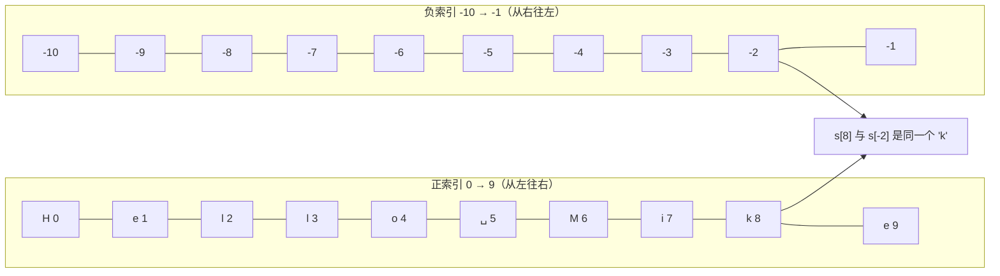
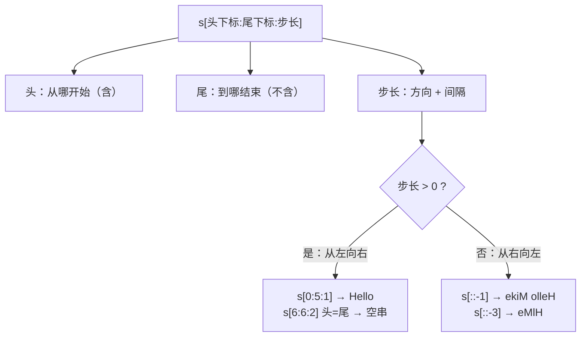
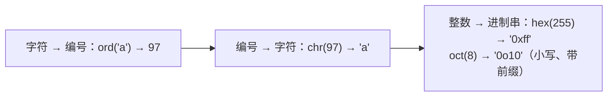
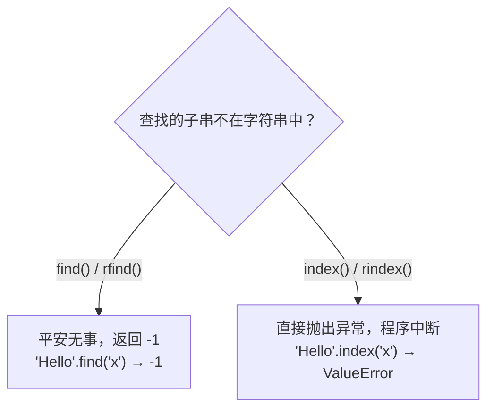
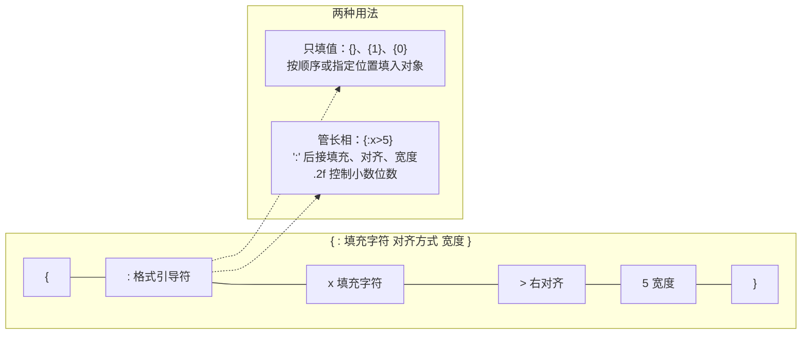
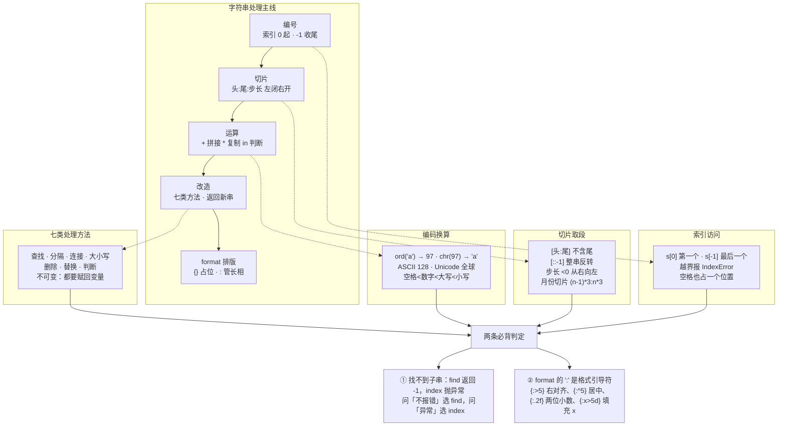

# Python 程序设计 · 第 5 讲整理笔记

> 整理自 22 页课堂课件照片 · 2026 年 10 月
> 主题：字符串 · 索引与切片 · 运算符 · 编码 · 内置处理方法 · format 格式化

---

## 01 字符串的索引与访问

**一句话要点：字符编号从 0 开始正着数，也可以从 -1 开始倒着数——取一个字符写 `字符变量名[索引]`。**

| 编号方式 | 范围（s = 'Hello Mike'，共 10 个字符） | 说明 |
|---|---|---|
| 正索引 | 0 → 9 | 从左往右，第一个字符是 0 |
| 负索引 | -10 → -1 | 从右往左，最后一个字符是 -1 |

- 索引越界（如 `s[10]`、`s[-11]`）会直接抛 `IndexError`
- 字符串长度用 `len(s)` 查看——**中间的空格也算一个字符**

```python
>>> s = 'Hello Mike'
>>> print(s[0], s[-1], s[8], s[-2])
H e k k
```



> [!warning] 易错点
> 索引越界会抛 `IndexError`；`'Hello Mike'` 的长度是 10（含中间的空格）。

---

## 02 切片：取一段子串

**一句话要点：`s[头下标:尾下标]` 左闭右开——取头、不取尾，头尾都能省略，还能加步长。**

**基础切片：**

```python
>>> s = 'Hello Mike'
>>> print(s[0:5], s[6:-1])
Hello Mik          # s[0:5] 取 0~4；s[6:-1] 取 6~8（不含 -1）
>>> print(s[:5], s[6:])
Hello Mike         # 省头 = 从头开始；省尾 = 取到结尾
>>> print(s[:])
Hello Mike         # 头尾全省略 = 复制整串
```

**复杂切片 `[头下标:尾下标:步长]`：**

- 可以取子串的**顺序及间隔**
- 步长值 **> 0**：从左向右取字符
- 步长值 **< 0**：从右向左取字符
- `s[::-1]` 是最常用的**字符串反转**写法

```python
>>> s = 'Hello Mike'
>>> print(s[0:5:1])      # 步长 1：顺序取 0~4
Hello
>>> print(s[6:6:2])      # 头 = 尾：区间是空的
                        # 输出一个空行
>>> print(s[6:-1])       # 省略步长，默认 1
Mik
>>> print(s[4:0:-1])     # 从 4 倒着取到 1（不含 0）
olle
>>> print(s[::-1])       # 整串反转
ekiM olleH
>>> print(s[::-3])       # 反转 + 每隔 3 个取一个
eMlH
```

> [!warning] 两处注意
> 1. `s[6:6:2]` 头和尾指向同一位置，结果是**空字符串**，屏幕上表现为输出一个空行
> 2. 课件屏幕上的 `eM1H` 是字体显示问题，实际结果是 `eMlH`（取 e、M、l、H 四个字符）



**切片应用：月份缩写查询（课件问题）**

- **问题**：输入一个 1-12 的整数，输出对应的月份名称缩写
- **思路**：12 个月份缩写存进一个字符串，每个缩写正好 3 个字符，用切片切出来
- **关键公式**：第 n 个月的切片位置是 `months[(n-1)*3 : n*3]`——如 n=3 时切 `[6:9]` 得到 'Mar'

```python
months = "JanFebMarAprMayJunJulAugSepOctNovDec"
n = 3
print(months[(n-1)*3 : n*3])     # Mar
```

---

## 03 内置的字符串运算符

**一句话要点：四种运算符——`+` 拼接、`*` 复制、`in` / `not in` 判断包含。**

| 运算符 | 描述 | 示例与结果 |
|---|---|---|
| `+` | 字符串拼接 | `"AB" + "123"` → 'AB123' |
| `*` | 字符串复制 | `"Tom" * 3` → 'TomTomTom' |
| `in` | 判断是否为子串 | `"H" in "Hello"` → True；`"h" in "Hello"` → False |
| `not in` | 判断是否不为子串 | `"h" not in "Hello"` → True |

> [!warning] 注意大小写敏感
> in 判断严格区分大小写，"h" 不在 "Hello" 里。想忽略大小写，先 `.lower()` 或 `.upper()` 统一了再判断。

---

## 04 编码与内置字符串函数

**一句话要点：字符在计算机里就是一串编号——ASCII 管英文，Unicode 管全世界。**

| 编码 | 特点 |
|---|---|
| **ASCII 码**（美国信息交换标准代码） | 单字节表示字符，最高位固定为 0，最多 128 个字符；只涉及英文字符或数字、不涉及中文时可用；只能解决**美国人**的编码问题 |
| **Unicode 码** | 把所有语言都统一到一套编码里（2 个字节/字符），中文、日文等都有唯一编号；Python 3 字符串内部就是 Unicode |

**ASCII 编码分布：**

| 字符 | 十六进制表示 | 十进制表示 |
|---|---|---|
| 空格 | 20H | 32 |
| '0' ~ '9' | 30H ~ 39H | 48 ~ 57 |
| 'A' ~ 'Z' | 41H ~ 5AH | 65 ~ 90 |
| 'a' ~ 'z' | 61H ~ 7AH | 97 ~ 122 |

- 例：'a' 字符的编码为 **1100001**，十进制数是 **97**
- 大小关系：**空格 < 数字 < 大写字母 < 小写字母**（所以 'a' > 'A' > '9' > ' '）



**内置的字符串处理函数：**

| 函数 | 描述 | 示例与结果 |
|---|---|---|
| `len(x)` | 返回字符串 x 的长度 | `len('Hello Mike')` → 10 |
| `str(x)` | 将任意类型 x 转换为字符串类型 | `str(123)` → '123' |
| `chr(x)` | 返回 Unicode 编码为 x 的字符 | `chr(97)` → 'a' |
| `ord(x)` | 返回字符 x 的 Unicode 编码值 | `ord('a')` → 97 |
| `hex(x)` | 整数转十六进制，返回**小写**字符串 | `hex(255)` → '0xff' |
| `oct(x)` | 整数转八进制，返回**小写**字符串 | `oct(8)` → '0o10' |

> [!tip] 记忆钩子
> `ord` 像 order（字符→序号），`chr` 像 character（序号→字符）。`hex` / `oct` 的结果分别带 `0x` / `0o` 前缀，和第 2 讲的进制引导符一致。

---

## 05 内置的字符串处理方法

> [!important] 总原则：字符串是不可变的
> 字符串对象是**不可变**的，所以涉及「修改」的方法都是**返回修改之后的新字符串**，并不对原字符串做任何修改——想保住结果，必须赋值回去：`s = s.replace("小", "small")`。

### 1 · 查找类：find() / rfind() / index() / rindex() / count()

- `find()` 和 `rfind()`：分别查找子串在另一字符串中**首次和最后**一次出现的位置；**找不到则返回 -1**
- `index()` 和 `rindex()`：同样找首次和最后一次；**找不到则抛出异常**
- `count()`：统计子串出现的次数

```python
"Hello".find("l")      # 2
"Hello".rfind("l")     # 3
"Hello".find("x")      # -1（不报错）
"Hello".index("x")     # ValueError（直接抛异常）
```



### 2 · 分隔类：split() / rsplit()

- 分别以**指定字符**为分隔符，从字符串**左端和右端**开始将其分隔成多个子串，返回**列表**
- **默认按空白字符**分隔（空格、换行、制表符等）

```python
>>> s = "bird,fish,monkey,fish,rabbit"
>>> s.split(',')
['bird', 'fish', 'monkey', 'fish', 'rabbit']
>>> s = "I am a boy"
>>> s.split()               # 不写参数 = 按空白分
['I', 'am', 'a', 'boy']
```

### 3 · 连接类：join()

- 将列表中多个字符串**连接**起来，并在相邻两个字符串之间**插入指定字符**，返回新字符串

```python
>>> li = ['apple', 'banana', 'pear', 'peach']
>>> print(':'.join(li))
apple:banana:pear:peach
>>> print('-'.join(li))
apple-banana-pear-peach
```

### 4 · 大小写转换类

```python
>>> s = "I have two big eyes."
>>> s.lower()        # 全部小写
'i have two big eyes.'
>>> s.upper()        # 全部大写
'I HAVE TWO BIG EYES.'
>>> s.capitalize()   # 首字母大写
'I have two big eyes.'
>>> s.title()        # 每个单词首字母大写
'I Have Two Big Eyes.'
>>> s.swapcase()     # 大小写互换
'i HAVE TWO BIG EYES.'
```

### 5 · 删除指定字符类：strip() / rstrip() / lstrip()

- 默认删除**空白字符**（空格、制表符、换行符等），也可以指定要删的字符
- 三兄弟分工：`strip` 删两端、`rstrip` 删右端、`lstrip` 删左端

```python
>>> s = "  abc  "
>>> s.strip()        # 删两端空白
'abc'
>>> s.rstrip()       # 删右端空白
'  abc'
>>> s.lstrip()       # 删左端空白
'abc  '
>>> s = "====Mike===="
>>> s.strip('=')     # 指定删 '='
'Mike'
```

### 6 · 替换类：replace()

- 把字符串中指定的字符**或子串**换成新的字符或子串，返回新字符串
- 不给次数参数时，**所有**出现的目标都会被换掉；可用第三个参数限制替换次数

```python
>>> s = "你是我的小呀小苹果儿"
>>> s.replace("小", "small")
'你是我的small呀small苹果儿'    # 两处「小」都换了
```

### 7 · 判断字符类型类

```python
>>> s = 'years'
>>> s.islower()        # 是否全小写
True
>>> s = 'YEARS'
>>> s.isupper()        # 是否全大写
True
>>> s = '20100405'
>>> s.isdigit()        # 是否全数字
True
>>> s = "He is 10 years old"
>>> s.replace(" ", "").isalnum()   # 是否数字或字母
True
>>> s = 'YEARS'
>>> s.isalpha()        # 是否全字母
True
```

---

## 06 format 格式化方法

**一句话要点：`"格式化模板".format(对象1, …, 对象n)`——模板里用 `{}` 占位，用 `:` 管长相。**

- 从 **Python 2.6** 开始新增的格式化字符串方法
- 格式化模板使用大括号 `{}` 作为**特殊字符**，format 方法可以有多个输出项，**位置可以按指定顺序**

**默认顺序 vs 指定顺序：**

```python
>>> "我是{}班{}号的学生{}".format("化工1701", 28, "赵帅")
'我是化工1701班28号的学生赵帅'
>>> "我是{1}班{2}号的学生{0}".format("赵帅", "化工1701", 28)
'我是化工1701班28号的学生赵帅'
```

**格式引导符：** 格式化时要在 `{}` 中首先输入 `":"`，之后分别设置 `<填充字符> <对齐方式> <宽度>`

| 设置项 | 可选值 |
|---|---|
| `<填充字符>` | `"*"`、`"_"`、`"-"` 等，但**只能是一个字符**，默认为空格 |
| `<对齐方式>` | `^`（居中）、`<`（左对齐）、`>`（右对齐） |
| `<宽度>` | 一个整数，指格式化后整个字符串的字符个数 |

```python
>>> "{:5d}".format(24)          # 宽度 5，右对齐，空格填满
'    24'
>>> "{:x>5d}".format(24)        # 宽度 5，右对齐，'x' 填充
'xxx24'
>>> "{:.2f}".format(3.1415926)  # 保留 2 位小数
'3.14'
>>> "{:.4f}".format(3.1415926)  # 保留 4 位小数
'3.1416'
```



---

## 07 全课总结 · 一图流



### 考前自查清单

- [ ] **索引**：从 0 开始正数、-1 是最后一个；越界抛 `IndexError`；空格也算字符
- [ ] **切片**：`s[头:尾]` 左闭右开；头尾可省；`s[头:尾:步长]`；步长 < 0 从右向左取；`s[::-1]` 反转；`s[6:6:2]` 结果为空串
- [ ] **月份缩写**：`months[(n-1)*3 : n*3]`，每个缩写固定 3 字符
- [ ] **运算符**：`+` 拼接、`*` 复制、`in` / `not in` 判断子串（区分大小写）
- [ ] **编码**：ASCII 单字节 128 字符只解决美国；Unicode 统一所有语言用 2 字节；'a' = 97；空格 32 < 数字 48~57 < 大写 65~90 < 小写 97~122
- [ ] **内置函数**：`len` 长度、`str` 转串、`ord` 字符→编码、`chr` 编码→字符、`hex`/`oct` 转十六/八进制（小写带前缀）
- [ ] **不可变原则**：所有「修改」方法都返回新字符串，原串不变——结果要赋回变量
- [ ] **查找分水岭**：find/rfind 找不到返回 -1；index/rindex 找不到抛异常；count 统计次数
- [ ] **分隔与连接**：`split()` 默认按空白分、返回列表；`':'.join(列表)` 用冒号连接
- [ ] **大小写与清理**：lower/upper/capitalize/title/swapcase；strip/rstrip/lstrip 默认删空白、可指定字符
- [ ] **替换**：`replace(旧, 新)` 默认全换，可加第三个参数限制次数
- [ ] **format**：`{}` 按顺序、`{n}` 指定位置；`:` 后接 填充<对齐<宽度；`^` 居中、`<` 左、`>` 右；`{:.2f}` 保留两位小数
