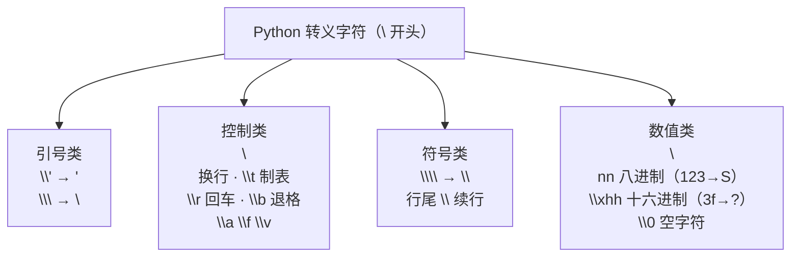
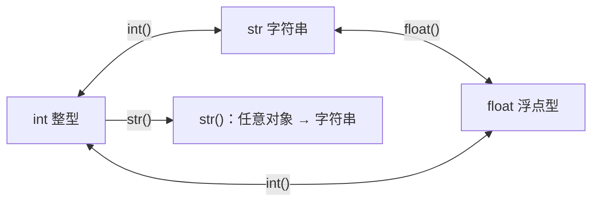
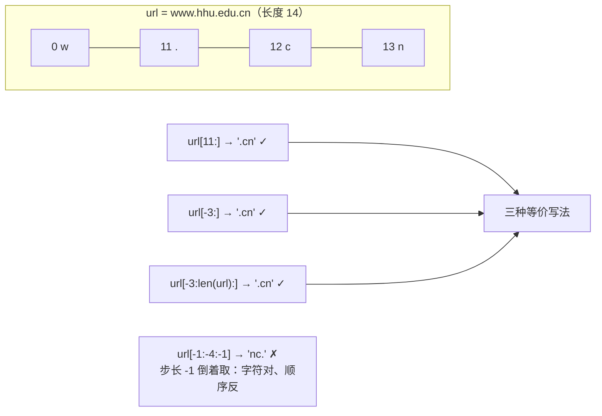
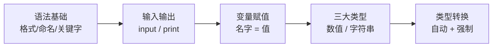
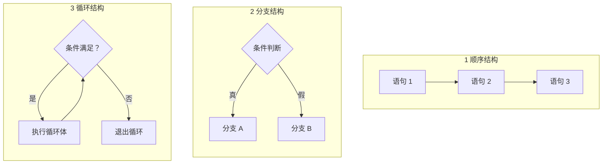
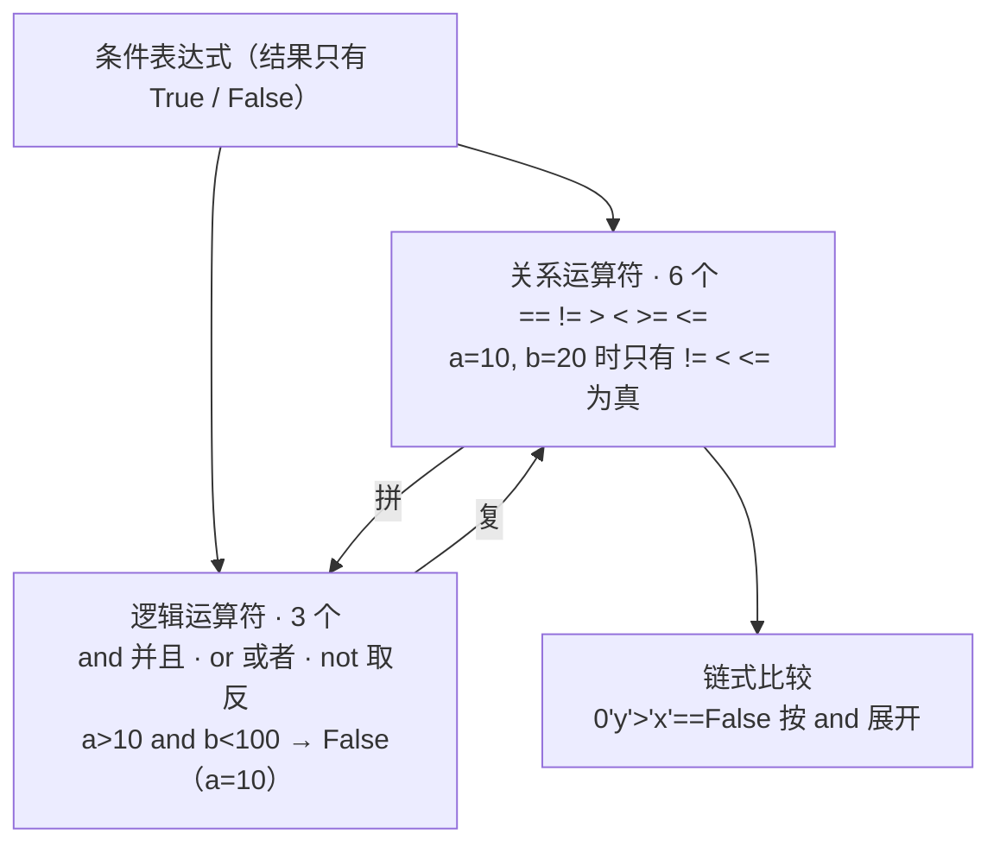

# Python 程序设计 · 第 6 讲整理笔记

> 整理自 10 页课堂课件照片 · 2026 年 10 月
> 主题：转义字符 · 类型强制转换 · 本章小结 · 程序流程控制 · 条件表达式

---

## 01 字符的类型与转义字符（补充）

**一句话要点：字符分一般字符和特殊字符——字符串里有特殊符号，就用转义字符（特殊的格式化控制字符）输出特殊效果。**

```python
>>> print("爱\t生活\n爱\tPython")
爱	生活
爱	Python
```

**Python 支持的转义字符全表：**

| 转义字符 | 输出语句 | 输出结果及意义 |
|---|---|---|
| `\'` | `print("\'")` | '（单引号） |
| `\"` | `print("\"")` | "（双引号） |
| `\`（在行尾） | 在行尾时 | 表示续行 |
| `\\` | `print("\")` | \（一个反斜杠） |
| `\a` | `print("\a")` | 产生声音信号（响铃） |
| `\b` | `print("\b")` | 将当前位置后退一个字符（退格） |
| `\f` | `print("\f")` | 将当前位置移到下一页的开头（换页） |
| `\n` | `print("\n")` | 将当前位置移到下一行的开头（换行） |
| `\r` | `print("\r")` | 将当前位置移到本行的开头（回车） |
| `\t` | `print("\t")` | 将当前位置移到下一个 tab 位置（水平制表符） |
| `\v` | `print("\v")` | 将当前位置移到下一个垂直制表对齐点（垂直制表符） |
| `\nnn` | `print("\123")` | S——nnn 为 1~3 位八进制数，输出其 ASCII 码八进制值为 nnn 的字符（123₈=83₁₀='S'） |
| `\xhh` | `print("\x3f")` | ?——hh 为 1~2 位十六进制数，以 x 或 X 开头，输出其 ASCII 码十六进制值为 hh 的字符（0x3f=63='?'） |
| `\0` | `print("\0")` | 空字符（ASCII 编码为 0 的字符） |



> [!warning] 新手最常踩的坑
> Windows 路径 `"C:\new"` 不写双反斜杠，`\n` 会被当成换行——正确写法 `"C:\\new"` 或用原始字符串 `r"C:\new"`。

---

## 02 类型强制转换（2.7.2）

**一句话要点：强制类型转化是将表达式强制转换为所需的数据类型——int、float、str 三函数。**

| 函数 | 作用 |
|---|---|
| `int()` | 将一个字符串（**不带小数点，不能是表达式**）或浮点数转换为整型 |
| `float()` | 将字符串（**不能是表达式**）或整数转换成浮点数 |
| `str()` | 将对象转化为字符串 |

```python
>>> int("123")       # 合法：纯整数字符串
123
>>> int("12.5")      # 带小数点，int 不接
ValueError
>>> int("99//3")     # 表达式不行——int 不算式
ValueError
>>> float("12.5")
12.5
>>> int(12.9)        # 浮点转整型：直接截断，不是四舍五入
12
>>> str(123)
'123'
```



> [!tip] 两个高频考点
> 1. int / float **不接受表达式**——想算 `"99//3"` 得先用 `eval()`
> 2. `int(12.9)` 是 **12**（截断取整），不是 13

---

## 03 课堂练习

### 第 1 题：引号题

执行下列选项，不能输出 "Hohai University" 的选项是（　）。

```
A. print(" 'Hohai University' ")
B. print(' "Hohai University" ')
C. print(""" "Hohai University" """)
D. print(' \"Hohai University\" ')
```

> [!success] 答案：A
> 按实际输出逐一验证：
> - **A**：双引号字符串里，单引号是**普通字符**，原样输出 `'Hohai University'`（单引号版）
> - **B**：单引号字符串里，双引号是普通字符，输出 `"Hohai University"`
> - **C**：三引号同理，双引号照输
> - **D**：`\"` 是转义双引号，输出的还是 `"Hohai University"`
>
> 只有 A 的输出引号形式与其他三项不同。
> 注意：若题目目标是不带任何引号的纯文本，则四个选项的输出都带引号、题目本身有歧义——本题按「输出含双引号的 "Hohai University"」判定，选 A。

```mermaid
flowchart TD
    RULE["规则：引号在「另一种引号」里 = 普通字符"] --> A["A · 双引号内单引号<br/>输出 'Hohai University'<br/>单引号版 ✗ 选它"]
    RULE --> B["B · 单引号内双引号<br/>输出 \"Hohai University\" ✓"]
    RULE --> C["C · 三引号内双引号<br/>输出 \"Hohai University\" ✓"]
    RULE --> D["D · \\\" 转义双引号<br/>输出 \"Hohai University\" ✓"]
```

### 第 2 题：int("99//3")

表达式 `int("99//3")` 的执行结果是（　）。

```
A. 33　　B. ValueError　　C. 33.0　　D. "99//3"
```

> [!success] 答案：B
> int() 只接受「纯整数字面量」字符串，**不解析表达式**。"99//3" 里有除号和斜杠，不是合法整数字面量，直接抛 `ValueError`。
> - A 是把它当成算式算了的错觉
> - C 错在 int 不可能返回浮点
> - D 是「不转换直接返回」，int() 没这个行为

### 第 3 题：url 切片

若 `url = "www.hhu.edu.cn"`，不能输出字符串 url 后三个字符 ".cn" 的选项是（　）。

```
A. url[11:]          B. url[-3:]
C. url[-3:len(url):] D. url[-1:-4:-1]
```

> [!success] 答案：D
> url 长 14，索引 11~13 正是 ".cn"：A 用正索引 11 起切、B 用负索引 -3 起切、C 用 -3 切到 len(url)，三种写法等价，都得到 `'.cn'`。
> 只有 D 的 `url[-1:-4:-1]` 是从索引 13 **倒着**取到 12→11，结果是 `'nc.'`——字符对，顺序反了。



---

## 04 本章小结（第 2 章）

课件原话六条——第 2 章到此收尾，从语法基础一路讲到类型转换：

- [ ] **基本语法知识**：代码的书写格式、标识符的命名规则、关键字
- [ ] **变量和赋值语句**
- [ ] **input 函数和 print 函数**：实现数据的输入与输出
- [ ] **数值类型**：int、float、complex 的操作，包括操作符、内置函数以及 math 库函数的使用
- [ ] **字符串类型**：类型的表示以及索引和切片的概念，以及操作字符串的各种函数和方法
- [ ] **数据类型的转换**：自动转换、强制转换



---

## 05 程序流程控制 · 三种基本结构

**一句话要点：任何程序，无论多复杂，拆开都是这三种结构的组合。**

1. **顺序结构**：语句一条接一条，从上到下执行——最基本的结构
2. **分支结构**：按条件真假选择走哪条路——if / else 的地盘
3. **循环结构**：条件满足就反复执行——while / for 的地盘（后续章节展开）



> [!note] 承上启下
> 本讲先学「分支」的判据——条件表达式；循环结构留在后续章节用 while / for 展开。

---

## 06 条件表达式 · 关系与逻辑运算符

**一句话要点：分支结构的判据由条件表达式给出——用关系运算符比大小，用逻辑运算符拼条件。**

### 关系运算符（假设 a = 10，b = 20）

| 运算符 | 算术符 | 实例 |
|---|---|---|
| `==` | = | (a == b) 返回 False |
| `!=` | ≠ | (a != b) 返回 True |
| `>` | > | (a > b) 返回 False |
| `<` | < | (a < b) 返回 True |
| `>=` | ≥ | (a >= b) 返回 False |
| `<=` | ≤ | (a <= b) 返回 True |

### 逻辑运算符：and / or / not

- 当需要形成更复杂的条件表达式的时候，会使用到逻辑运算符 `and`（并且）、`or`（或者）和 `not`（取反）
- `not A`：逻辑非，求反运算
- `A and B`：逻辑与，A 与 B 同时为真，表达式值才为真
- `A or B`：逻辑或，A 与 B 有一个为真，表达式值就为真

```python
>>> a, b = 10, 50
>>> a > 10 and b < 100   # 表示 a>10 并且 b<100
False                      # a=10 不满足 >10，与运算一票否决
>>> a > 10 or b < 100    # 表示 a>10 或者 b<100
True                       # b=50 满足 <100，或运算一票通过
>>> not(a > 10 and b < 100)  # 将 a>10 并且 b<100 的结果取反
True
```

### Python 特色：链式比较

- `0<a<b` ⟶ 等价于 `0<a and a<b`（数学写法直接能用）
- `'y'>'x'==False` ⟶ 等价于 `'y'>'x' and 'x'==False`——按字符 Unicode 编码值比较，'y' > 'x' 为真，但 'x' == False 为假，整条为 `False`



---

## 07 全课总结 · 一图流

```mermaid
flowchart TD
    subgraph 主线["第 6 讲主线：字符串细节补完 → 类型转换 → 流程控制开篇"]
        direction LR
        A1["特殊字符<br/>\\ 开头转义"] --> A2["强制转换<br/>int / float / str"]
        A2 --> A3["流程控制<br/>顺序/分支/循环"]
        A3 --> A4["条件表达式<br/>关系 + 逻辑"]
        A4 --> A5["分支语句<br/>下一讲 if 落地"]
    end
    subgraph 支线1["转义字符怎么记"]
        B1["\\n 换行 · \\t 制表 · \\\\ 反斜杠<br/>\\' \\" 打出引号 · 行尾 \\ 续行<br/>\\nnn 八进制 → 字符（123→S）<br/>\\xhh 十六进制 → 字符（3f→?）"]
    end
    subgraph 支线2["转换三函数"]
        B2["int()：整型串或浮点 → int<br/>float()：串或整数 → float<br/>str()：任意对象 → 字符串<br/>不接表达式！int(12.9)=12 截断"]
    end
    subgraph 支线3["条件表达式"]
        B3["关系 6 个：== != > < >= <=<br/>逻辑 3 个：and or not<br/>链式比较 0<a<b 直接写<br/>a=10,b=50：and→False or→True"]
    end
    A1 -.-> B1
    A2 -.-> B2
    A4 -.-> B3
    B1 --> C["三道练习答案：引号题选 A；int(\"99//3\") → ValueError（选 B）；url[-1:-4:-1] 得 'nc.'（选 D）"]
    B2 --> C
    B3 --> C
```

### 考前自查清单

- [ ] **转义字符**：`\n` 换行、`\t` 水平制表、`\r` 回车、`\b` 退格、`\a` 响铃、`\f` 换页、`\v` 垂直制表；`\\` 表示反斜杠；`\'` `\"` 输出引号；行尾 `\` 表示续行
- [ ] **数值转义**：`\nnn` 是 1~3 位八进制（`\123` → 'S'）；`\xhh` 是 1~2 位十六进制（`\x3f` → '?'）；`\0` 是空字符
- [ ] **引号规则**：双引号字符串里的单引号、单引号字符串里的双引号，都是普通字符，原样输出
- [ ] **int()**：字符串必须不带小数点、不能是表达式；浮点数转 int 直接截断（`int(12.9)` → 12）
- [ ] **float()**：字符串不能是表达式；整数可以转
- [ ] **str()**：任意对象都能转成字符串
- [ ] **练习 1**：只有 A 输出单引号版 'Hohai University'，B/C/D 都输出双引号版，选 A
- [ ] **练习 2**：`int("99//3")` 抛 ValueError——int 不算表达式，选 B
- [ ] **练习 3**：`url[11:]`、`url[-3:]`、`url[-3:len(url):]` 都得 '.cn'；`url[-1:-4:-1]` 得 'nc.'（逆序），选 D
- [ ] **三种基本结构**：顺序、分支、循环——程序无论大小都是这三者的组合
- [ ] **关系运算符**：`==` `!=` `>` `<` `>=` `<=`，共 6 个；注意 `==` 是比较、`=` 是赋值
- [ ] **逻辑运算符**：and 同时为真才真；or 有一个为真就真；not 取反
- [ ] **链式比较**：`0<a<b` 等价于 `0<a and a<b`；`'y'>'x'==False` 按 and 展开
