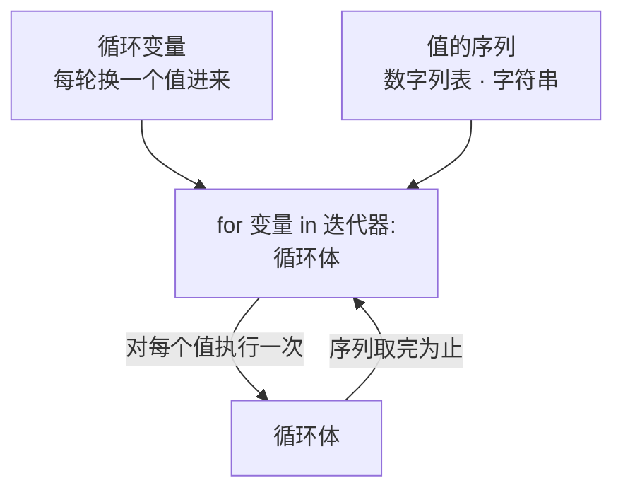
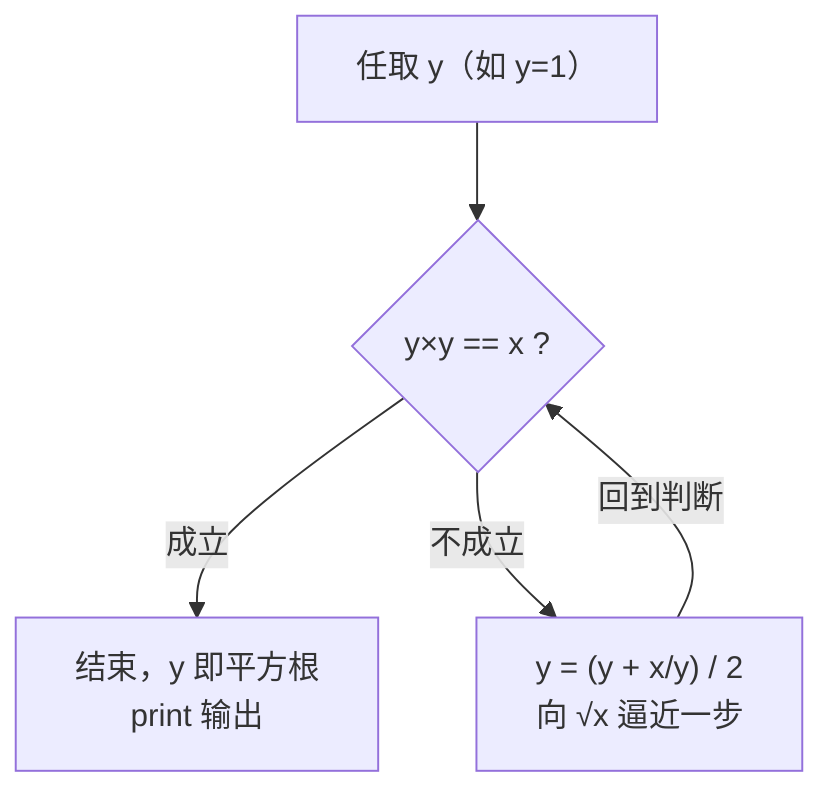
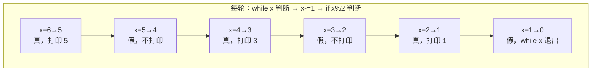
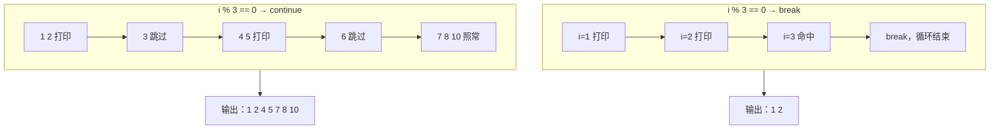
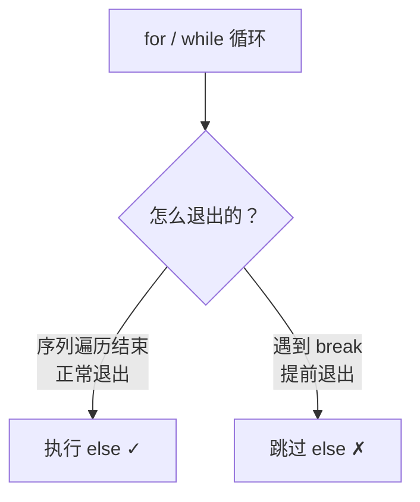
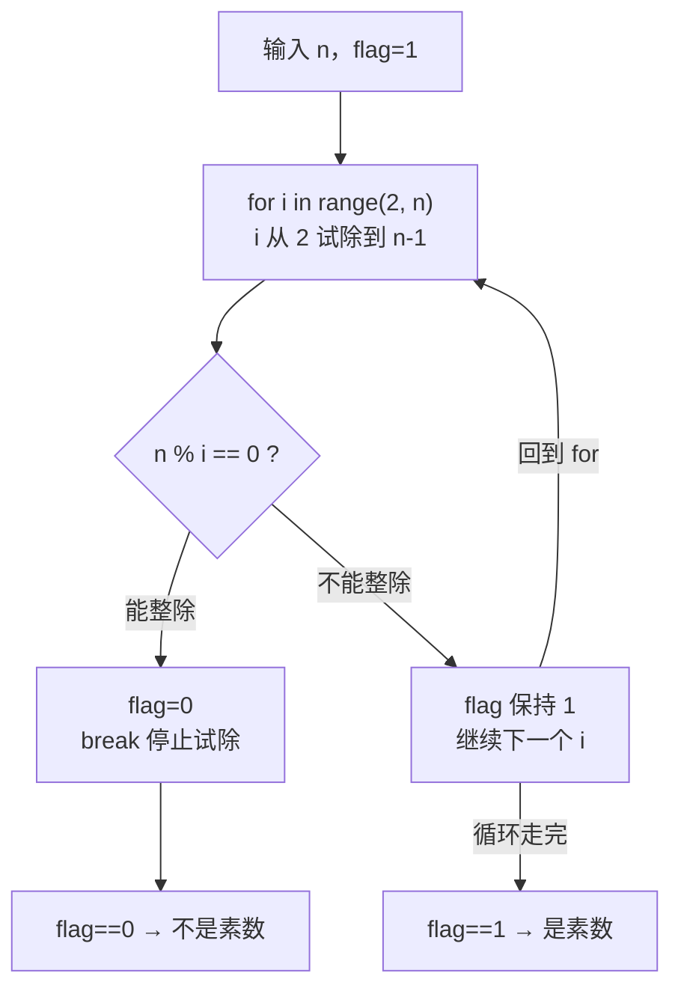
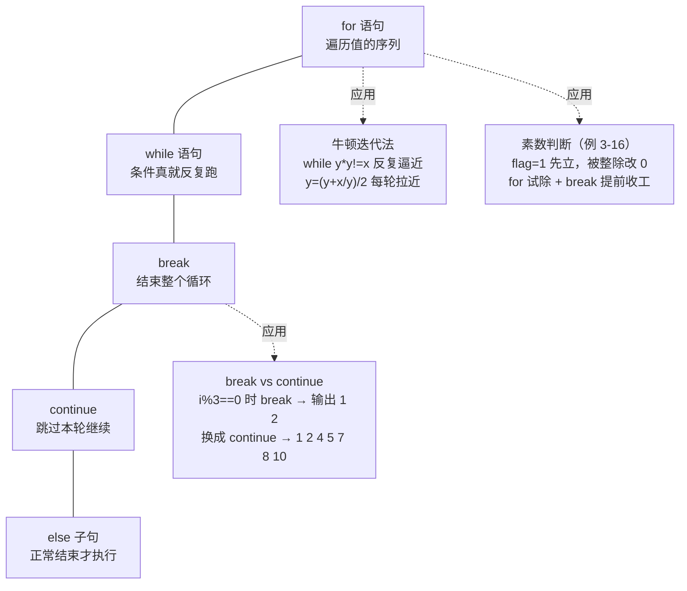

# Python 程序设计 · 第 7 讲整理笔记

> 整理自 8 页课堂课件照片 · 2026 年 11 月
> 主题：循环结构 · for 语句 · while 语句 · break & continue · else 子句 · 素数判断

---

## 01 for 语句（3.3.1）

**一句话要点：for 遍历一串已知的值——循环变量从值的序列中顺序取值，对每个值执行一次循环体。**

```python
for 循环变量 in 迭代器:
    循环体（缩进！）
```

**语义（课件原话）**：让变量顺序取得迭代器表示的值序列中的各个值，对每个值执行循环体一次。

- 值的序列：数字列表、字符串等
- 课件留下的问题：迭代器该如何表示？→ 即后续要学的 `range()`、列表、字符串等可遍历对象



---

## 02 while 语句 · 牛顿迭代法（3.3.2）

**一句话要点：条件为真就反复执行，不知道跑多少轮，但知道什么时候停。**

**迭代规则**：一套反复计算的规则，并证明反复使用规则就一定能得到解。

**牛顿迭代法求算术平方根（三步）**：
1. 假设需要求实数 x 的平方根，任取 y 为某个实数值
2. 如果 `y × y = x`，计算结束，y 就是 x 的平方根
3. 否则令 `y = (y + x/y) / 2`

```python
x=float(input("输入正实数： "))
y=1
while y*y!=x:
    y=(y+x/y)/2
print(y,y*y)
print("sqrt({})={}".format(x,y))
```



> [!warning] 实测发现的坑：浮点精确比较会死循环
> 课件代码用 `while y*y!=x` 判断收敛，这是**浮点精确相等比较**。x=4.0 这类完全平方数能正常退出（6 轮）；但输入 `x=2.0` 时，y 收敛到 1.414213562373095 后 `y*y` 恒等于 `1.9999999999999996`，永远不等于 2.0——**死循环**。
> 严谨写法：`while abs(y*y-x) > 1e-10:`

---

## 03 课堂练习 · 读程序写结果

```python
x=6
while x:
    x-=1
    if x%2:
        print(x,end=" ")
```

**答案：5 3 1**

- 关键在 `while x:`——x 是**非零即真**：x=6,5,4,3,2,1 都为真，x=0 退出
- 每轮先 `x-=1` 再判断：5→打印、4→不打印、3→打印、2→不打印、1→打印、0→退出
- `if x%2:` 的语义是「x 为奇数时真」——余数直接当条件用



> [!tip] 变体对比
> 若把 `if x%2:` 改成 `if x%2 == 0:`（判断偶数），同样六轮下来输出变成 **4 2**——条件反过来，结果完全反。读程序题先写「每轮变量表」，再对条件。

---

## 04 break & continue 语句（3.3.3）

**一句话要点：循环中断的两把刀，区别只在砍多大——break 砍掉整个循环，continue 只砍当前这一轮。**

| 语句 | 作用 |
|---|---|
| `break` | 结束整个循环 |
| `continue` | 结束本轮循环，转去做下一次循环 |

```python
# break：遇到 3 的倍数，立即结束 → 输出 1 2
for i in range(1, 10+1):
    if i % 3 == 0:
        break
    print(i, end=' ')

# continue：10 以内非 3 的倍数的数 → 输出 1 2 4 5 7 8 10
for i in range(1, 10+1):
    if i % 3 == 0:
        continue
    print(i, end=' ')
```



> [!tip] 记忆锚点
> continue 的「续」= 继续下一轮；break 的「断」= 整个断掉。考试常把两者放在同一道读程序题里对比——看到 break 就当「循环到此为止」，看到 continue 就当「本轮作废、下轮再来」。

---

## 05 else 子句（3.3.4）

**一句话要点：循环也能挂 else——正常跑完才执行 else，被 break 打断就不执行。**

```python
# 左：无 break —— 正常结束
for i in range(5):
    print(i, end=" ")
else:
    print("for循环正常结束！")
# 输出：0 1 2 3 4 for循环正常结束！

# 右：有 break —— 提前退出
for i in range(5):
    print(i, end=" ")
    if i >= 3: break
else:
    print("for循环正常结束！")
# 输出：0 1 2 3（else 没执行）
```



> [!warning] 常见误区
> 循环的 else 不是「循环没执行过才跑」——空序列（如 `for i in []:`）一次都没进循环体，也属于「正常结束」，else **照样执行**。判据只有一个：**是不是被 break 打断的**。

---

## 06 问题 2 · 判断素数（例 3-16）

**一句话要点：for 遍历 + break 中断 + 标志变量——flag 先立后破，被任何数整除立刻改 0 并 break。**

```python
n = int(input("输入一个正整数n(n>=2):"))
flag=1
for i in range(2, n):
    if n % i==0:
        flag=0
        break
if flag == 1:
    print(n, "是素数")
else:
    print(n, "不是素数")
```



实测：n=17 是素数；n=91（7×13）不是素数。

> [!warning] 课件显示缺口
> 例 3-16 里 `if flag == ?:` 的问号是投影显示问题——按上下文逻辑应填 **1**（flag 没被改成 0，说明没有任何数能整除 n，n 是素数）。
> 另外 `range(2, n)` 只试到 n-1；效率更高的写法是试到 `range(2, int(n**0.5)+1)`，原理是大因数必然配一个小因数。

---

## 07 全课总结 · 一图流



**考前自查清单：**

- [x] **for 语义**：让变量顺序取得迭代器表示的值序列中的各个值，对每个值执行循环体一次
- [x] **while 语义**：条件为真就反复执行循环体，条件为假立即退出
- [x] **牛顿迭代法**：任取 y → y×y==x 则结束 → 否则 y=(y+x/y)/2 再来一轮
- [x] **读程序先列表**：每轮记下循环变量变化和条件真假，再对输出——while x 是非零即真
- [x] **break**：结束整个循环；**continue**：结束本轮循环，转去做下一次循环
- [x] **对照记忆**：i%3==0 时 break 输出 1 2；continue 输出 1 2 4 5 7 8 10
- [x] **循环 else**：序列遍历结束而正常退出才执行 else；break 提前退出则不执行；空序列不进循环体也算正常
- [x] **素数判断**：flag=1 起步，range(2,n) 内任一 i 能整除 n 就 flag=0 并 break；最后 if flag==1 判「是素数」
- [x] **浮点陷阱**：while y*y!=x 这类精确相等判断，遇 2.0 这类非完全平方数会死循环，严谨写法用 abs(y*y-x) 比阈值
- [x] **缩进**：循环体必须缩进；break/continue 写在哪一级缩进，决定它归哪层循环管

---

*整理自《Python 程序设计》第 7 讲课堂课件（8 页照片） · 2026 年 11 月 · 仅供个人学习复习使用*
