# 河海大学2026年"扬帆·大学生涯启航周"梦想公开课 听课全记录

## 一、活动概况

- **活动名称**：河海大学2026年"扬帆·大学生涯启航周"梦想公开课
- **时间**：2026年9月13日下午（现场影像时间跨度约14:02—15:10）
- **地点**：校内报告厅／礼堂（带升降舞台与红色幕布）
- **主办**：河海大学（学生生涯启航周系列活动，舞台背景板印有"信仰公开课"标识）
- **分享嘉宾**：王嘉钰（机械工程，研支团）、一位学姐（学业与科创方向）、王亚辉（土木水利，水利信息化）、王越宇（海洋科学博士）、王政焱（河海里尔学院，艺术特长）
- **听众**：以2026级本科新生为主，身着统一院服，全场落座。

## 二、会场与氛围

现场是典型的大礼堂宣讲场景：舞台正中巨幅LED大屏，顶部悬挂红色会标横幅，舞台前方放置"信仰公开课"立体字立牌，两侧红色立柱立牌上书"中国灵魂""全球视野""河海特质"三大标语，气氛庄重而热烈。台下新生密集而坐，多人在拍照、记录，随着嘉宾讲述不时响应；演讲者多为单人站立持麦，节奏紧凑，幻灯片以经历＋数据＋照片的组合呈现，信息密度高。

## 三、流程大纲（逻辑顺序）

1. **开场**：会标与"信仰公开课"主题定调，五位优秀学长学姐依次登台。
2. **王嘉钰：以支教经历作答"青春之题"**——从个人介绍、获奖情况到西藏支教的教学成绩与育人感悟。
3. **学姐分享：学业—竞赛—科研—建议**——自我认知（成绩／学生工作／志愿服务）、学习方法五步法、学科竞赛与双创备赛、科技创新科研实战，最后给出三点建议。
4. **王亚辉：水利人的职业成长**——个人履历数据、千乡万村环保科普、水利部联合培养与实习、全国职业规划大赛夺冠。
5. **王越宇：科研路上的"目标与坚持"**——海洋洄游鱼类与河鲀育种研究，方法论总结，以及学校平台资源介绍。
6. **王政焱：全面发展样本**——学业荣誉与艺术特长（弦乐团、提琴、外语）并重。

## 四、逐图信息条目（按文件时间顺序）

### IMG_20260913_140212.jpg

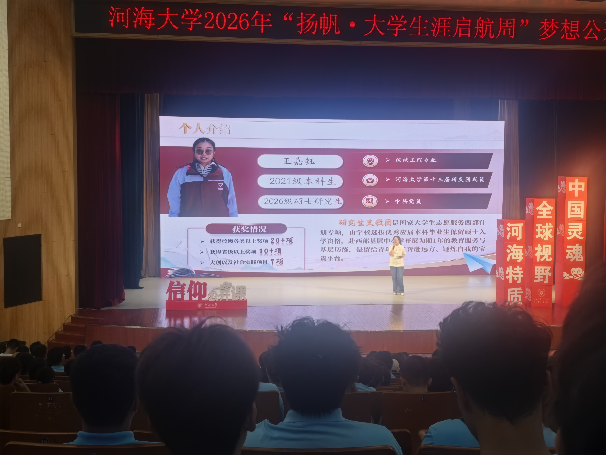
- **标题**：个人介绍（王嘉钰）
- **正文**：王嘉钰，2021级本科生，2026级硕士研究生；机械工程专业；河海大学第十三届研支团成员；中共党员。获奖情况：获得校级各类以上奖项20+项；获得省级以上奖项10+项；大创以及社会实践项目7项。右侧说明文字：研究生支教团是国家大学生志愿服务西部计划专项，由学校选拔优秀应届本科毕业生保留硕士研究生入学资格，赴西部基层中学开展为期1年的教育服务与基层历练，是青春奋斗的地方，是奔赴远方、锤炼自我的宝贵平台。
- **视觉**：舞台大屏个人介绍页，含本人证件照；讲者黄色上衣站立讲述；顶部红色横幅"河海大学2026年'扬帆·大学生涯启航周'梦想公开…"；观众席新生背影。

### IMG_20260913_140633.jpg

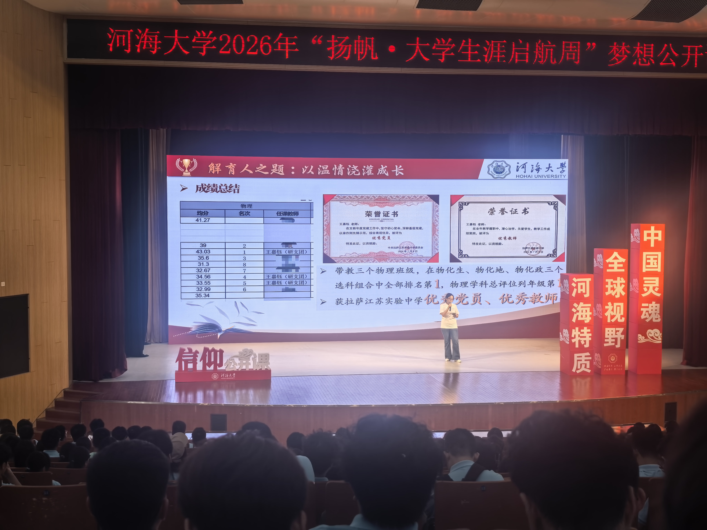
- **标题**：解育人之题：以温情浇灌成长
- **正文**：成绩总结表格（班级均分41.27、名次与任职对照，物理学科多次位列前茅，任职含"王嘉钰（研支团）"）；展示两张荣誉证书。要点：带教三个物理班级，在物化生、物化地、物化政三个选科组合中全部排名第一，物理学科总评位列年级第一；获拉萨江苏实验中学优秀党员、优秀教师等称号。
- **视觉**：河海大学校徽右上角；屏幕中左侧证书扫描件、数据表；讲者黄衣；舞台两侧红色立牌"河海特质""全球视野""中国灵魂"。

### IMG_20260913_141056.jpg

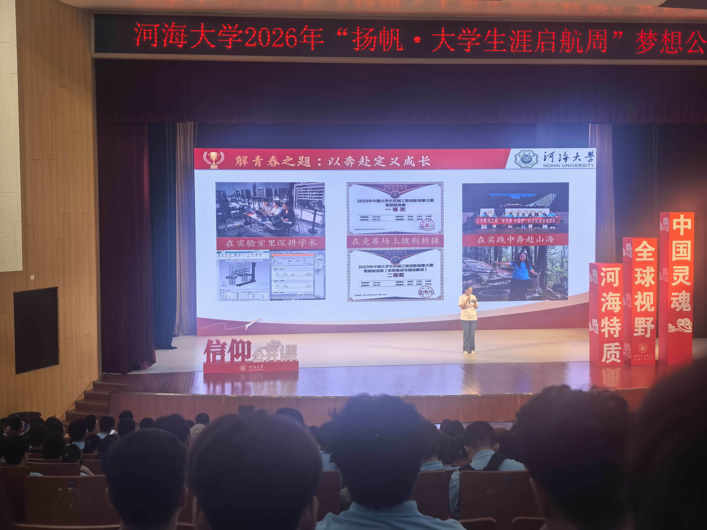
- **标题**：解青春之题：以奔赴定义成长
- **正文**：三段式叙事——在实验室里深耕学术、在竞赛场上披荆斩棘、在实践中奔赴山海；配2023年中国大学生工程实践与创新大赛国家级一等奖、2024年中国大学生创新创业大赛（省级/国家级/国赛组）、大国工匠等相关证书与团队合影。
- **视觉**：三列证书＋实践照片；讲者站立讲述；舞台横幅同前。

### IMG_20260913_141333.jpg

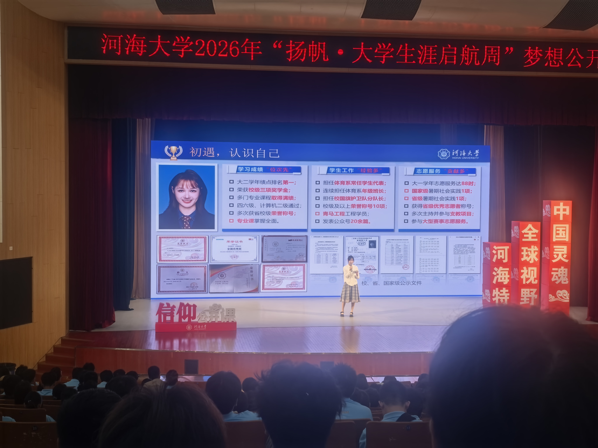
- **标题**：初遇，认识自己（一位学姐／现场未显示姓名）
- **正文**：学习成绩·位次类——大二学年绩点排名第一、荣获校级三级奖学金、多门专业课程取得满分、四六级与计算机二级通过、多次获校级荣誉、专业课程掌握全面；学生工作·组织类——担任体育系常任学生代表、连续担任体育系年级班长、担任校园国旗护卫队分队长、校级及以上荣誉奖项10项、青马工程学员、发表公众号20余篇；志愿服务·公益类——大一学年志愿服务达88时、国家级暑期社会实践1项、省级暑期社会实践1项、获省级优秀志愿者称号、多次主持并参与支教项目、参与大型赛事志愿服务。下方标注"校、省、国家级公示文件"。
- **视觉**：蓝白冷暖渐变幻灯片，左个人照片＋九宫格证书墙；讲者浅黄上衣；观众席整齐落座。

### IMG_20260913_142029.jpg

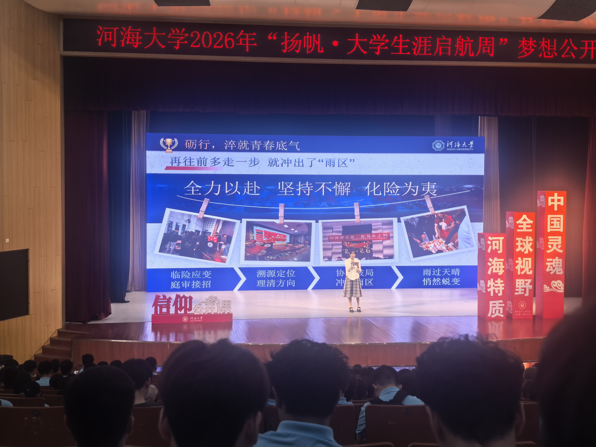
- **标题**：砺行，淬就青春底气
- **正文**：核心句"再往前多走一步 就冲出了'雨区'"，主标语"全力以赴 坚持不懈 化险为夷"；四阶段：临险应变·庭审接招 → 溯源定位·理清方向 → 协作冲关·（雨区）→ 雨过天晴·悄然蜕变。
- **视觉**：深蓝主题页，四张实拍照片串联流程箭头；讲者站立。

### IMG_20260913_142528.jpg

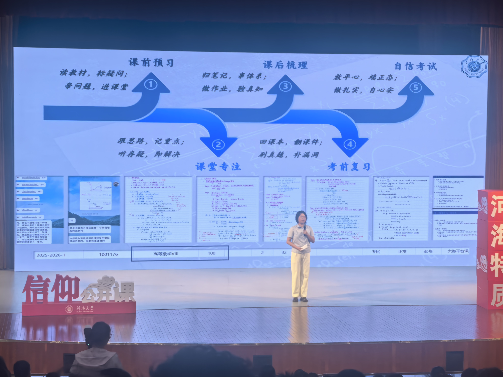
- **标题**：五步学习闭环（课前预习—课堂专注—课后梳理—考前复习—自信考试）
- **正文**：①课前预习：读教材、标疑问；带问题、进课堂。②课堂专注：跟思路、记重点；听存疑、即解决。③课后梳理：归笔记、事体系；做作业、验真知。④考前复习：回课本、翻课件；刷真题、补漏洞。⑤自信考试：放平心、摆正态；做扎实、自心安。底部成绩单截图显示"高等数学VIII 100分"（2025-2026-1，课程号1001176）。
- **视觉**：蓝色阶梯式流程图＋大量手写笔记、错题整理截图；讲者持麦讲解。

### IMG_20260913_142906.jpg

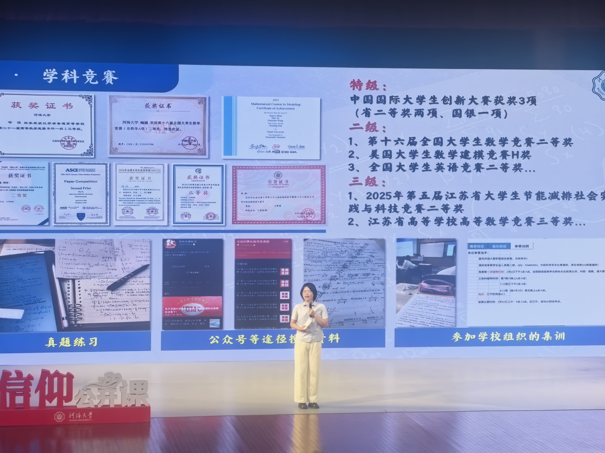
- **标题**：学科竞赛
- **正文**：特级——中国国际大学生创新大赛获奖3项（省二等奖两项、国银一项）；二级——第十六届全国大学生数学竞赛二等奖、美国大学生数学建模竞赛H奖、全国大学生英语竞赛二等奖等；三级——2025年第五届江苏省大学生节能减排社会实践与科技竞赛二等奖、江苏省高等学校高等数学竞赛三等奖等。底栏："真题练习／公众号等途径找资料／参加学校组织的集训"。
- **视觉**：满屏证书墙（河海大学、ASC、AICE、数学建模等）；讲者居中持麦。

### IMG_20260913_142939.jpg

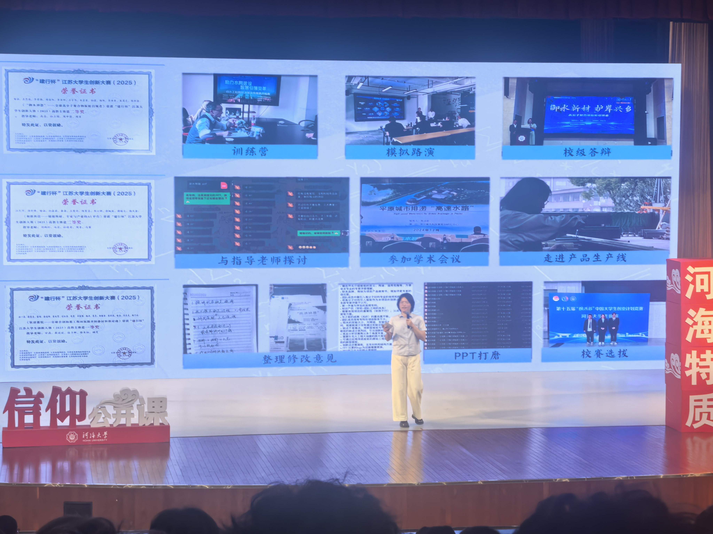
- **标题**：双创竞赛备赛历程（"建行杯"江苏大学生创新大赛2025）
- **正文**：左侧三张"建行杯"江苏大学生创新大赛（2025）荣誉证书；右侧九宫格流程——训练营、模拟路演、校级答辩；与指导老师探讨、参加学术会议、走进产品线；整理修改意见、PPT打磨、校赛选拔。项目关键词"御水新材 护岸兴农"；另含第十三届"挑战杯"中国大学生创业计划竞赛校赛选拔。
- **视觉**：九宫格实拍＋聊天记录截图＋PPT修改稿；讲者站立讲解。

### IMG_20260913_143116.jpg

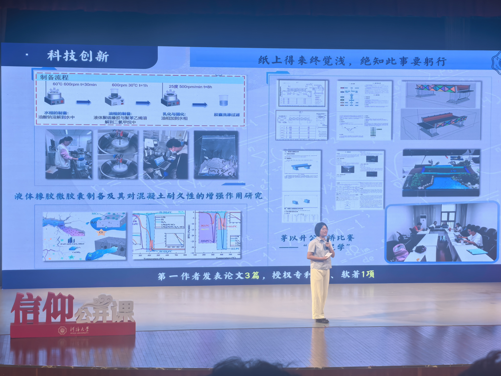
- **标题**：科技创新（纸上得来终觉浅，绝知此事要躬行）
- **正文**：制备流程——水相制备：油酸钠溶解到水中（60℃、600rpm、t=30min）；油相制备：液体聚硫橡胶与聚苯乙烯溶解到二甲苯中（600rpm、30℃、t=1h）；乳化与固化：油相加到水相（25℃、500rpm、t=8h）；胶囊洗涤过滤。研究课题"液体橡胶微胶囊制备及其对混凝土耐久性的增强作用研究"。成果：第一作者发表论文3篇，授权专利1项、软著1项。
- **视觉**：工艺流程图＋实验室实拍＋性能对比曲线图＋设计图纸；讲者站立。

### IMG_20260913_143352.jpg

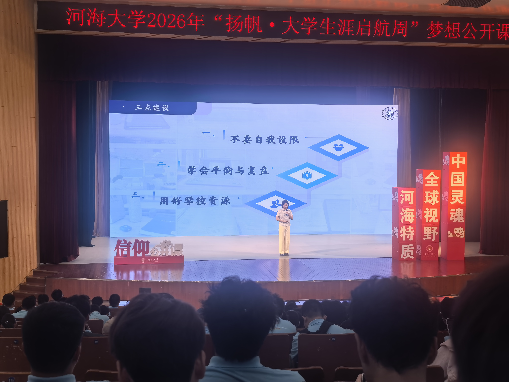
- **标题**：三点建议
- **正文**：一、不要自我设限；二、学会平衡与复盘；三、用好学校资源。
- **视觉**：极简蓝底菱形引导线版式；讲者居中；右侧红色立牌标语。

### IMG_20260913_143533.jpg

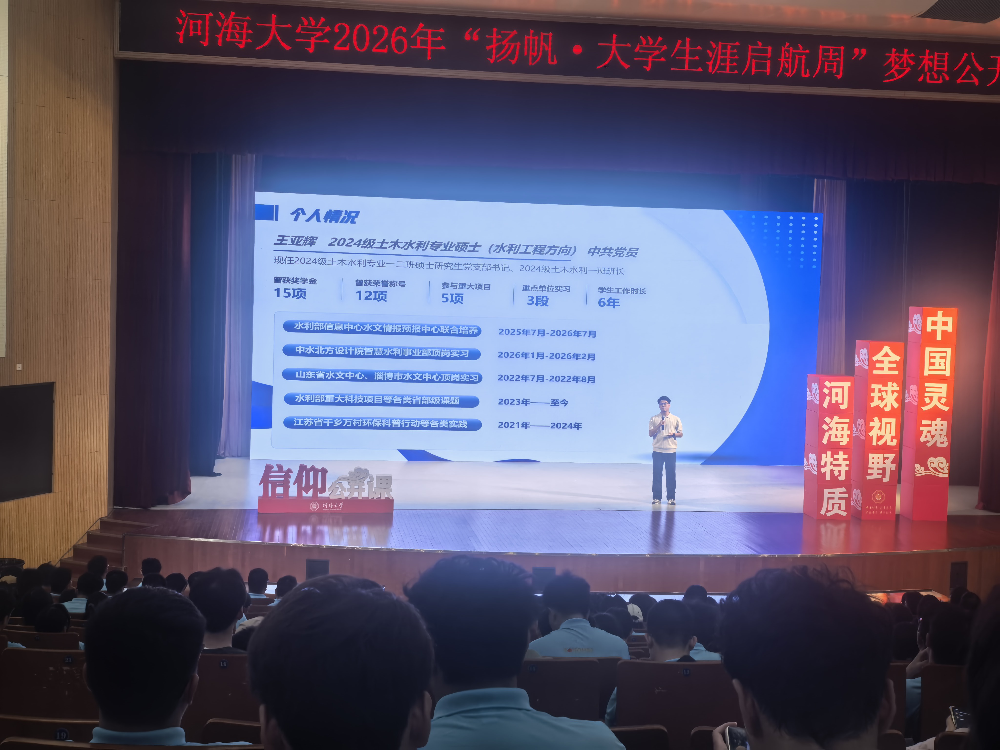
- **标题**：个人情况（王亚辉）
- **正文**：王亚辉，2024级土木水利专业硕士（水利工程方向），中共党员；现任2024级土木水利专业二班硕士研究生党支部书记、2024级土木水利一班班长。数据栏：曾获奖学金15项、曾获荣誉称号12项、参与重大项目5项、重点单位实习3段、学生工作时长6年。经历：水利部信息中心水文情报预报中心联合培养（2025年7月—2026年7月）；中水北方设计院智慧水利事业部顶岗实习（2026年1月—2026年2月）；山东省水文中心、淄博市水文中心顶岗实习（2022年7月—2022年8月）；水利部重大科技项目等各类省部级课题（2023年—至今）；江苏省千乡万村环保科普行动等各类实践（2021年—2024年）。
- **视觉**：深蓝数据型个人页，右侧六个关键词卡片；讲者白衫深裤。

### IMG_20260913_143627.jpg

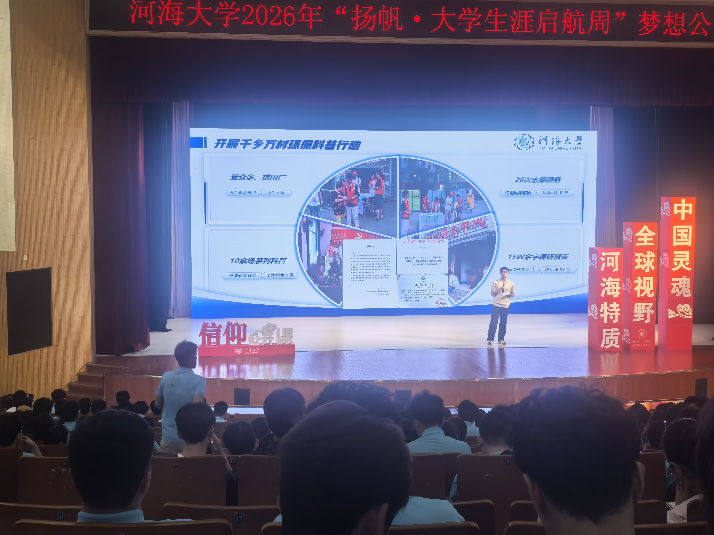
- **标题**：开展千乡万村环保科普行动
- **正文**：受众广、范围广（多个街道社区、多个乡镇）；20次志愿服务（河海大学志愿者、温暖同行等）；10余场系列科普（低碳高效解民忧、节水用水惠民生）；15W余字调研报告（长江大保护、长三角一体化、黄河流域等）。中央展示通讯报道与感谢信。
- **视觉**：环形照片墙＋左右数据卡片；讲者站立。

### IMG_20260913_143851.jpg

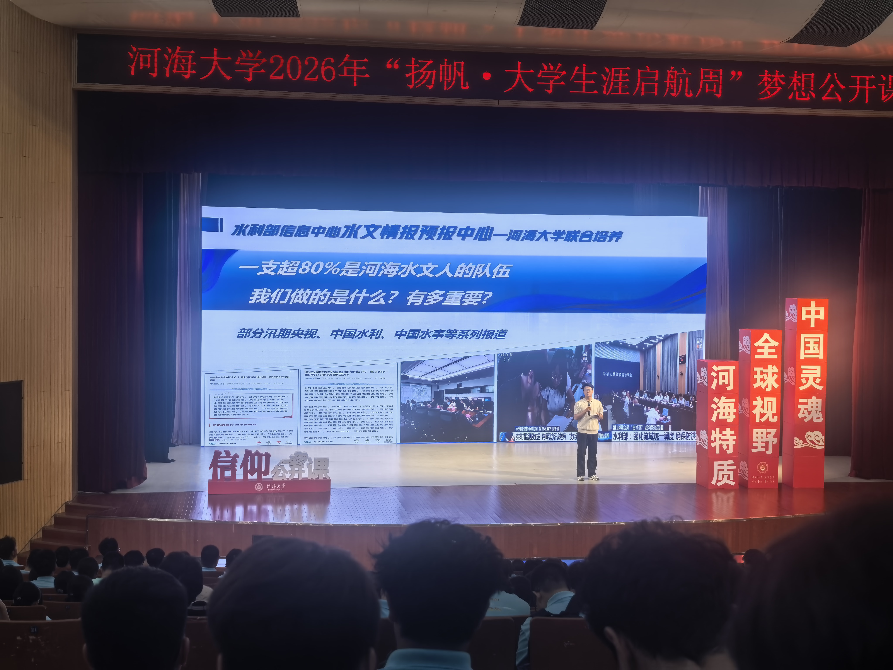
- **标题**：水利部信息中心水文情报预报中心—河海大学联合培养
- **正文**：核心句"一支超80%是河海水文人的队伍"；提问"我们做的是什么？有多重要？"；提及部分汛期央视、中国水利、中国水事等系列报道。
- **视觉**：新闻播报截图（央视新闻、水利部会商画面等）；讲者站立。

### IMG_20260913_144127.jpg

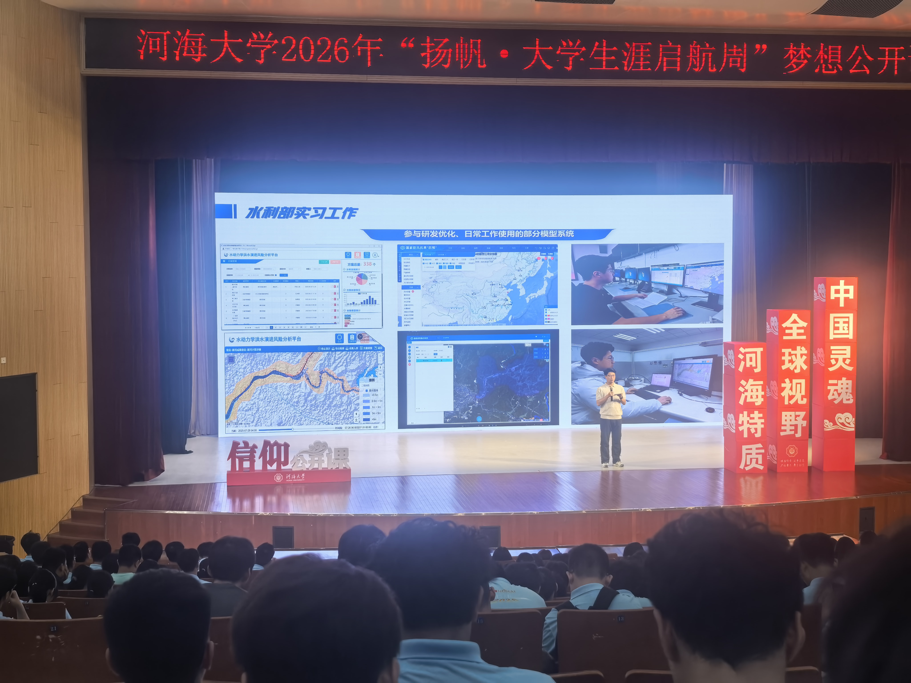
- **标题**：水利部实习工作（模型系统）
- **正文**：参与研发优化、日常工作使用的部分模型系统。
- **视觉**：多张业务系统界面截图（预报平台、流域水系图、水动力模型、数据可视化大屏）＋同事工位工作照；观众席密集背影。

### IMG_20260913_144238.jpg

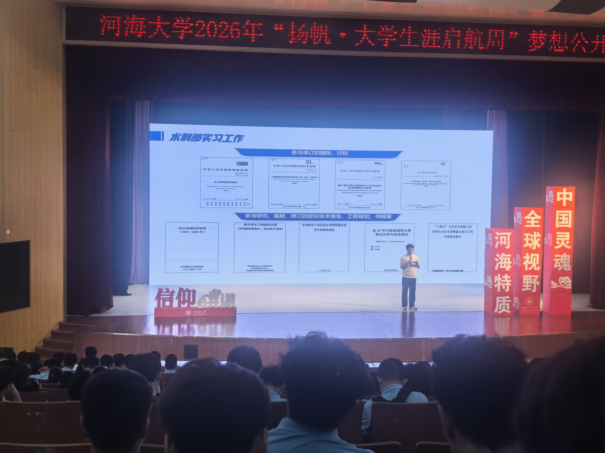
- **标题**：水利部实习工作（标准与技术文件）
- **正文**：参与修订的国际、行标（SL 中华人民共和国水利行业标准体系文件）；参与研究、编制、修订的部分技术报告、工程规划、书稿等（含数字孪生流域、"十四五"水安全保障、长江40余项工程体系等）。
- **视觉**：左右两排标准封面与文件封面扫描件；讲者站立。

### IMG_20260913_144359.jpg

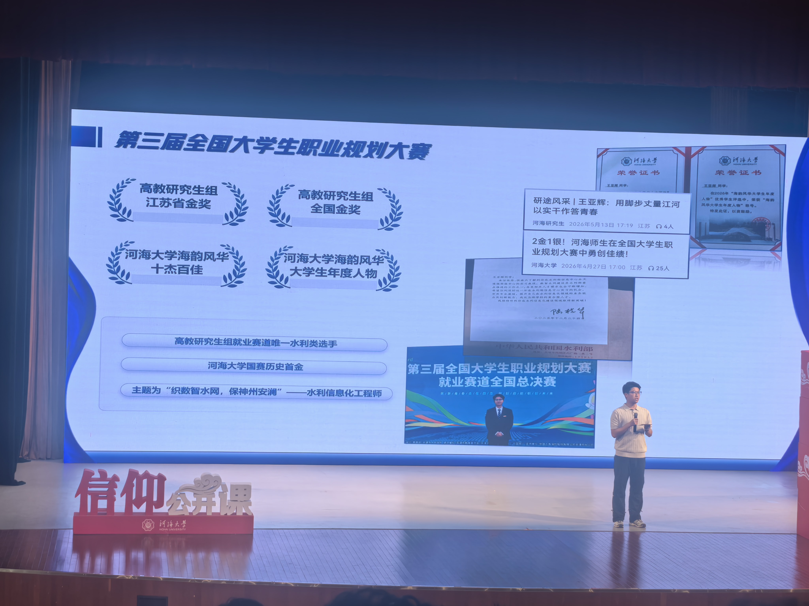
- **标题**：第三届全国大学生职业规划大赛
- **正文**：荣誉——高教研究生组江苏省金奖、高教研究生组全国金奖；河海大学海韵风华十杰百佳、河海大学海韵风华大学生年度人物。亮点——高教研究生组就业赛道唯一水利类选手；河海大学国赛历史首金；参赛主题"织数智水网，保神州安澜"——水利信息化工程师。右侧推文截图："研途风采｜王亚辉：用脚步丈量江河 以实干作答青春""2金1银！河海师生在全国大学生职业规划大赛中勇创佳绩！"。
- **视觉**：宣传海报＋获奖证书＋校媒推文截图；讲者持麦站立。

### IMG_20260913_144724.jpg

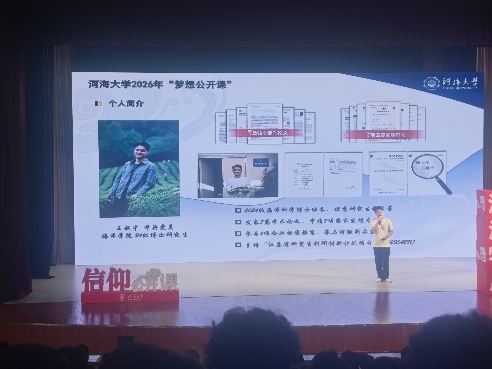
- **标题**：河海大学2026年"梦想公开课"——个人简介（王越宇）
- **正文**：王越宇，中共党员，海洋学院24级博士研究生。亮点：7篇核心期刊论文、7项国家发明专利；2024级海洋科学博士班长、优秀研究生等；发表7篇学术论文、申请7项国家发明专利；参与4项企业标准撰写、参与河鲀新品系相关研究；主持"江苏省研究生科研创新计划项目"。
- **视觉**：左侧本人生活照（茶园场景），右侧论文与专利封面墙；讲者白衫。

### IMG_20260913_144923.jpg

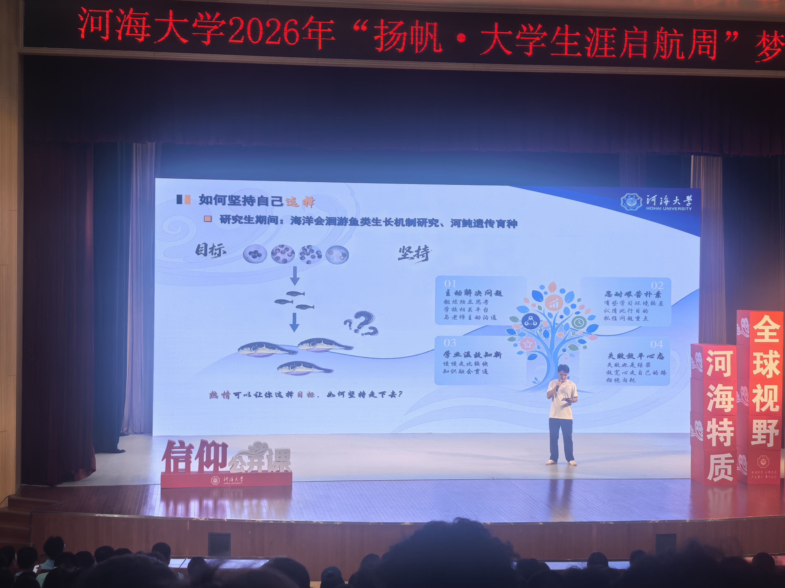
- **标题**：如何坚持自己的选择？（研究生期间：海洋洄游鱼类生长机制研究、河鲀遗传育种）
- **正文**：由"目标"走向"坚持"；四条要点——01 主动解决问题（敢想敢思考、善用相关平台、与导师主动沟通）；02 思考积累素材（善用学习寻找灵感）；03 学业温故知新（缺漏及时补，知识融会贯通）；04 失败处平心态（失败也很正常，放宽心态，拒绝死磕）。页脚提问："热情可以让你选择目标，如何坚持走下去？"
- **视觉**：鱼群图示＋成长树图形；讲者持麦。

### IMG_20260913_145107.jpg

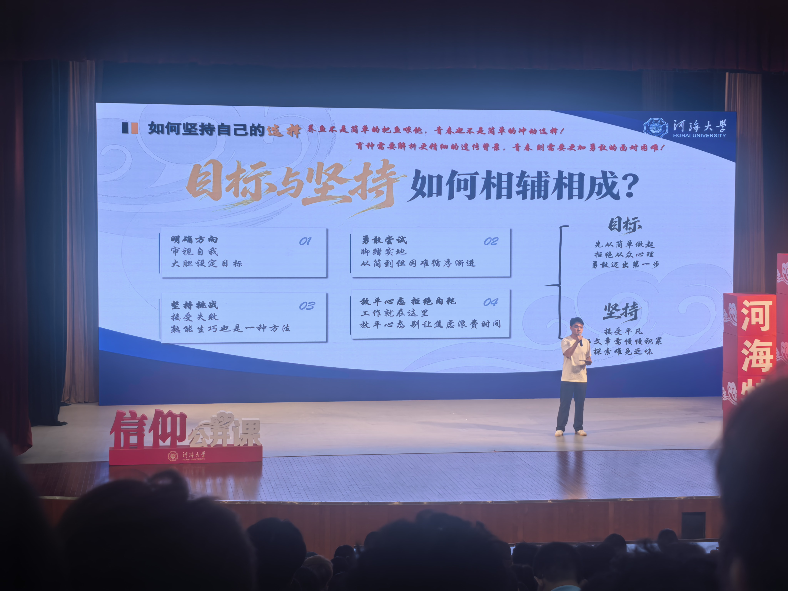
- **标题**：目标与坚持 如何相辅相成？
- **正文**：金句"养鱼不是简单的把鱼喂饱，青春也不是简单的冲动选择！育种需要解析精细的遗传背景，青春也需要更加勇敢地面对困难！"四要点——01 明确方向（审视自我，大胆设定目标）；02 勇敢尝试（脚踏实地，从简到难循序渐进）；03 坚持挑战（接受失败，熟能生巧也是一种方法）；04 放平心态 拒绝内耗（工作就在这里，别让焦虑浪费时间）。右侧归纳——目标：从简单做起，拒绝从众心理，勇敢迈出第一步；坚持：接受平凡，文章需慢慢积累，探索难免艰难乏味。
- **视觉**：米金色大字标题页，四宫格卡片；讲者讲解。

### IMG_20260913_145256.jpg

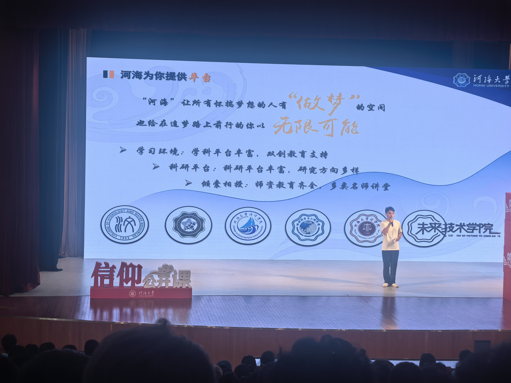
- **标题**：河海为你提供平台
- **正文**："'河海'让所有怀揣梦想的人有'做梦'的空间，也给在追梦路上前行的你无限可能。"三条支撑——学习环境：学科平台丰富，双创教育支持；科研平台：科研平台丰富，研究方向多样；倾囊相授：师资教育齐全，多类名师讲堂。
- **视觉**：页脚并列学院/机构徽标（含河海大学、未来技术学院等）；讲者站立。

### IMG_20260913_145400.jpg

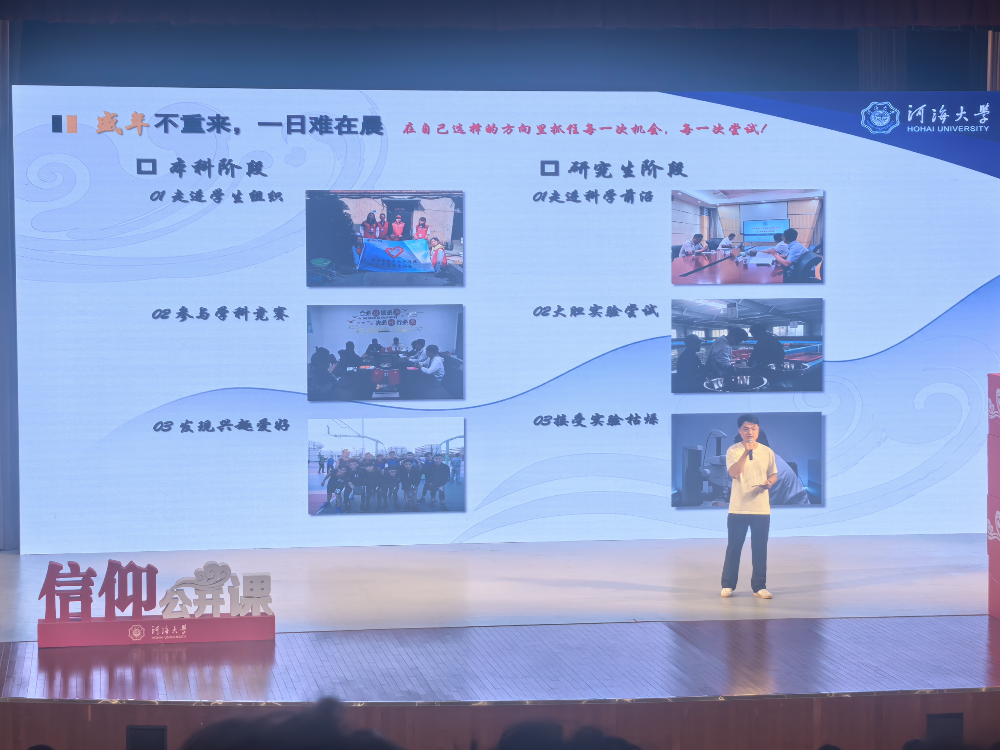
- **标题**：盛年不重来，一日难再晨
- **正文**：副标"在自己选择的方向里抓住每一次机会，每一次尝试！"本科阶段：01 走进学生组织、02 参与学科竞赛、03 发现兴趣爱好；研究生阶段：01 走进科学前沿、02 大胆实验尝试、03 接受实验枯燥。
- **视觉**：左右对照六张实拍照（组织活动、竞赛路演、兴趣运动、学术会议、实验操作、深夜实验）；讲者站立。

### IMG_20260913_151034.jpg

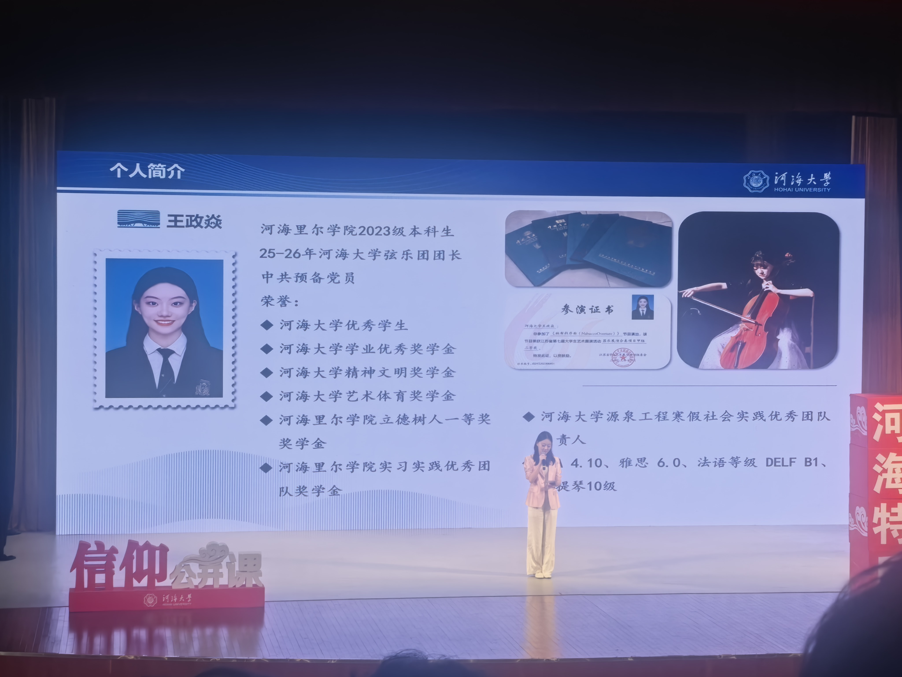
- **标题**：个人简介（王政焱）
- **正文**：王政焱，河海里尔学院2023级本科生，25-26年河海大学弦乐团团长，中共预备党员。荣誉：河海大学优秀学生、河海大学学业优秀奖学金、精神文明奖学金、艺术体育奖学金、艺术体育奖学金、河海里尔学院立德树人一等奖学金、实习实践优秀团队奖学金；河海大学源泉工程寒假社会实践优秀团队负责人。个人能力：绩点4.10、雅思6.0、法语等级DELF B1、提琴10级。
- **视觉**：左证件照，右参演证书、小提琴演奏照与证件照；讲者粉色外套站立。

## 五、核心内容要点

**嘉宾一：王嘉钰（机械工程·第十三届研支团）**
- 身份：2021级本科→2026级硕士，中共党员，研支团成员。
- 成绩：校级以上奖项20+项、省级以上奖项10+项、大创及社会实践项目7项。
- 支教成果：带教三个物理班级，在物化生、物化地、物化政三种选科组合中全部排名第一，物理总评年级第一；获拉萨江苏实验中学优秀党员、优秀教师。
- 路径诠释：以"实验室深耕学术—竞赛场披荆斩棘—实践奔赴山海"定义青春成长。

**嘉宾二：学姐（学业与科创）**
- 学业：大二学年绩点排名第一，多门课程满分，四六级与计算机二级通过。
- 学生工作：体育系常任学生代表、连续任年级班长、校园国旗护卫队分队长、青马工程学员、公众号发文20余篇。
- 志愿服务：大一学年88小时，国家级/省级暑期社会实践各1项，省级优秀志愿者。
- 学习方法：课前预习—课堂专注—课后梳理—考前复习—自信考试五步闭环（高数VIII考取100分）。
- 竞赛：中国国际大学生创新大赛3项（国银1项）、全国大学生数学竞赛二等奖、美赛H奖、全国大学生英语竞赛二等奖、江苏省节能减排竞赛二等奖等；完整展示从训练营、模拟路演、答辩到PPT打磨的备赛链。
- 科研：液体橡胶微胶囊制备及其对混凝土耐久性增强作用研究，第一作者论文3篇、授权专利1项、软著1项。

**嘉宾三：王亚辉（土木水利·水利信息化）**
- 履历：奖学金15项、荣誉称号12项、重大项目5项、重点单位实习3段、学生工作6年。
- 实践：千乡万村环保科普行动——20次志愿服务、10余场系列科普、15万余字调研报告。
- 实习：水利部信息中心水文情报预报中心联合培养（2025.7—2026.7），参与模型系统研发优化、行业标准（SL）修订及技术报告与工程规划编制。
- 亮点：所在团队"超80%是河海水文人"；参与汛期央视、中国水利等报道相关工作。
- 竞赛：第三届全国大学生职业规划大赛高教研究生组江苏省金奖＋全国金奖，是就业赛道唯一水利类选手，为河海大学国赛历史首金，主题为"织数智水网，保神州安澜"——水利信息化工程师。

**嘉宾四：王越宇（海洋学院24级博士）**
- 成果：7篇核心期刊论文、7项国家发明专利；参与4项企业标准撰写、河鲀新品系研究；主持江苏省研究生科研创新计划项目。
- 研究：海洋洄游鱼类生长机制、河鲀遗传育种。
- 方法论：明确方向、勇敢尝试、坚持挑战、放平心态拒绝内耗；"目标"要从简单做起、拒绝从众、勇敢迈步，"坚持"则要接受平凡、慢慢积累。
- 平台推介：学科平台与双创支持、丰富的科研平台与多元方向、齐全的师资与名师讲堂。

**嘉宾五：王政焱（河海里尔学院2023级）**
- 身份：校弦乐团团长、中共预备党员。
- 荣誉：优秀学生、学业优秀奖学金、精神文明奖学金、艺术体育奖学金、立德树人一等奖学金、实习实践优秀团队奖学金；源泉工程寒假社会实践优秀团队负责人。
- 素质标签：绩点4.10、雅思6.0、法语DELF B1、提琴十级。

## 六、金句与关键数字

**金句**
- "再往前多走一步，就冲出了'雨区'。"
- "全力以赴，坚持不懈，化险为夷。"
- "纸上得来终觉浅，绝知此事要躬行。"
- "不要自我设限；学会平衡与复盘；用好学校资源。"
- "盛年不重来，一日难再晨——在自己选择的方向里抓住每一次机会、每一次尝试。"
- "养鱼不是简单的把鱼喂饱，青春也不是简单的冲动选择！"
- "'河海'让所有怀揣梦想的人有'做梦'的空间，也给在追梦路上前行的你无限可能。"
- "信仰公开课"＋"中国灵魂 / 全球视野 / 河海特质"。

**关键数字**
- 高等数学VIII：100分
- 支教物理：3个班级、3种选科组合全部第一
- 王嘉钰：20+校级奖项、10+省级奖项、7项大创/社会实践
- 学姐：志愿服务88小时、公众号20余篇、竞赛国银1项＋省级奖多项、论文3篇＋专利1项＋软著1项
- 王亚辉：奖学金15项、荣誉12项、重大项目5项、实习3段、学生工作6年、科普志愿服务20次、科普10余场、调研报告15W余字、职业规划大赛3项大奖（2金1银中的主力）
- 王越宇：核心期刊论文7篇、国家发明专利7项、企业标准4项
- 王政焱：绩点4.10、雅思6.0、法语DELF B1、提琴10级

## 七、视觉亮点

- **顶部红色会标**：贯穿全程的"河海大学2026年'扬帆·大学生涯启航周'梦想公开课"，是该场活动的统一视觉标识。
- **舞台两侧标语柱**：以"中国灵魂、全球视野、河海特质"三句话构成的价值导向布置，与"信仰公开课"立体字同台呼应。
- **幻灯片风格**：以"河海蓝＋金色"为主色，大量采用"个人照＋证书墙＋实拍九宫格"的版式，个人介绍页统一呈现照片、身份标签、量化数据，可信度高、观感整齐。
- **实拍素材**：支教课堂、实验室操作、企业生产线、学术会议、职业规划大赛决赛舞台、央视新闻播报截图等，把"经历"直接可视化。
- **会场氛围照**：多张照片以观众席新生背影为前景、舞台大屏为主体，形成"学长学姐讲、学弟学妹听"的代际传递感。

## 八、给大学生的启发与思考

这场公开课最打动人的地方，是它没有把"优秀"讲成天赋或运气，而是拆解成一条条可复制的路径。王嘉钰把青春交给西部课堂，用三个班级的物理成绩回答"育人之题"；王亚辉把脚步走进水文预报中心与"千乡万村"，用15万余字调研报告和一枚职业规划国赛金牌回答"专业有何用"；王越宇在鱼群与实验台之间反复打磨，把"坚持"具体成"与导师主动沟通、拒绝内耗、接受平凡"。他们的共同点不是一开始就目标明确，而是先迈出第一步，再在行动中把方向校准——这正是大一新生最需要的心理支撑：不必焦虑于"想清楚一切再出发"。

从方法论上看，这一小时的分享几乎给出了一套完整的大学生存指南。学习上，是"课前预习—课堂专注—课后梳理—考前复习—自信考试"的五步闭环；竞赛与科研上，是从训练营、模拟路演到PPT打磨的全链条，以及"真题练习、找资料、参加学校集训"的具体动作；成长节奏上，是"本科阶段走进组织、参与竞赛、发现兴趣，研究生阶段走进前沿、大胆实验、接受枯燥"的分段建议。值得注意的是，几乎所有嘉宾都强调了同一件事——善用学校资源。"河海提供平台"不只是口号，学科平台、双创支持、名师讲堂、联合培养基地，都是可以主动去敲的门。

如果说要给新生留下三句可执行的提醒，我会选这三条：**第一，不要自我设限**——绩点满分、国赛首金、博士论文，起点都是"先试一次"；**第二，学会平衡与复盘**——志愿、学生工作、科研、竞赛可以并行，但需要不断回看与取舍，拒绝无效内耗；**第三，用好学校资源**——平台已经搭好，关键是主动沟通、主动求助、主动进入。所谓"扬帆启航"，从来不是等风来，而是"再往前多走一步"，一步就是冲出自己的"雨区"。
