# 启智未来·生涯 —— 港口航道与海岸工程专业4班第一次主题班会

---

## 一、活动概况

| 项目 | 内容 |
| --- | --- |
| **活动名称** | 启智未来·生涯 |
| **活动形式** | 港口航道与海岸工程专业4班 **第一次主题班会** |
| **时间** | 2026 年 9 月（照片时间戳 9 月 14 日 9:51—10:55，全程约 1 小时） |
| **主讲/班主任** | **庄宁（教授、博士生导师）**，河海大学港口海岸与近海工程学院、水运工程科学研究所 |
| **特邀分享** | **刘思恩**，南京水利科学研究院水工水力学研究所高级工程师，荷兰代尔夫特理工大学博士 |
| **学院/专业/班级** | 河海大学 港口海岸与近海工程学院 · 港口航道与海岸工程专业 · 4 班 |
| **举办地点** | 教室（大屏 + 讲台式多媒体教室，挂钟显示实时时间） |

## 二、课堂氛围

- **面对面、近距离**：教师全程站立于讲台左前方，不使用坐讲，与学生视线基本平齐，是典型的“班主任小班谈心”式而非大课宣讲。
- **节奏紧凑、层层递进**：从 9:51 开场到 10:55 结束，约一小时里完成了“自我介绍—专业扫盲—培养方案—学长案例—就业数据—寄语”六段推进，几乎没有停顿。
- **听讲状态良好**：多张照片中前排学生均抬头注视大屏，教室安静、座位集中在讲台前区，属于专注度较高的班会。
- **信息量偏“硬核”**：第 3 部分“学涯地图”连放五页（学分表、课程清单、实践清单、时间轴、四年规划），是本场信息密度最高、也最需要学生拍照记录的环节。

## 三、班会脉络（逻辑顺序）

1. **1 本人概况**——教师亮明身份：研究方向与讲授课程，建立信任与专业权威感。
2. **2 专业认知**——回答“我学的到底是什么”：学校定位 → 专业定位（水上运输先行者 / 蓝色疆域保护者）→ 港口/航道两大工程定义 → 典型工程案例（洋山深水港）→ 专业优势与就业面。
3. **3 学涯地图**——回答“四年怎么读”：培养方案总学分与结构 → 理论课程体系 → 实践教学体系 → 四年课程时间轴 → 四年成长路径（含目标/困难/拓展框架）→ “简历加分”清单。
4. **4 学长经验**——用同门/同行学长刘思恩的履历与科研方向，示范“这个专业能走多远”（读博、进国家级科研院所、参与国家重点研发计划）。
5. **5 毕业发展**——用毕业去向饼图给出可量化的出口预期。
6. **结语寄语**——把“个人前途”与“国家事业（碧海蓝天）”合二为一，完成价值收束。

## 四、逐图记录（按文件名时间升序）

### 1. `IMG_20260914_095106.jpg`（9:51）

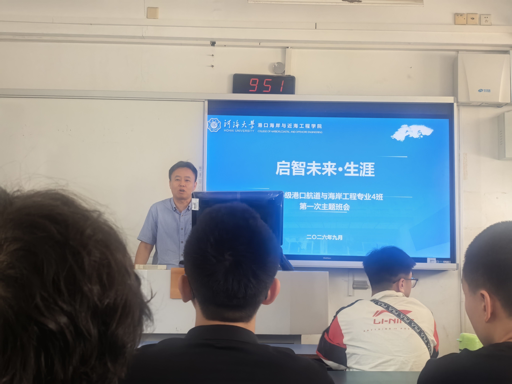
- **标题**：启智未来·生涯 ——《港口航道与海岸工程专业4班 第一次主题班会》
- **正文**：河海大学 港口海岸与近海工程学院；副标题“级港口航道与海岸工程专业4班 第一次主题班会”；落款“二〇二六年九月”
- **视觉**：教室大屏首页蓝底白字主题页，右上有淡色中国地图轮廓。讲台上一位中年男教师（短发、浅蓝色短袖衬衫）正站立讲解，屏幕左上挂钟显示 9:51；前排多名学生（含一名穿 Lining 白红运动外套的男生）背对镜头听讲。

### 2. `IMG_20260914_095300.jpg`（9:53）

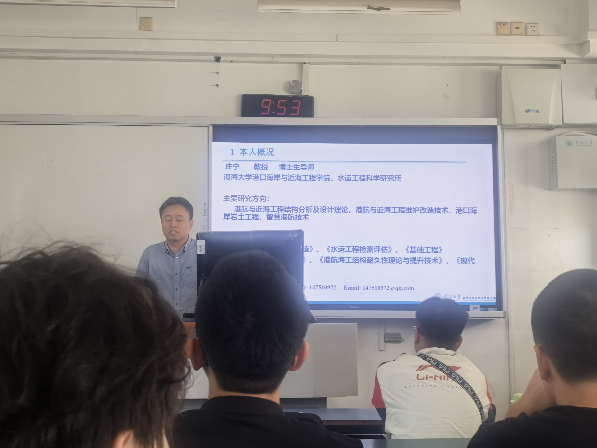
- **标题**：1 本人概况
- **正文**：庄宁　教授　博士生导师；河海大学港口海岸与近海工程学院、水运工程科学研究所；**主要研究方向**：港航与近海工程结构分析及设计理论、港航与近海工程维护改造技术、港口海岸岩土工程、智慧港航技术；**讲授课程**：《水运工程检测评估》《基础工程》…《港航海工结构耐久性理论与提升技术》《现代…》；联系方式：147510972　Email：147510972@qq.com
- **视觉**：教师本人信息介绍页，教师站立于屏幕左侧继续讲解；下方学生背影与上一张一致。

### 3. `IMG_20260914_095920.jpg`（9:59）

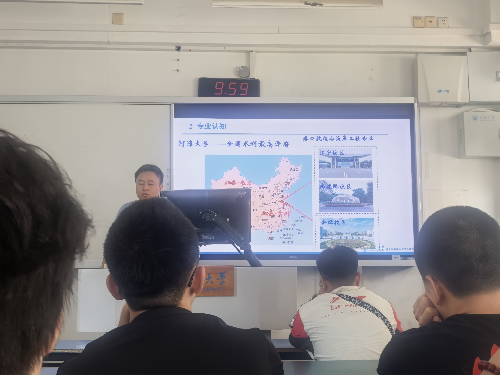
- **标题**：2 专业认知
- **正文**：河海大学——全国水利最高学府；港口航道与海岸工程专业
- **视觉**：左侧为标注“江苏·南京”的中国地图；右侧纵向排列三张校区实景照片——**江宁校区、西康路校区、金坛校区**；教师站在屏幕前讲解。

### 4. `IMG_20260914_100049.jpg`（10:00）

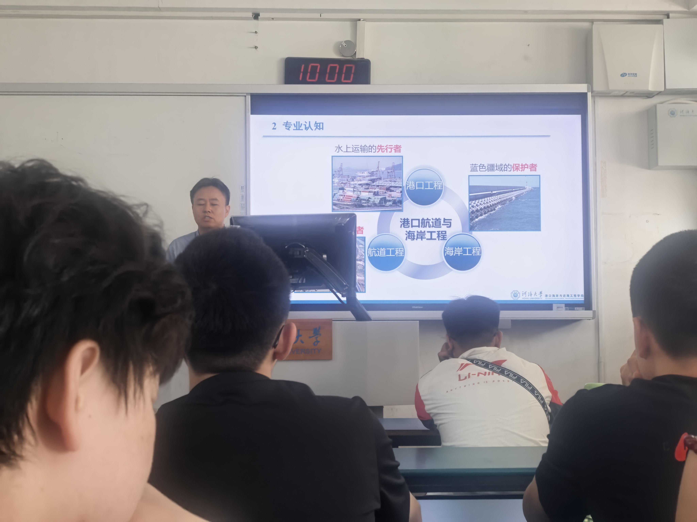
- **标题**：2 专业认知
- **正文**：水上运输的先行者 ／ 蓝色疆域的保护者；圆形结构图由“港口工程”“航道工程”“海岸工程”汇入中心“港口航道与海岸工程”
- **视觉**：概念示意图，左侧配港口照片、右侧配海岸/防波堤照片，球状环绕式版式；教师继续讲解。

### 5. `IMG_20260914_101534.jpg`（10:15）

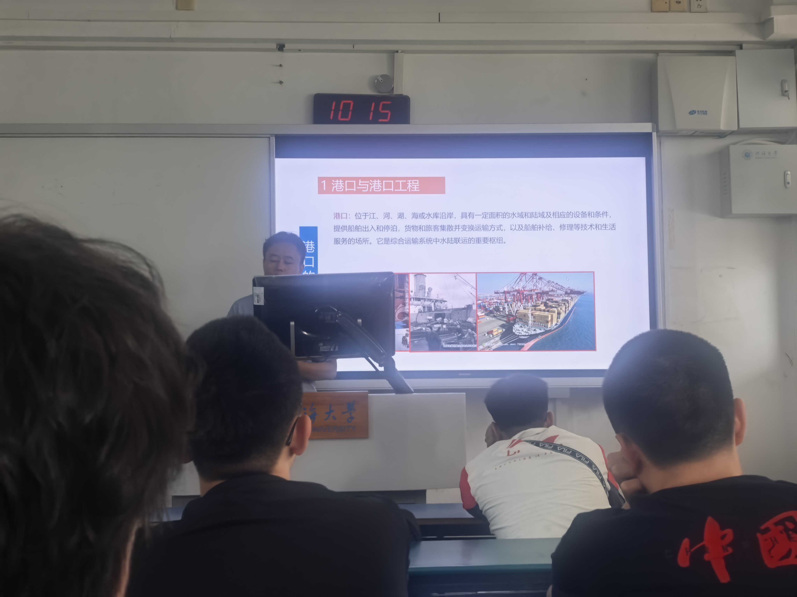
- **标题**：1 港口与港口工程
- **正文**：**港口**：位于江、河、湖、海或水库沿岸，具有一定面积的水域和陆域及相应设备和条件，提供船舶出入和停泊、货物和旅客集散并变换运输方式，以及船舶补给、修理等技术和服务场所，是综合运输系统中水陆联运的重要枢纽
- **视觉**：定义页，下方并排两张港口实景照（集装箱岸桥、码头作业）。

### 6. `IMG_20260914_101702.jpg`（10:17）

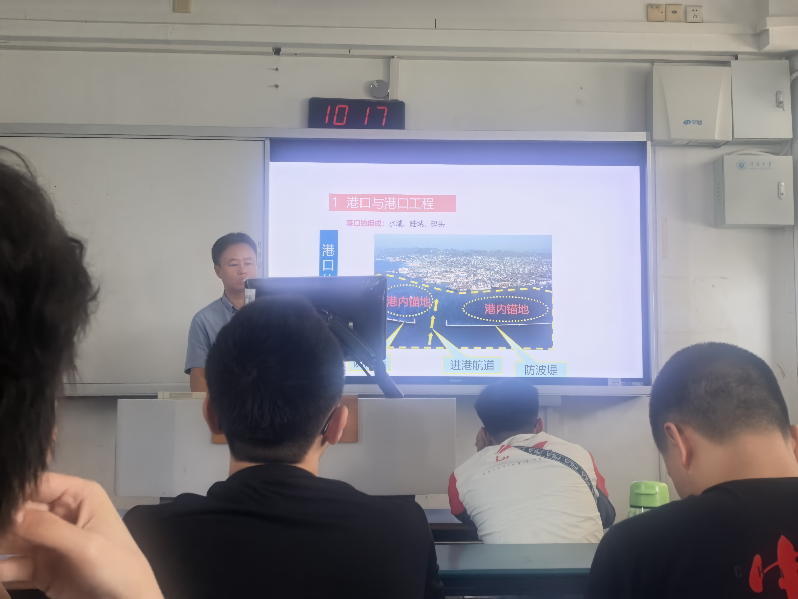
- **标题**：1 港口与港口工程
- **正文**：港口的组成：**水域、陆域、码头**；图中标注“港内锚地”“进港航道”“防波堤”
- **视觉**：港口平面示意/航拍图，以黄色虚线标示航道走向，用椭圆圈出两处港内锚地，是本节最典型的结构示意图。

### 7. `IMG_20260914_101831.jpg`（10:18）

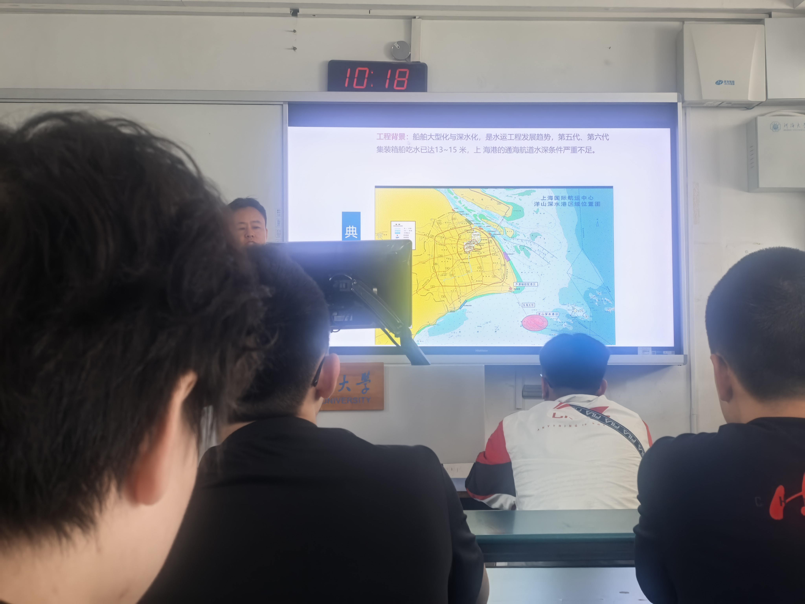
- **标题**：典型案例（页眉“典…”）
- **正文**：工程背景：船舶大型化与深水化，是水运工程发展趋势，第五代、第六代集装箱船吃水已达 13~15 米，上海港的通海航道水深条件严重不足
- **视觉**：配图《上海国际航运中心洋山深水港区位置图》，黄/蓝色海域分区地图，右下角红点标注港区位置。

### 8. `IMG_20260914_102144.jpg`（10:21）

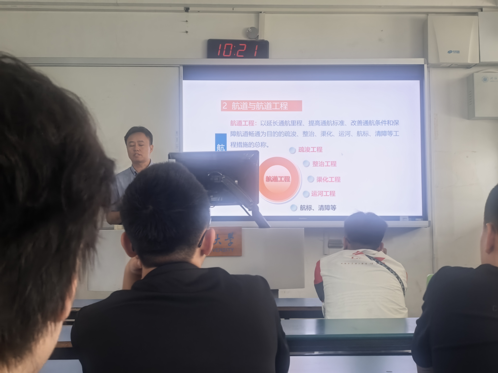
- **标题**：2 航道与航道工程
- **正文**：**航道工程**：以延长通航里程、提高通航标准、改善通航条件和保障航道畅通为目的的疏浚、整治、渠化、运河、航标、清障等工程措施的总称
- **视觉**：中心圆“航道工程”向外辐射五个分支：疏浚工程、整治工程、渠化工程、运河工程、航标·清障等。

### 9. `IMG_20260914_102935.jpg`（10:29）

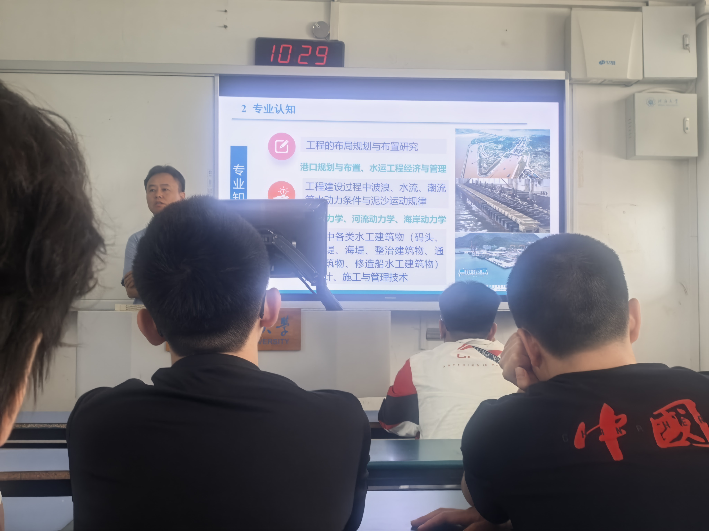
- **标题**：2 专业认知
- **正文**：工程的布局规划与布置研究（港口规划与布置、水运工程经济与管理）；工程建设过程中波浪、水流、潮流等动力条件与泥沙运动规律（水力学、河流动力学、海岸动力学）；各类水工建筑物（码头…堤、海堤、整治建筑物、通航建筑物、修造船水工建筑物）的设计、施工与管理技术
- **视觉**：要点式排版，配两张水工建筑物/港区工程实景图（上方高桩码头、右侧枢纽/船闸俯视）。

### 10. `IMG_20260914_103252.jpg`（10:32）

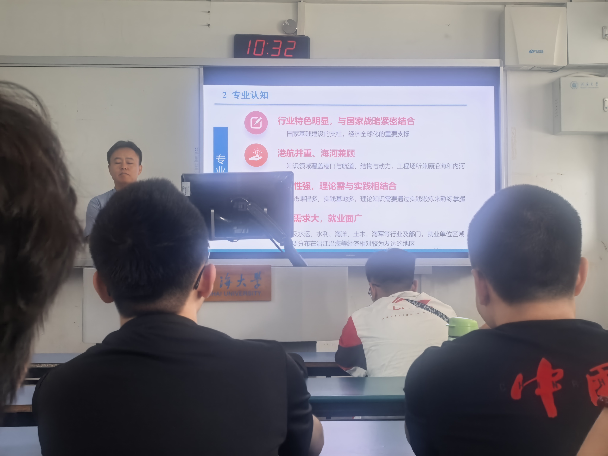
- **标题**：2 专业认知（专业优势）
- **正文**：
  - **行业特色明显，与国家战略紧密结合**——国家基础建设的支柱，经济全球化的重要支撑
  - **港航并重、海河兼顾**——知识领域覆盖港口与航道、结构与动力，工程场所兼顾沿海和内河
  - **实践性强，理论需与实践相结合**——知识课程多，实践基地多，理论知识需要通过实践锻炼来熟练掌握
  - **需求大，就业面广**——涉及水运、水利、海洋、土木、海军等行业及部门，就业单位区域主要分布在沿江沿海等经济相对较为发达的地区
- **视觉**：四条图标化卡片式要点，左侧“专业…”竖排标签。

### 11. `IMG_20260914_103442.jpg`（10:34）

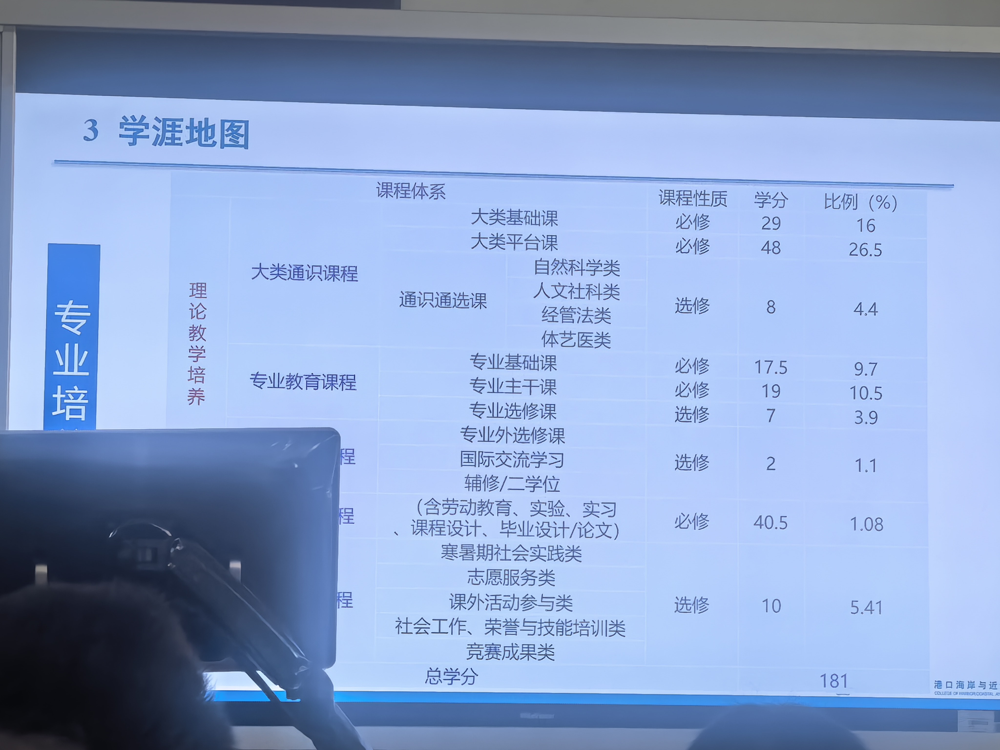
- **标题**：3 学涯地图（培养方案总表）
- **正文**：课程体系／课程性质／学分／比例（%）
  - 大类基础课：必修 29 / 16
  - 大类平台课：必修 48 / 26.5
  - 通识通选课（自然科学类、人文社科类、经管法类、体艺医类）：选修 8 / 4.4
  - 专业基础课：必修 17.5 / 9.7
  - 专业主干课：必修 19 / 10.5
  - 专业选修课：选修 7 / 3.9
  - 专业外选修课；国际交流学习：选修 2 / 1.1；辅修/二学位
  - 实践环节（含劳动教育、实验、实习、课程设计、毕业设计/论文）：必修 40.5
  - 寒暑期社会实践类、志愿服务类、课外活动参与类、社会工作、荣誉与技能培训类、竞赛成果类：选修 10 / 5.41
  - **总学分：181**
- **视觉**：左侧“专业培养—理论教学培养”竖排结构，右侧为四列数据表格，是全场信息密度最高的一页。

### 12. `IMG_20260914_103520.jpg`（10:35）

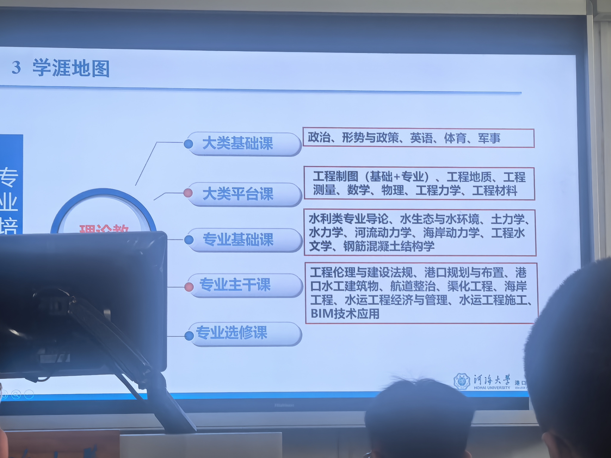
- **标题**：3 学涯地图（理论课程清单）
- **正文**：
  - 大类基础课：政治、形势与政策、英语、体育、军事
  - 大类平台课：工程制图（基础+专业）、工程地质、工程测量、数学、物理、工程力学、工程材料
  - 专业基础课：水利类专业导论、水生态与水环境、土力学、水力学、河流动力学、海岸动力学、工程水文学、钢筋混凝土结构学
  - 专业主干课：工程伦理与建设法规、港口规划与布置、港口水工建筑物、航道整治、渠化工程、海岸工程、水运工程经济与管理、水运工程施工、BIM技术应用
  - 专业选修课

### 13. `IMG_20260914_103605.jpg`（10:36）

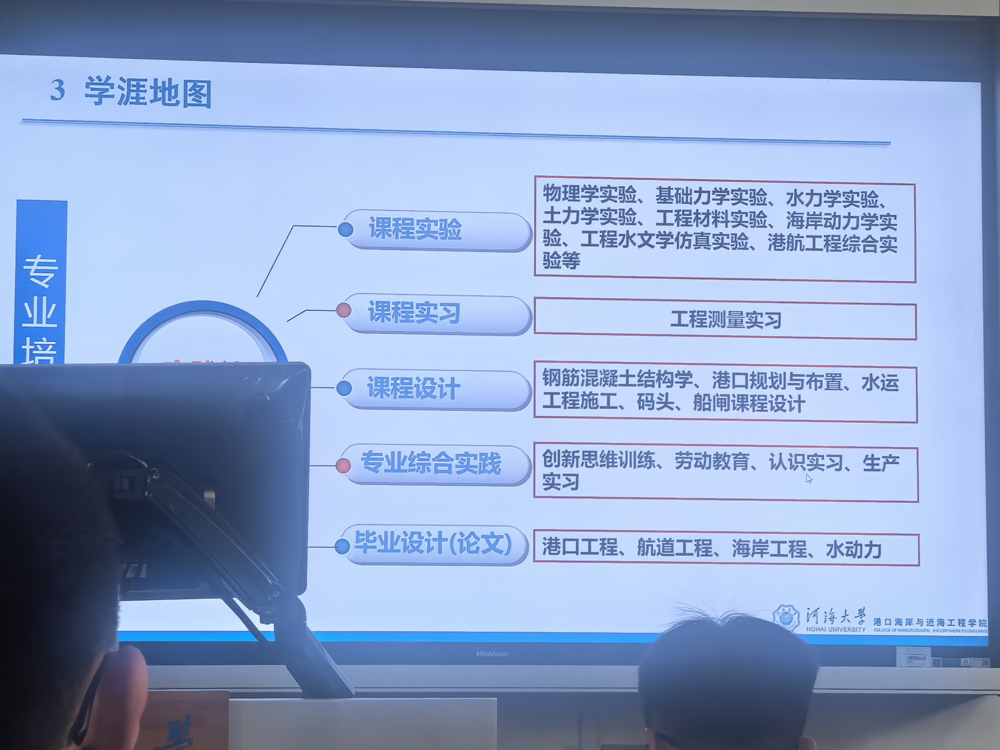
- **标题**：3 学涯地图（实践教学）
- **正文**：
  - 课程实验：物理学实验、基础力学实验、水力学实验、土力学实验、工程材料实验、海岸动力学实验、工程水文学仿真实验、港航工程综合实验等
  - 课程实习：工程测量实习
  - 课程设计：钢筋混凝土结构学、港口规划与布置、水运工程施工、码头、船闸课程设计
  - 专业综合实践：创新思维训练、劳动教育、认识实习、生产实习
  - 毕业设计（论文）：港口工程、航道工程、海岸工程、水动力

### 14. `IMG_20260914_103905.jpg`（10:39）

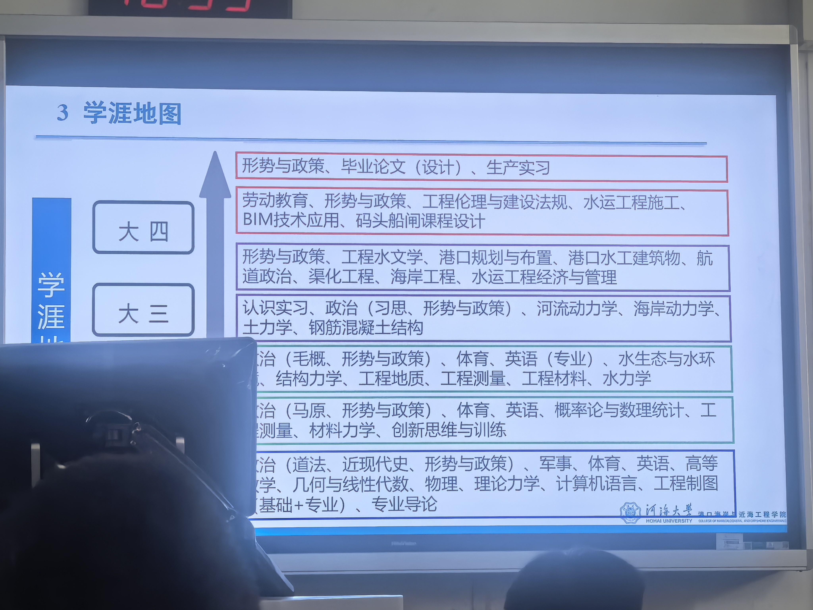
- **标题**：3 学涯地图（四年课程时间轴）
- **正文**（自下而上 大一→大四）：
  - **大一**：政治（道法、近现代史、形势与政策）、军事、体育、英语、高等数学、几何与线性代数、物理、理论力学、计算机语言、工程制图（基础+专业）、专业导论
  - **大二**：政治（马原、形势与政策）、体育、英语、概率论与数理统计、工程测量、材料力学、创新思维与训练
  - **大三**：政治（毛概、形势与政策）、体育、英语（专业）、水生态与水环境、结构力学、工程地质、工程测量、工程材料、水力学；认识实习、政治（习思、形势与政策）、河流动力学、海岸动力学、土力学、钢筋混凝土结构
  - **大四**：形势与政策、工程水文学、港口规划与布置、港口水工建筑物、航道整治、渠化工程、海岸工程、水运工程经济与管理；劳动教育、形势与政策、工程伦理与建设法规、水运工程施工、BIM技术应用、码头船闸课程设计；形势与政策、毕业论文（设计）、生产实习
- **视觉**：中央向上的蓝色箭头构成“年级—课程”阶梯式时间轴。

### 15. `IMG_20260914_104015.jpg`（10:40）

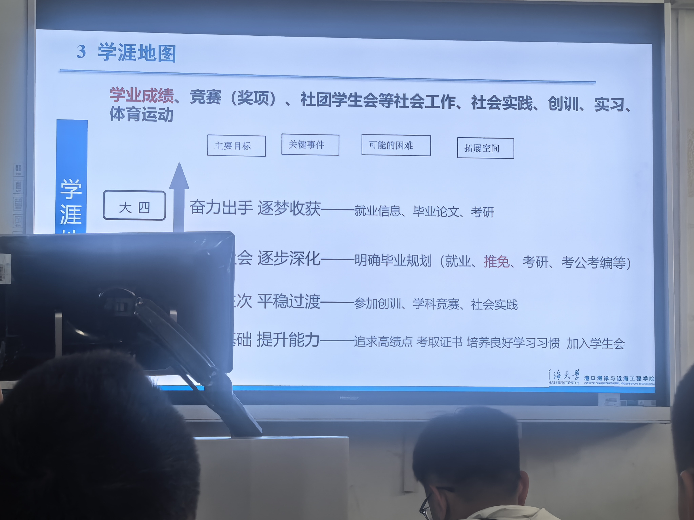
- **标题**：3 学涯地图（四年成长路径）
- **正文**：大学四年应关注——学业成绩、竞赛（奖项）、社团学生会等社会工作、社会实践、创训、实习、体育运动；分析框架四栏：**主要目标 / 关键事件 / 可能的困难 / 拓展空间**
  - 大四：奋力出手 逐梦收获——就业信息、毕业论文、考研
  - 大三：逐步深化——明确毕业规划（就业、推免、考研、考公考编等）
  - 大二：平稳过渡——参加创训、学科竞赛、社会实践
  - 大一：打基础 提升能力——追求高绩点、考取证书、培养良好学习习惯、加入学生会
- **视觉**：与上一页同款向上箭头时间轴，右侧为大四（蓝框）段落。

### 16. `IMG_20260914_104418.jpg`（10:44）

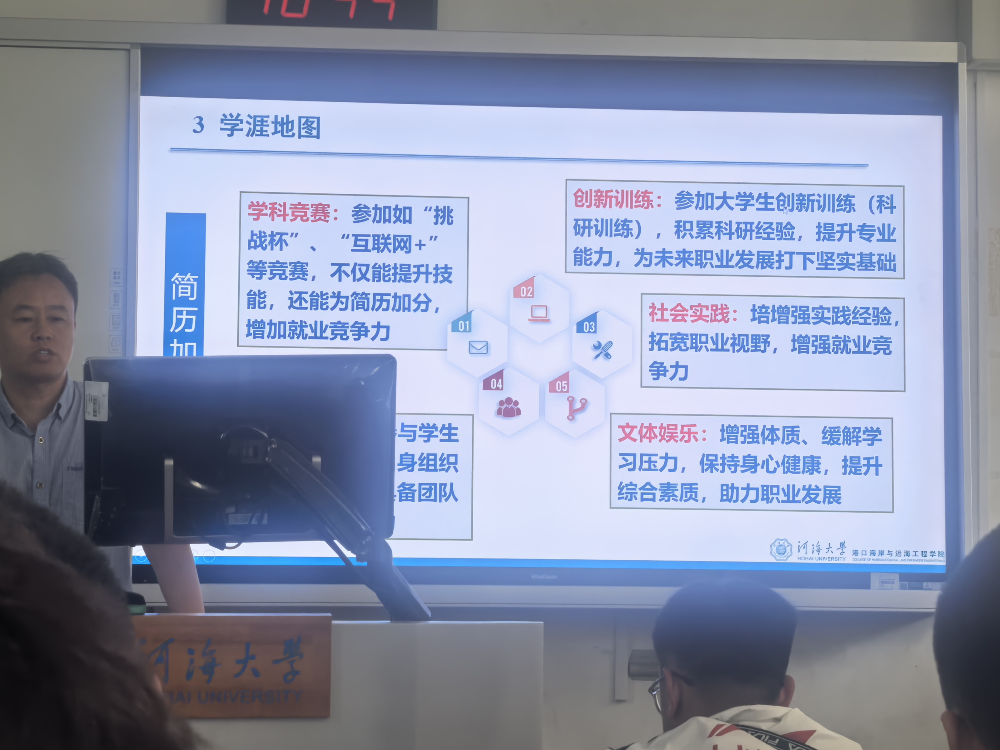
- **标题**：3 学涯地图（“简历加分”项）
- **正文**：
  - **学科竞赛**：参加如“挑战杯”“互联网+”等竞赛，不仅能提升技能，还能为简历加分，增加就业竞争力
  - **创新训练**：参加大学生创新训练（科研训练），积累科研经验，提升专业能力，为未来职业发展打下坚实基础
  - **社会实践**：增强实践经验，拓宽职业视野，增强就业竞争力
  - **文体娱乐**：增强体质、缓解学习压力，保持身心健康，提升综合素质，助力职业发展
  - 另有一栏关于学生会/社团与学生骨干团队组建的说明（画面被讲台遮挡）
- **视觉**：中央为 5 个编号图标（01–05）的六边形蜂窝式示意图；教师已走到讲台左侧，露出半身。

### 17. `IMG_20260914_105024.jpg`（10:50）

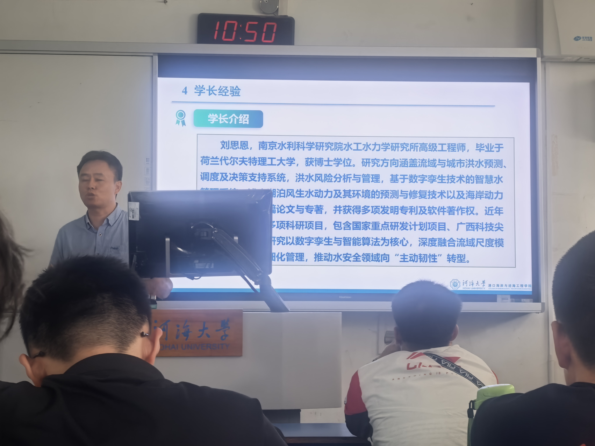
- **标题**：4 学长经验 —— 学长介绍
- **正文**：刘思恩，南京水利科学研究院水工水力学研究所高级工程师，毕业于荷兰代尔夫特理工大学，获博士学位。研究方向涵盖流域与城市洪水预测、调度及决策支持系统，洪水风险分析与管理，基于数字孪生技术的智慧水库…；湖泊风生水动力及其环境的预测与修复技术以及海岸动力…；发表论文与专著，并获得多项发明专利及软件著作权。近年参与多项科研项目，包含国家重点研发计划项目、广西科技尖…；研究以数字孪生与智能算法为核心，深度融合流域尺度模…化管理，推动水安全领域向“主动韧性”转型。
- **视觉**：绿色“学长介绍”标题条 + 大段人物简介卡片。

### 18. `IMG_20260914_105114.jpg`（10:51）

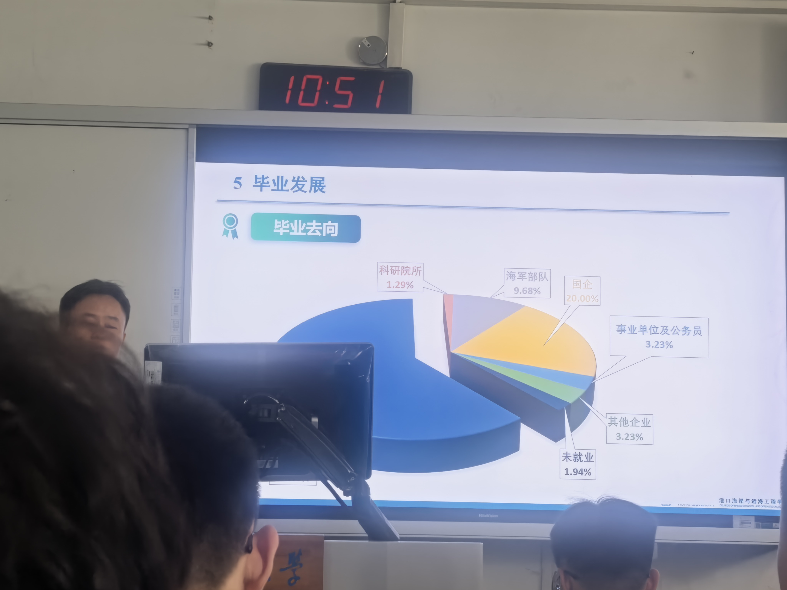
- **标题**：5 毕业发展 —— 毕业去向
- **正文**（饼图数据）：国企 20.00%、海军部队 9.68%、事业单位及公务员 3.23%、其他企业 3.23%、未就业 1.94%、科研院所 1.29%（另有占比最大的蓝色扇区未标注文字，通常为升学/深造）
- **视觉**：3D 立体饼图 + 引线标签；教师头部刚好凑近取景框左下。

### 19. `IMG_20260914_105500.jpg`（10:55）

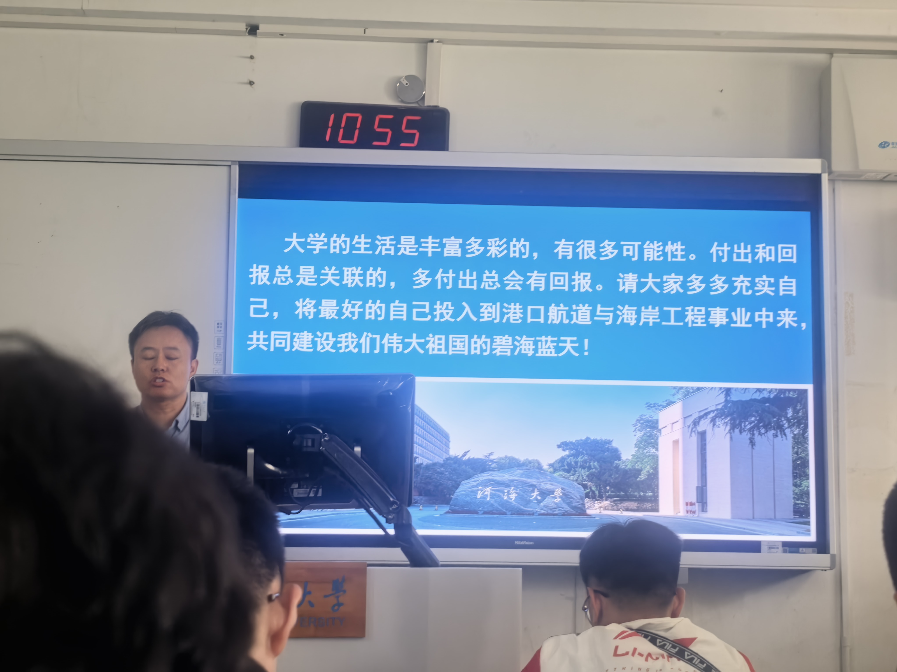
- **标题**：结语（蓝底寄语页）
- **正文**：“大学的生活是丰富多彩的，有很多可能性。付出和回报总是关联的，多付出总会有回报。请大家多多充实自己，将最好的自己投入到港口航道与海岸工程事业中来，共同建设我们伟大祖国的碧海蓝天！”
- **视觉**：蓝底白字寄语，下方配河海大学校门石刻与校园风光照；教师站立讲解，班会接近尾声。

## 五、核心内容要点

**① 专业内涵（专业认知）**
- 港口的定义：位于江、河、湖、海或水库沿岸，兼具水域与陆域及设备条件，承担船舶出入停泊、货客集散与运输方式转换、补给修理等功能，是**水陆联运的重要枢纽**。
- 港口的组成：**水域、陆域、码头**；相关要素包括港内锚地、进港航道、防波堤。
- 航道工程的目的：延长通航里程、提高通航标准、改善通航条件、保障航道畅通；手段包括**疏浚、整治、渠化、运河、航标、清障**。
- 专业覆盖范围：港口工程 + 航道工程 + 海岸工程，兼顾“水上运输的先行者”与“蓝色疆域的保护者”双重角色。
- 典型工程背景：船舶大型化、深水化是趋势，第五、六代集装箱船吃水已达 **13~15 米**，据此引出洋山深水港等重大工程需求。

**② 专业优势（教师归纳的四条）**
1. 行业特色明显，与国家战略紧密结合（国家基础建设的支柱、经济全球化的重要支撑）；
2. 港航并重、海河兼顾（知识覆盖“结构+动力”，场所兼顾“沿海+内河”）；
3. 实践性强，理论必须与实践结合（课程多、实践基地多）；
4. 需求大、就业面广（涉水运、水利、海洋、土木、海军等行业，就业区域集中在沿江沿海经济发达地区）。

**③ 学业规划工具（学涯地图）**
- **学分结构**：总学分 **181**；必修为主体——大类基础课 29 学分、大类平台课 48 学分（占比最高 26.5%）、专业基础课 17.5、专业主干课 19、实践环节 40.5；选修含通识通选课 8、专业选修课 7、国际交流 2、竞赛与第二课堂类 10。
- **理论主线**：数学/物理/力学 → 工程制图、工程测量、工程地质、工程材料 → 水力学、河流动力学、海岸动力学、结构力学、土力学、钢筋混凝土 → 港口规划与布置、港口水工建筑物、航道整治、渠化工程、海岸工程、水运工程施工、BIM 技术应用。
- **实践主线**：课程实验 → 工程测量实习 → 各类课程设计（码头、船闸）→ 认识实习/生产实习 → 毕业设计（港口工程、航道工程、海岸工程、水动力）。
- **四年路径**：大一“打基础、提升能力”（高绩点、证书、习惯、学生会）→ 大二“平稳过渡”（创训、学科竞赛、社会实践）→ 大三“逐步深化”（明确就业/推免/考研/考公考编方向）→ 大四“奋力出手、逐梦收获”（就业信息、毕业论文、考研）。
- **分析框架**：围绕每一个阶段追问“**主要目标—关键事件—可能的困难—拓展空间**”。
- **简历加分项**：学科竞赛（“挑战杯”“互联网+”）、大学生创新训练（科研训练）、社会实践、文体娱乐与学生骨干工作。

**④ 发展预期（毕业去向饼图）**
国企 20.00%、海军部队 9.68%、事业单位及公务员 3.23%、其他企业 3.23%、未就业 1.94%、科研院所 1.29%（另有最大扇区未标注，推测为升学/深造类去向）。

## 六、值得记录的语录与建议

- **开篇立意**：主题定为“**启智未来·生涯**”——把专业教育与生涯规划绑定在一起。
- **教师对学生的核心寄语（原话）**：
  > “大学的生活是丰富多彩的，有很多可能性。付出和回报总是关联的，多付出总会有回报。请大家多多充实自己，将最好的自己投入到港口航道与海岸工程事业中来，共同建设我们伟大祖国的碧海蓝天！”
- **两条“硬提醒”**：“实践性强，**理论需与实践相结合**”“知识课程多、实践基地多，理论要通过实践锻炼来熟练掌握”。
- **规划观**：四年不是一条直线，而是“**打基础—平稳过渡—逐步深化—奋力出手**”四个动作；每一步都要想清楚“主要目标、关键事件、可能的困难、拓展空间”。
- **榜样示范**：学长刘思恩以“数字孪生 + 智能算法”推动水安全向“**主动韧性**”转型，提示本专业的前沿方向并非传统土木，而是数字化、智能化。

## 七、视觉亮点

- **主题页地图轮廓**：首页右上角淡色中国地图，暗示“面向江海”的专业定位。
- **专业构成环形图**：港口工程、航道工程、海岸工程三环汇入中心，是全场最直观的一张概念图。
- **三校区实景照片墙**：江宁校区、西康路校区、金坛校区并排，配合“江苏·南京”定位地图，强化学校的“全国水利最高学府”标签。
- **港口平面示意图**：以航拍图叠加标注“港内锚地、进港航道、防波堤”，把抽象定义变成可指认的空间关系。
- **洋山深水港位置图**：大色块海图 + 红点定位，支撑“13~15 米吃水”的工程背景数据。
- **学涯地图系列**：学分四列数据表、“理论课—实践课”清单、四年向上箭头时间轴、5 个编号图标的蜂窝图，是全套 PPT 中最具“工具属性”的版式，适合课后反复查阅。
- **毕业去向 3D 饼图**：引线标签清晰，把就业结构一次说清。
- **结语页**：蓝底白字 + 河海大学校门石刻照片，视觉上收束为“学校—专业—事业”的三重认同。

## 八、个人收获与思考

作为刚进入大学的新生，这场班会的价值不在于告知了多少信息，而在于它第一次把“我所在的专业”翻译成了“我未来四年的动作清单”。庄宁老师用将近一半的时间讲《学涯地图》，其实是在做一件事：把抽象的专业热情落到 181 个学分、几十门课程和四次阶段性选择上。听下来最直接的感受是——**大学不是一段可以“慢慢适应”的缓冲期，而是一条有明确节点的时间轴**：大一能否拿到高绩点、养成学习习惯，直接决定大二参加创训和竞赛时的门槛；大三能否在就业、推免、考研、考公考编之间做出决断，又取决于前两年有没有真正接触过科研与实践。规划不是束缚，而是把“很多可能性”变成“几个可以抓住的选择”。因此，我打算在开学第一个月内先做三件事：把这份培养方案的课程清单按学期抄进自己的笔记本；给自己定下大一的核心指标（绩点、一门基础课的能力突破、加入一个组织）；以及尽快通过专业导论和认识实习去触摸真实的工程场景，避免“读到大三还不知道自己在学什么”。

第二个收获来自“专业认知”这一部分。此前我对这个专业的想象基本停留在“修码头、挖航道”的体力型印象，而屏幕上那张由港口工程、航道工程、海岸工程汇入“港口航道与海岸工程”的环形图，以及“水上运输的先行者 / 蓝色疆域的保护者”的定位，让我意识到这是一门**既参与国家基础设施建设、又承担生态与海洋保护责任**的复合型学科。洋山深水港的案例尤其有说服力：船舶吃水从十几米的发展倒逼航道整治与滨海工程决策，专业在这里不是“配套”，而是决定一个国家级航运中心能否成立的关键变量。老师总结的四条优势里，“与国家战略紧密结合”和“需求大、就业面广”都很诱人，但真正让我警惕的是“实践性强、理论需与实践相结合”——它意味着课堂上的力学、水文学、结构学如果不同时通过实验、测量、课程设计和实习落地，就很容易变成考试结束即遗忘的知识。所以，未来的学习策略应当是“课程—实验—设计—实习”成对推进，而不是把它们当作彼此独立的关卡。

第三点思考关于“路径”。学长的履历给了我一个很具体的参照：本专业毕业后既可以进入国家级科研院所解决真实的洪水与海岸动力问题，也可以把专业与“数字孪生 + 智能算法”这样的新技术方向结合，去做让水安全“主动韧性”的创新。毕业去向饼图里，国企占比最高、海军部队与科研院所也各自稳定，这说明专业的出口并不窄，但它对“能力标签”的要求是清晰的——科研经历、竞赛奖项、实践经验，几乎每一项都对应《简历加分》那页的内容。回看整场班会，老师最先讲的其实是“本人概况”，最后讲的是“碧海蓝天”：一头是专业权威，一头是国家叙事，中间那一小时就是学生自己要走的四年。真正要从中得到的，不只是一份 PPT 的截图，而是一个可执行的自我管理框架——明确目标、记录关键事件、预判困难、留出拓展空间，然后像结语里说的那样，“多付出”，因为付出和回报总是关联的。
