# 平陆运河工程技术创新——河海大学2026“扬帆·大学生涯启航周”院士演讲实录

## 活动信息

- **活动名称**：河海大学 2026“扬帆·大学生涯启航周”院士报告会
- **演讲主题**：平陆运河工程技术创新
- **演讲人**：胡亚安
- **主办单位**：河海大学港口海岸及近海工程学院
- **日期**：2026年9月13日
- **地点**：河海大学学术报告厅/礼堂

## 会场与氛围

演讲在现代化阶梯报告厅举行，主屏幕与侧屏同步显示PPT，灯光柔和，现场坐满以浅蓝色服装为主的新生，座无虚席。胡亚安院士身着白衬衫站在河海大学校徽讲台后，语调平稳、手势丰富，整场报告兼具工程硬核数据与人文期许，气氛庄重而热烈。

---

## 逐图要点记录

### IMG_20260913_110128.jpg

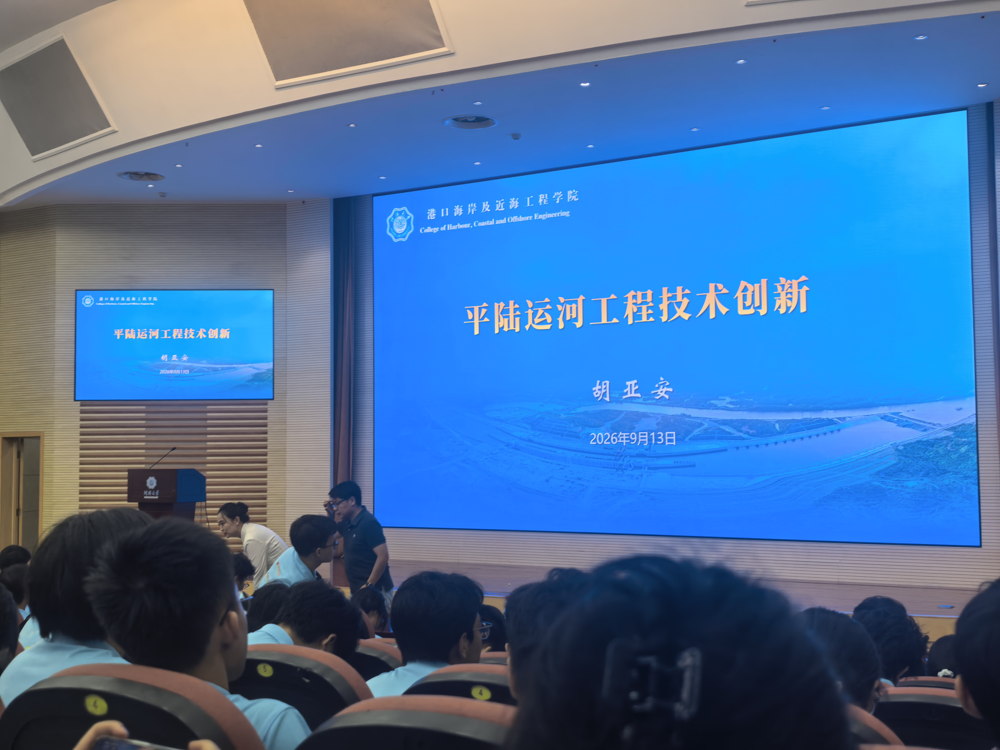
- **主标题**：平陆运河工程技术创新
- **副标题**：胡亚安 / 2026年9月13日
- **单位**：港口海岸及近海工程学院
- **视觉**：报告厅全景，主屏为蓝色基调封面，台下新生就座。

### IMG_20260913_110436.jpg

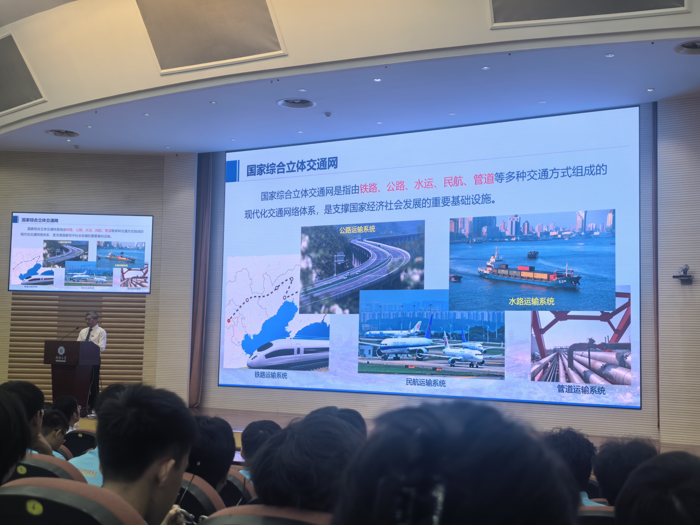
- **主标题**：国家综合立体交通网
- **正文**：由铁路、公路、水运、民航、管道等多种交通方式组成的现代化交通网络体系，是支撑国家经济社会发展的重要基础设施。
- **视觉**：中国地图与五种运输系统实景拼图，演讲人开始主讲。

### IMG_20260913_110453.jpg

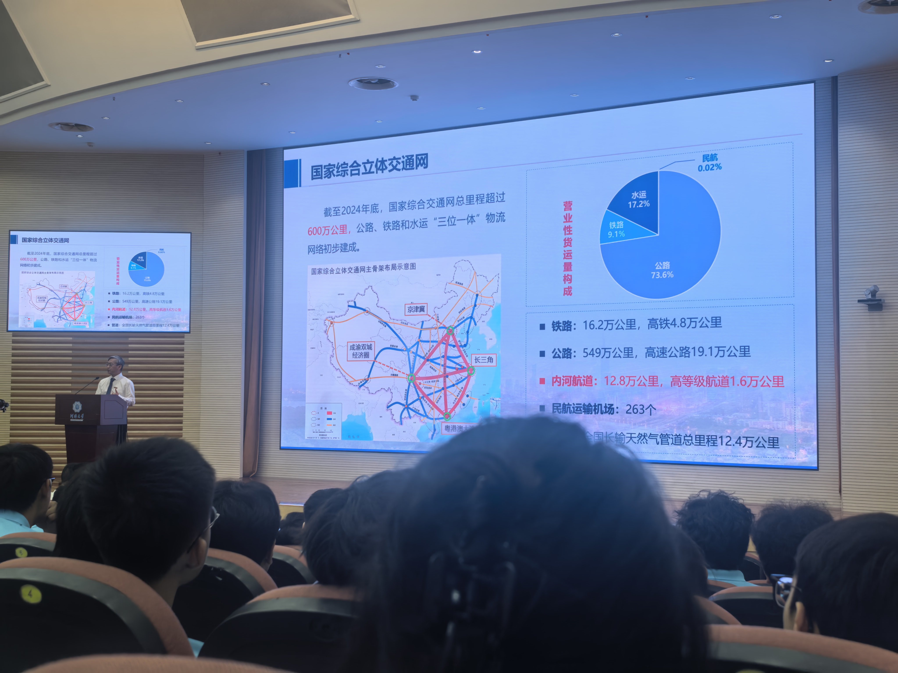
- **主标题**：国家综合立体交通网
- **关键数据**：截至2024年底，国家综合交通网总里程超过600万公里；公路、铁路、水运“三位一体”物流网络初步建成。
- **货运周转量构成**：公路73.6%、水运17.2%、铁路9.1%、民航0.02%。
- **基础设施**：铁路16.2万公里（高铁4.8万）、公路549万公里（高速19.1万）、内河航道12.8万公里（高等级1.6万）、民航机场263个、长输天然气管道12.4万公里。
- **视觉**：国家综合立体交通网主骨架布局示意图、饼图。

### IMG_20260913_110640.jpg

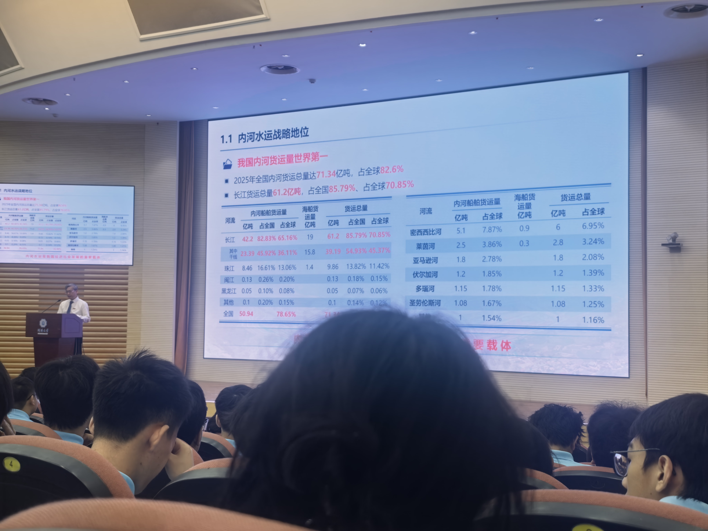
- **主标题**：1.1 内河水运战略地位
- **关键数据**：我国内河货运量世界第一；2025年全国内河货运总量71.34亿吨，占全球82.6%；长江货运量61.2亿吨，占全国85.79%、全球70.85%。
- **视觉**：世界主要河流货运量对比表。

### IMG_20260913_110929.jpg

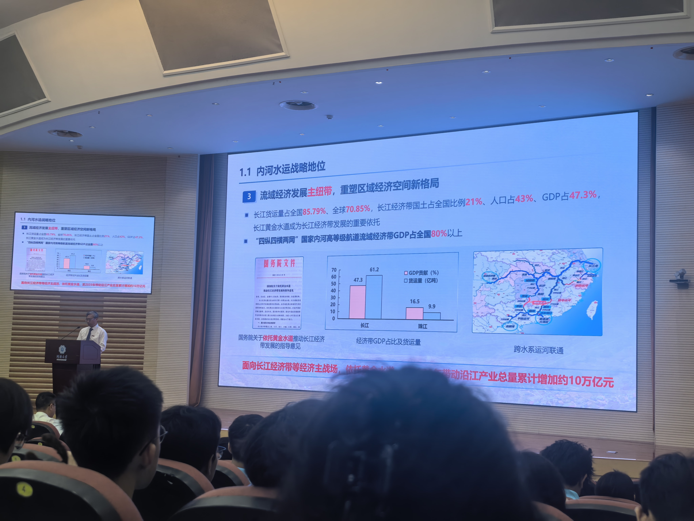
- **主标题**：1.1 内河水运战略地位
- **正文**：流域经济发展主纽带，重塑区域经济空间新格局；长江经济带国土占全国21%、人口43%、GDP占47.3%；“四纵四横两网”国家内河高等级航道流域经济带GDP占全国80%以上。
- **关键数据**：面向长江经济带等经济主战场，预计带动沿江产业总量累计增加约10万亿元。
- **视觉**：国务院文件封面、长江/珠江经济带GDP与货运量柱状图、跨水系运河联通地图。

### IMG_20260913_111416.jpg

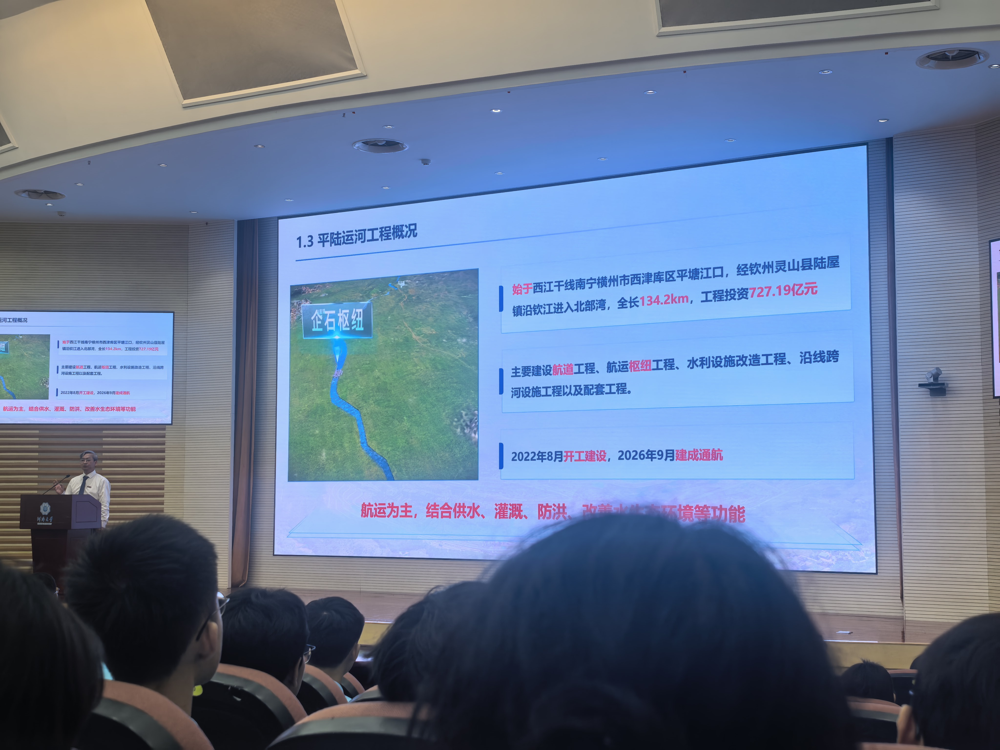
- **主标题**：1.3 平陆运河工程概况
- **工程概况**：始于西江干线南宁横州市西津库区平塘江口，经钦州灵山县陆屋镇沿钦江进入北部湾，全长134.2 km，工程投资727.19亿元。
- **主要建设**：航道工程、航运枢纽工程、水利设施改造工程、沿线跨河设施及配套工程。
- **工期**：2022年8月开工建设，2026年9月建成通航。
- **功能**：航运为主，结合供水、灌溉、防洪、改善水生态环境等。
- **视觉**：企石枢纽卫星/航拍图。

### IMG_20260913_111519.jpg

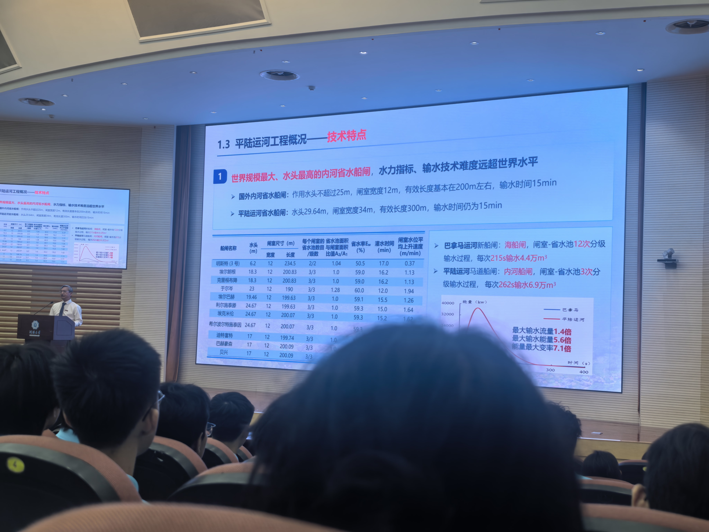
- **主标题**：1.3 平陆运河工程概况——技术特点（1）
- **正文**：世界规模最大、水头最高的内河省水船闸，水力指标、输水技术难度远超世界水平。
- **关键数据**：
  - 国外内河省水船闸：作用水头≤25 m，闸室宽12 m，有效长度约200 m，输水时间15 min。
  - 平陆运河省水船闸：水头29.64 m，闸室宽34 m，有效长度300 m，输水时间仍为15 min。
  - 巴拿马新船闸：海船闸，12次分级，每次215 s输水4.4万m³。
  - 平陆运河马道船闸：内河船闸，3次分级，每次262 s输水6.9万m³；最大输水流量为巴拿马1.4倍、最大输水能量5.6倍、能量最大变率7.1倍。
- **视觉**：船闸参数对比表、能量曲线图。

### IMG_20260913_111558.jpg

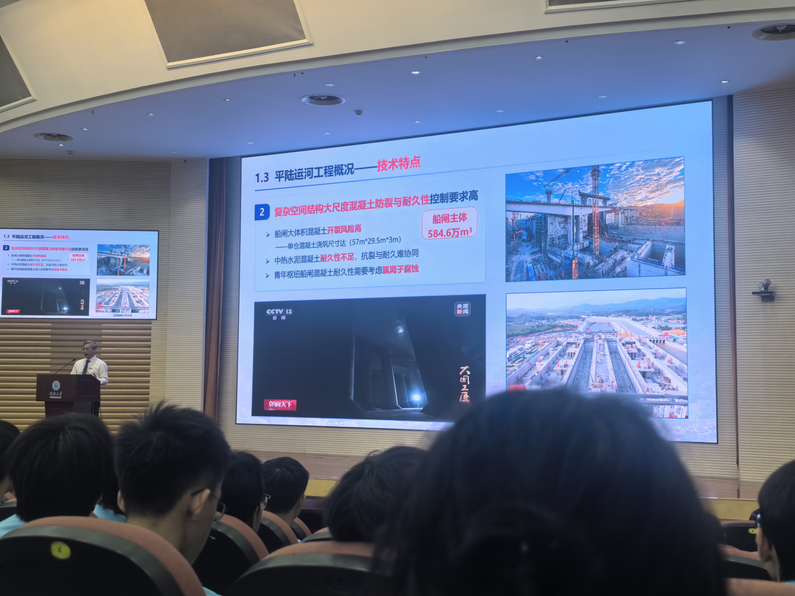
- **主标题**：1.3 平陆运河工程概况——技术特点（2）
- **正文**：复杂空间结构大尺度混凝土防裂与耐久性控制要求高；单仓混凝土浇筑尺寸达57 m×29.5 m×3 m；中热水泥混凝土耐久性不足；青年枢纽船闸混凝土需考虑氯离子腐蚀。
- **关键数据**：船闸主体混凝土584.6万m³。
- **视觉**：夜间施工、塔吊林立的船闸工地照片，CCTV13《大国工匠》画面截图。

### IMG_20260913_111719.jpg

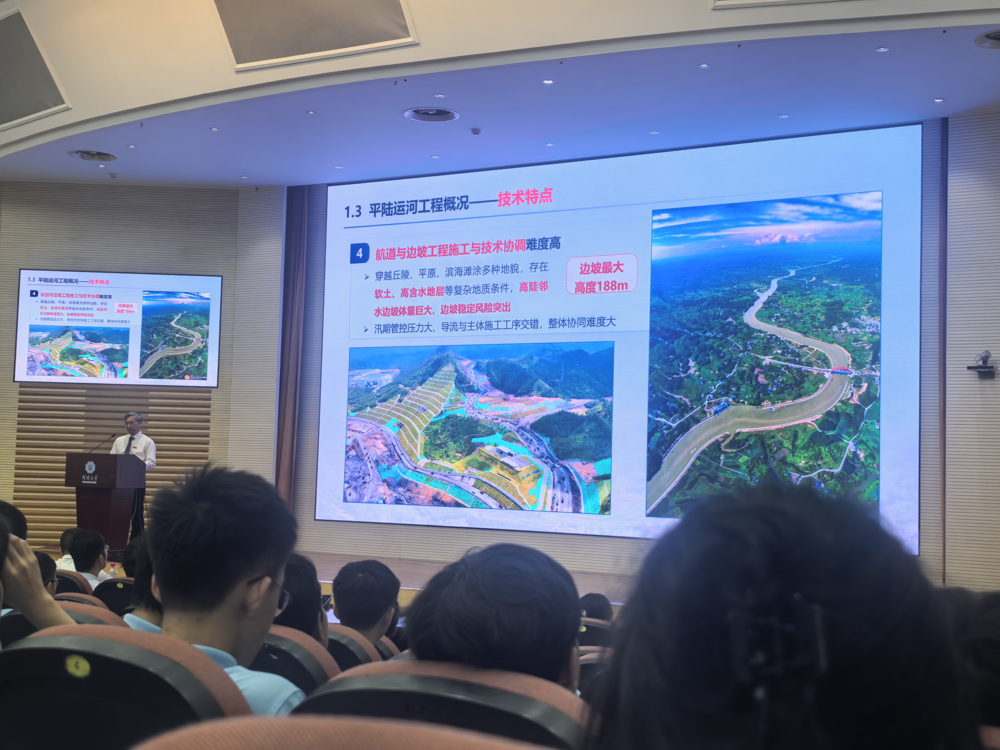
- **主标题**：1.3 平陆运河工程概况——技术特点（4）
- **正文**：航道与边坡工程施工与技术协调难度高；穿越丘陵、平原、滨海滩涂，软土、高含水地层复杂，高陡邻水边坡体量巨大，边坡稳定风险突出，汛期管控压力大，导流与主体施工工序交错。
- **关键数据**：边坡最大高度188 m。
- **视觉**：山间开挖的高边坡与蜿蜒航道航拍图。

### IMG_20260913_111808.jpg

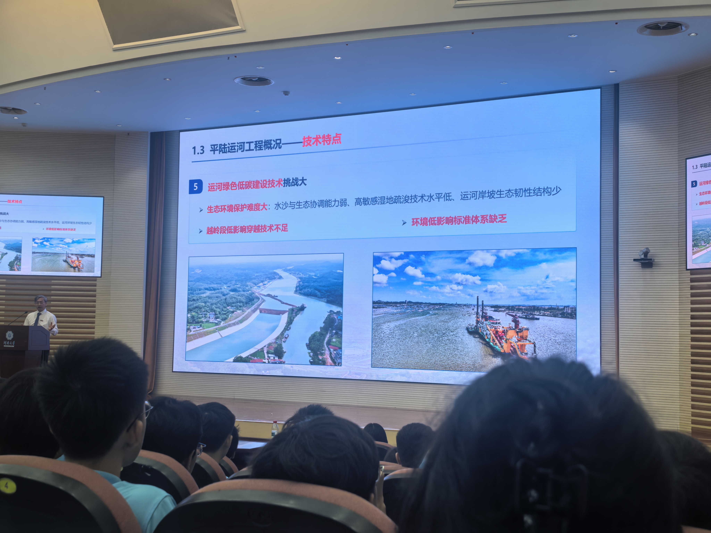
- **主标题**：1.3 平陆运河工程概况——技术特点（5）
- **正文**：运河绿色低碳建设技术挑战大；水沙与生态协调能力弱、高敏感湿地疏浚技术水平低、运河岸坡生态韧性结构少；越岭段低影响穿越技术不足；环境低影响标准体系缺乏。
- **视觉**：运河航拍、湿地疏浚船作业图。

### IMG_20260913_111819.jpg

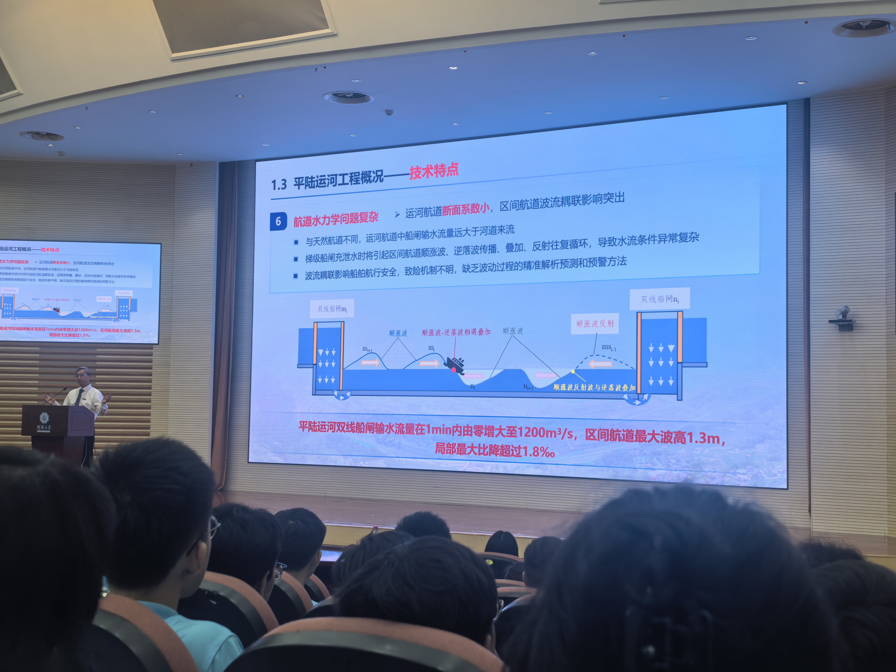
- **主标题**：1.3 平陆运河工程概况——技术特点（6）
- **正文**：航道水力学问题复杂；运河航道断面系数小，船闸输水与区间航道波流耦联影响突出；梯级船闸充泄水引起顺波、逆落波传播、叠加、反射，致险机制不明，缺乏精准解析预测和预警方法。
- **关键数据**：平陆运河双线船闸输水流量在1 min内由零增大至1200 m³/s；区间航道最大波高1.3 m；局部最大比降超过1.8‰。
- **视觉**：船闸—航道水流波动示意与波浪叠加图。

### IMG_20260913_111928.jpg

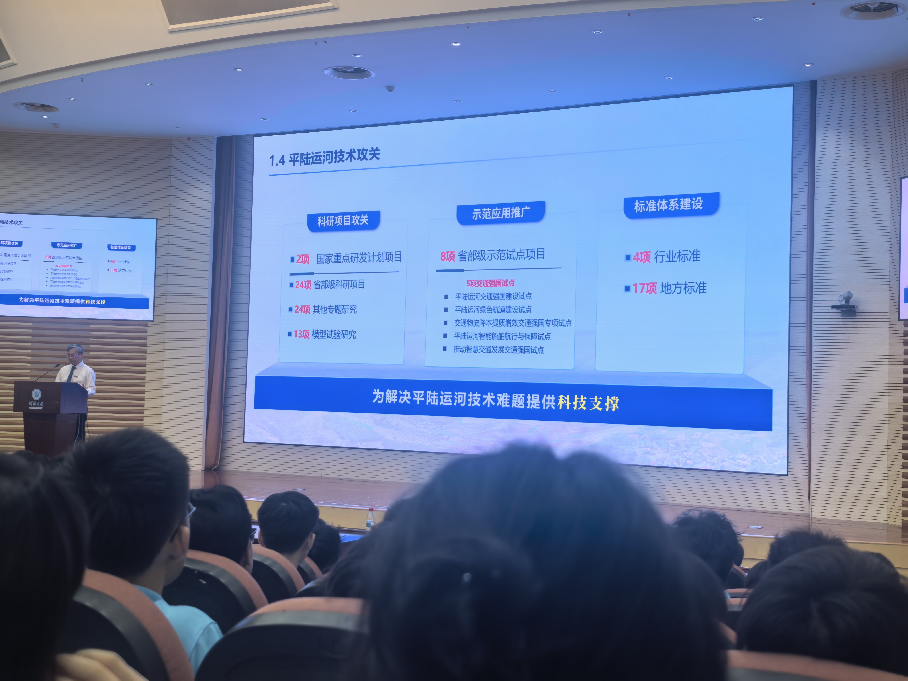
- **主标题**：1.4 平陆运河技术攻关
- **三大板块**：
  - 科研项目攻关：2项国家重点研发计划、24项省部级科研、24项其他专题研究、13项模型试验。
  - 示范应用推广：8项省部级示范试点项目（含5项交通强国试点）。
  - 标准体系建设：4项行业标准、17项地方标准。
- **结语**：为解决平陆运河技术难题提供科技支撑。
- **视觉**：三栏流程图。

### IMG_20260913_112033.jpg

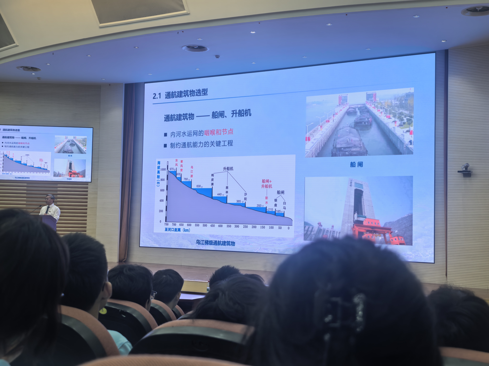
- **主标题**：2.1 通航建筑物选型
- **正文**：通航建筑物——船闸、升船机；内河水运网的咽喉和节点，制约通航能力的关键工程。
- **视觉**：船闸与升船机实景、乌江梯级通航建筑物纵剖面图。

### IMG_20260913_112218.jpg

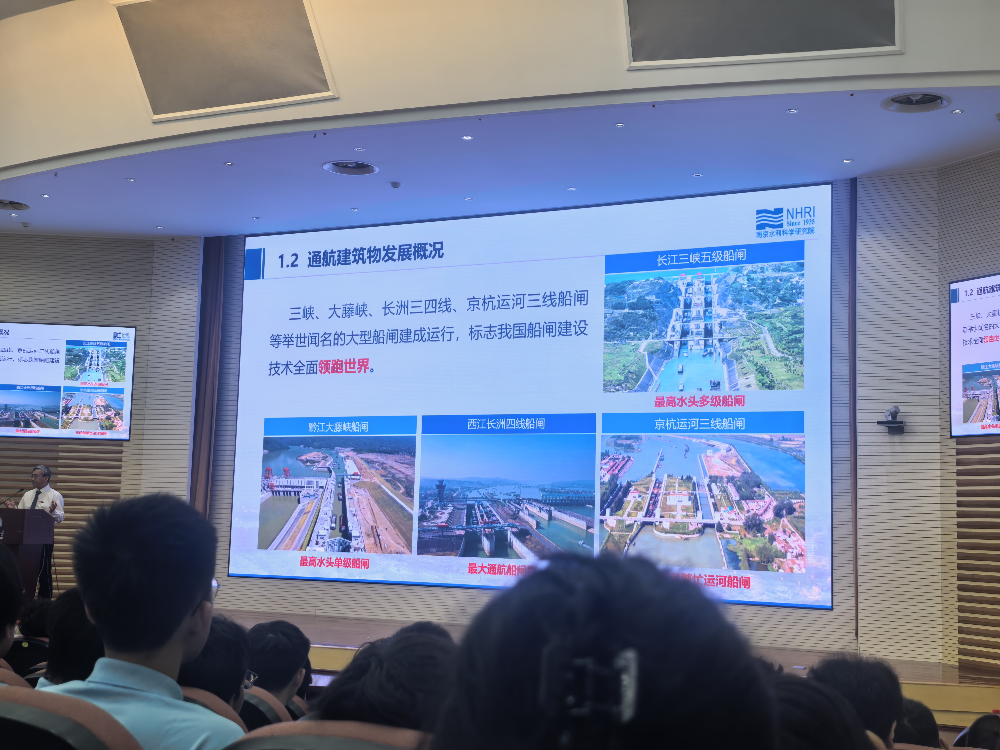
- **主标题**：1.2 通航建筑物发展概况
- **正文**：三峡、大藤峡、长洲三四线、京杭运河三线船闸等举世闻名的大型船闸建成运行，标志我国船闸建设技术全面领跑世界。
- **视觉**：长江三峡五级船闸、黔江大藤峡船闸、西江长洲四线船闸、京杭运河三线船闸航拍图。

### IMG_20260913_112328.jpg

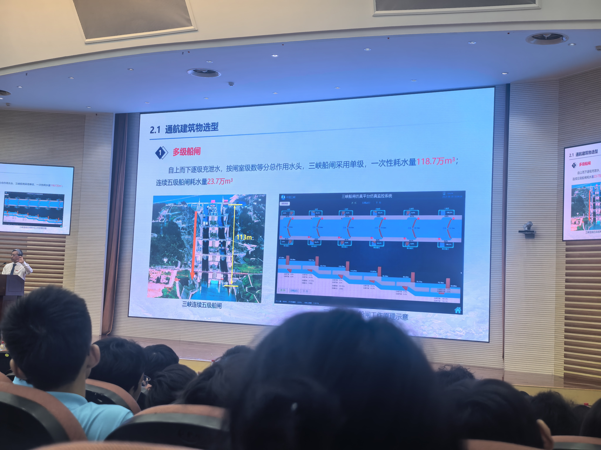
- **主标题**：2.1 通航建筑物选型——多级船闸
- **关键数据**：自上而下逐级充泄水，按闸室级数等分总作用水头；三峡船闸采用单级，一次性耗水量118.7万m³；连续五级船闸耗水量23.7万m³。
- **视觉**：三峡连续五级船闸航拍与工作原理示意。

### IMG_20260913_112432.jpg

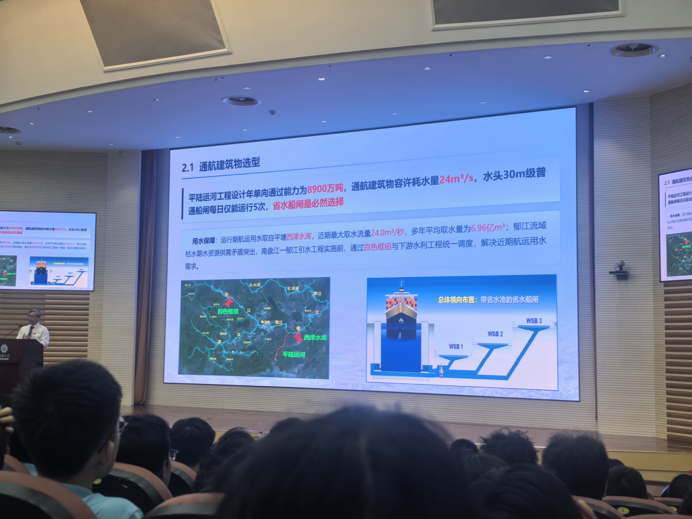
- **主标题**：2.1 通航建筑物选型
- **关键数据**：平陆运河设计年单向通过能力8900万吨；通航建筑物容许耗水量24 m³/s；水头30 m级普通船闸每日仅能运行5次，省水船闸是必然选择。
- **水资源保障**：运行期航运用水取自平塘西津水库，近期最大取水流量24.0 m³/s，多年平均取水量6.96亿m³。
- **视觉**：西津—百色枢纽水系图、带省水池的省水船闸总体横向布置图。

### IMG_20260913_112518.jpg

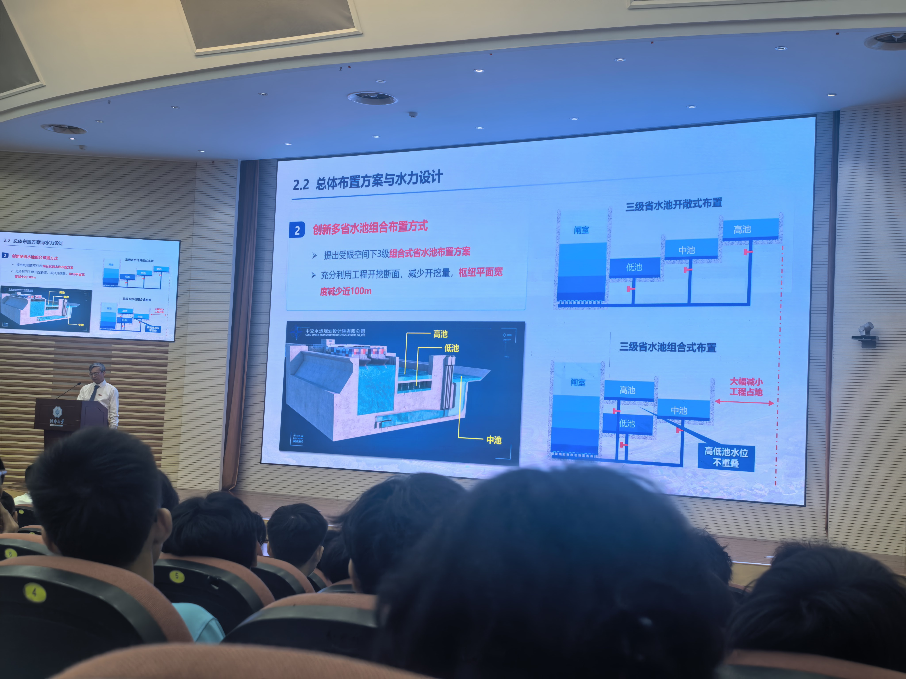
- **主标题**：2.2 总体布置方案与水力设计
- **正文**：创新多省水池组合布置方式；提出受限空间下3级组合式省水池布置方案；充分利用工程开挖断面，减少开挖量，枢纽平面宽度减少近100 m。
- **视觉**：三级省水池“开敞式”与“组合式”布置对比图、BIM三维模型。

### IMG_20260913_112555.jpg

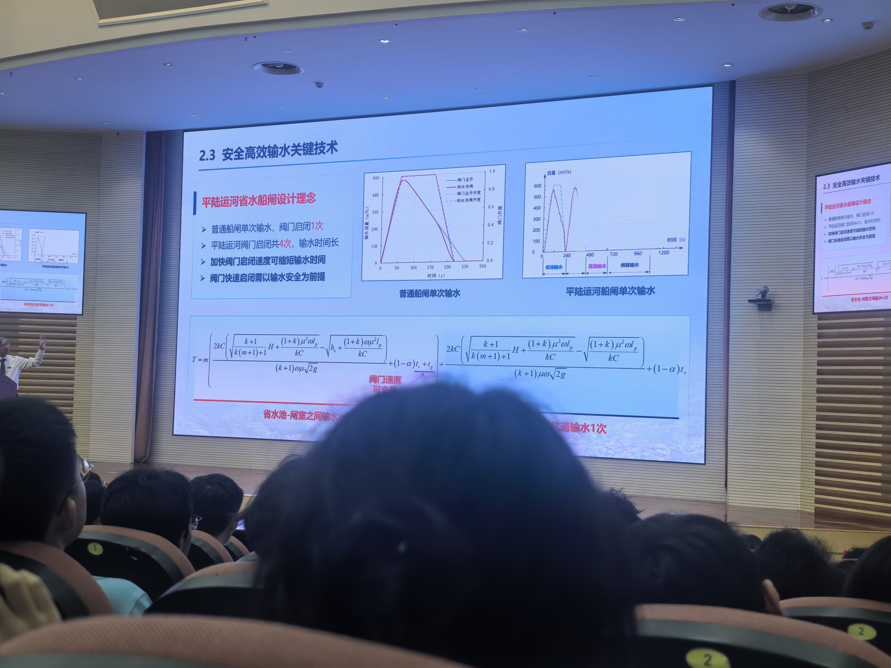
- **主标题**：2.3 安全高效输水关键技术
- **正文**：平陆运河省水船闸设计理念；普通船闸单次输水阀门启闭1次，平陆运河4次、输水时间长；加快阀门启闭速度可缩短输水时间，但需以输水安全为前提。
- **视觉**：普通船闸与平陆运河船闸单次输水曲线、输水历时计算公式。

### IMG_20260913_112633.jpg

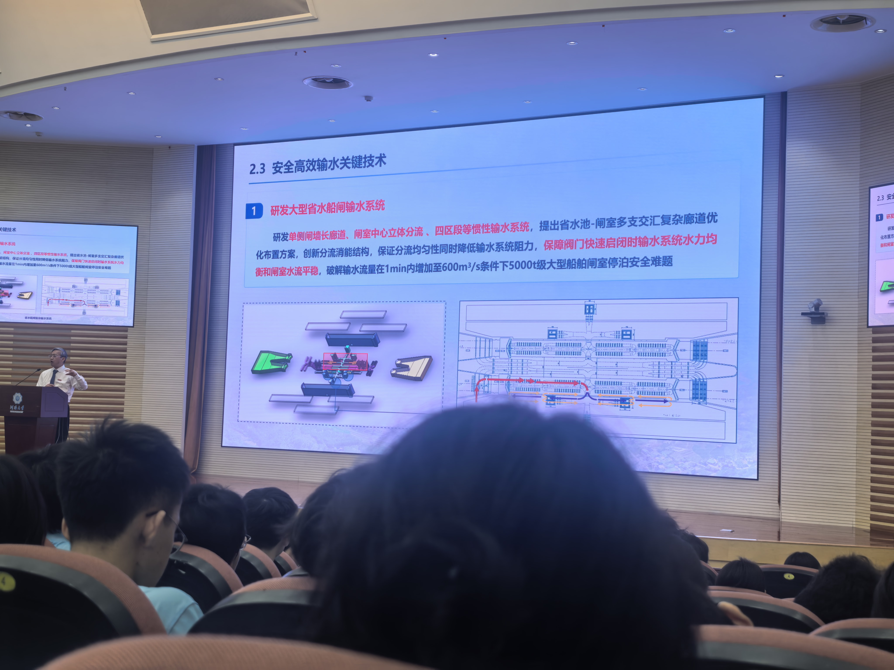
- **主标题**：2.3 安全高效输水关键技术（1）
- **正文**：研发大型省水船闸输水系统；单侧闸墙长廊道、闸室中心立体分流、四区段等惯性输水系统；提出省水池—闸室多支交汇复杂廊道优化布置；保证分流均匀性、降低阻力，保障快速启闭时水力均衡与闸室水流平稳；破解输水流量1 min内增至600 m³/s条件下5000 t级大型船舶闸室停泊安全难题。
- **视觉**：船闸输水系统平面与剖面技术图。

### IMG_20260913_112652.jpg

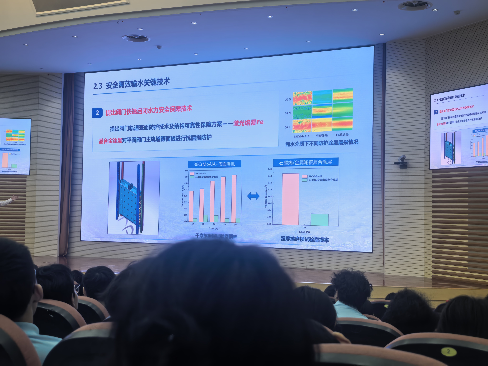
- **主标题**：2.3 安全高效输水关键技术（2）
- **正文**：提出阀门快速启闭水力安全保障技术；提出阀门轨道表面防护技术及结构可靠性保障方案——激光熔覆Fe基合金涂层，对平面闸门主轨道进行抗磨防护。
- **视觉**：涂层磨损对比柱状图、闸门轨道示意图。

### IMG_20260913_112747.jpg

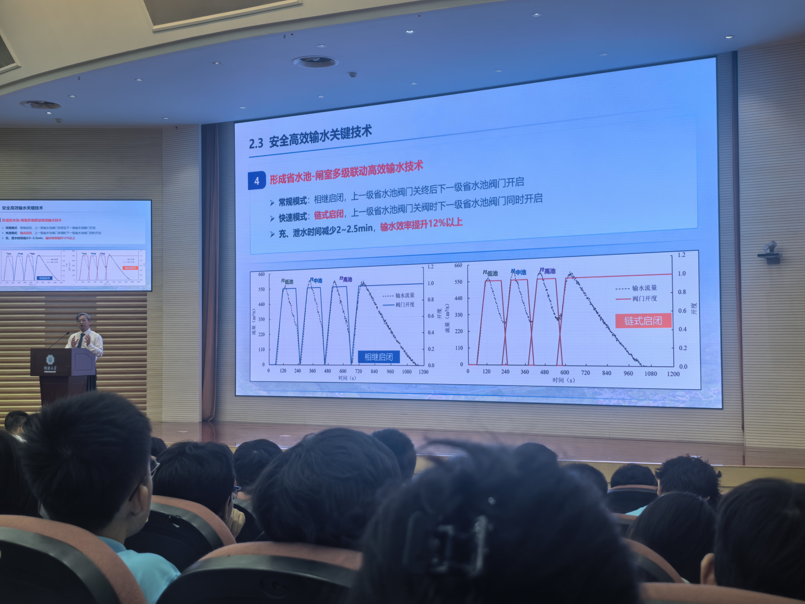
- **主标题**：2.3 安全高效输水关键技术（4）
- **正文**：形成省水池—闸室多级联动高效输水技术；常规模式“相继启闭”，快速模式“链式启闭”；充、泄水时间减少2–2.5 min，输水效率提升12%以上。
- **视觉**：相继启闭与链式启闭的流量—开度过程曲线对比。

### IMG_20260913_112808.jpg

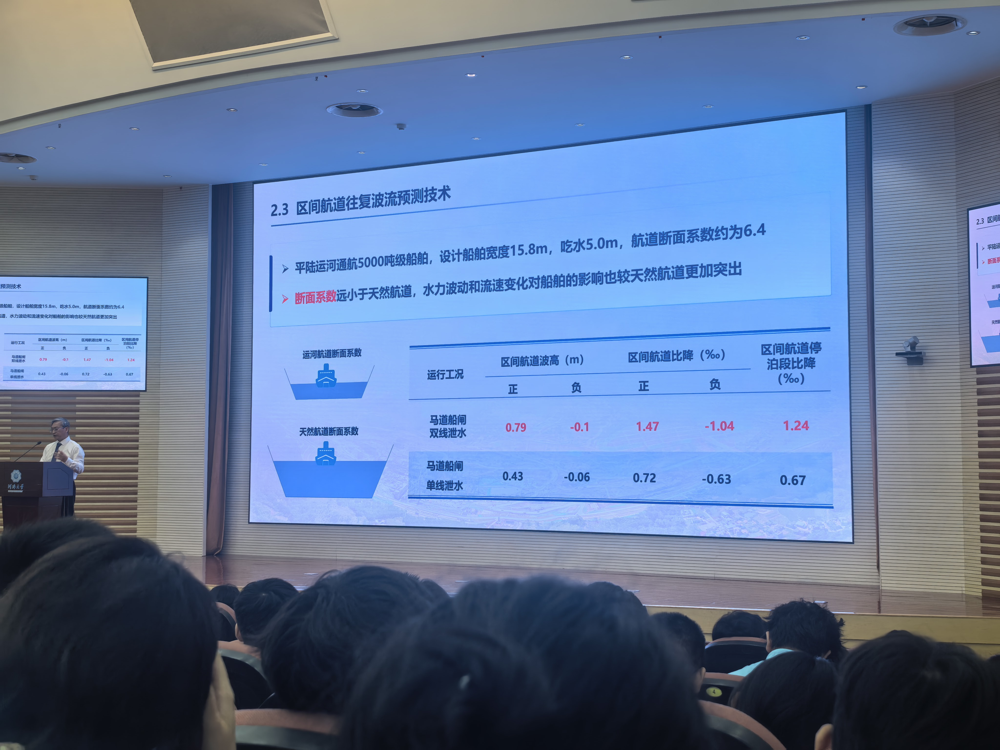
- **主标题**：2.3 区间航道往复波流预测技术
- **正文**：平陆运河通航5000吨级船舶，设计船宽15.8 m、吃水5.0 m，航道断面系数约6.4，远小于天然航道；水力波动和流速变化对船舶影响更突出。
- **视觉**：运河与天然航道断面系数对比、不同泄水工况下区间航道波高与比降数据表。

### IMG_20260913_112816.jpg

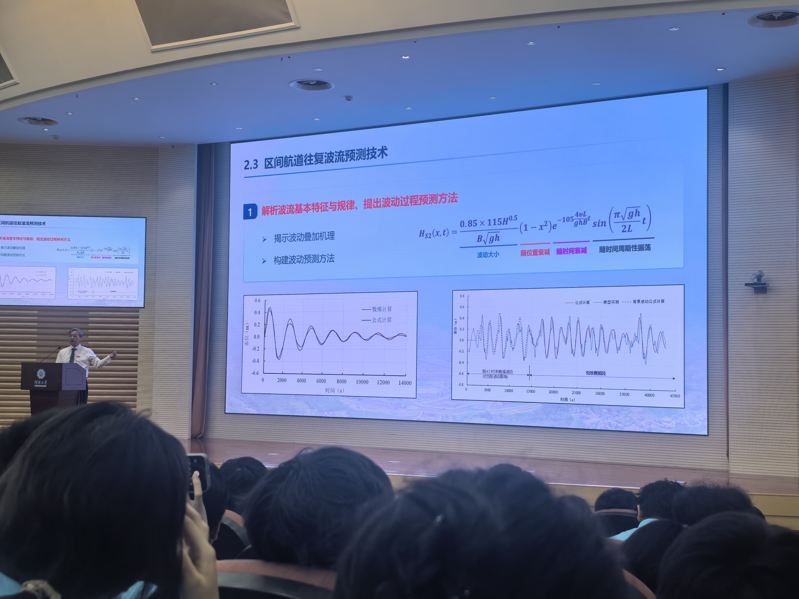
- **主标题**：2.3 区间航道往复波流预测技术（1）
- **正文**：解析波流基本特征与规律，提出波动过程预测方法；揭示波动叠加机理，构建波动预测方法。
- **视觉**：波动解析公式、数值计算与公式计算对比曲线。

### IMG_20260913_112855.jpg

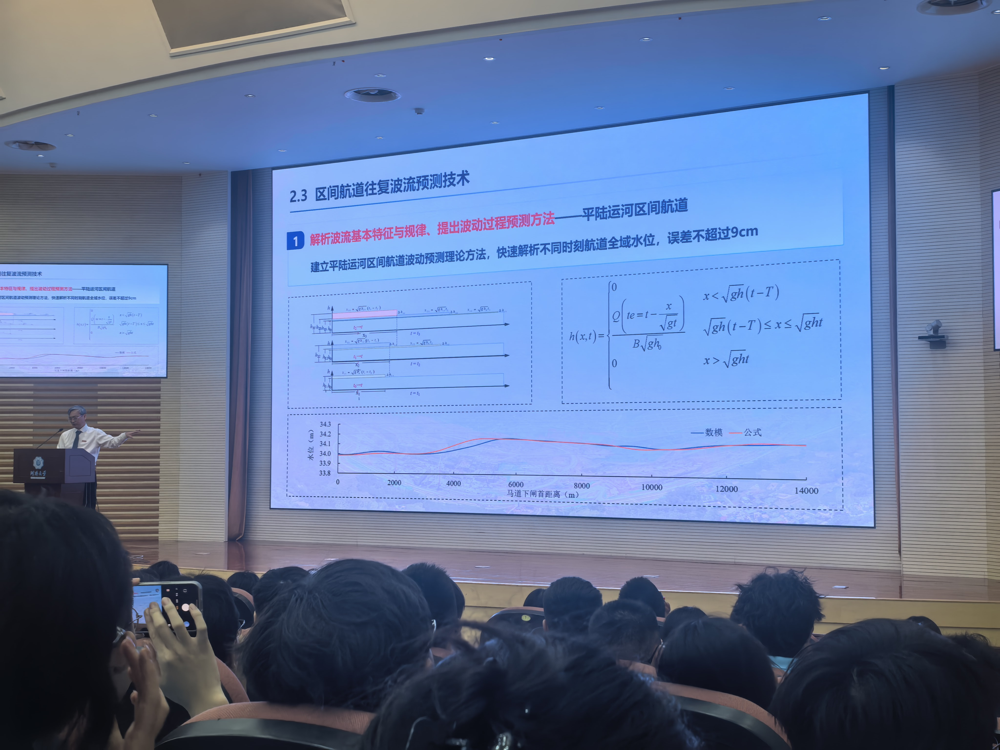
- **主标题**：2.3 区间航道往复波流预测技术
- **正文**：建立平陆运河区间航道波动预测理论方法，快速解析不同时刻航道全域水位。
- **关键数据**：误差不超过9 cm。
- **视觉**：分段函数公式、沿程水位波动对比图。

### IMG_20260913_112942.jpg

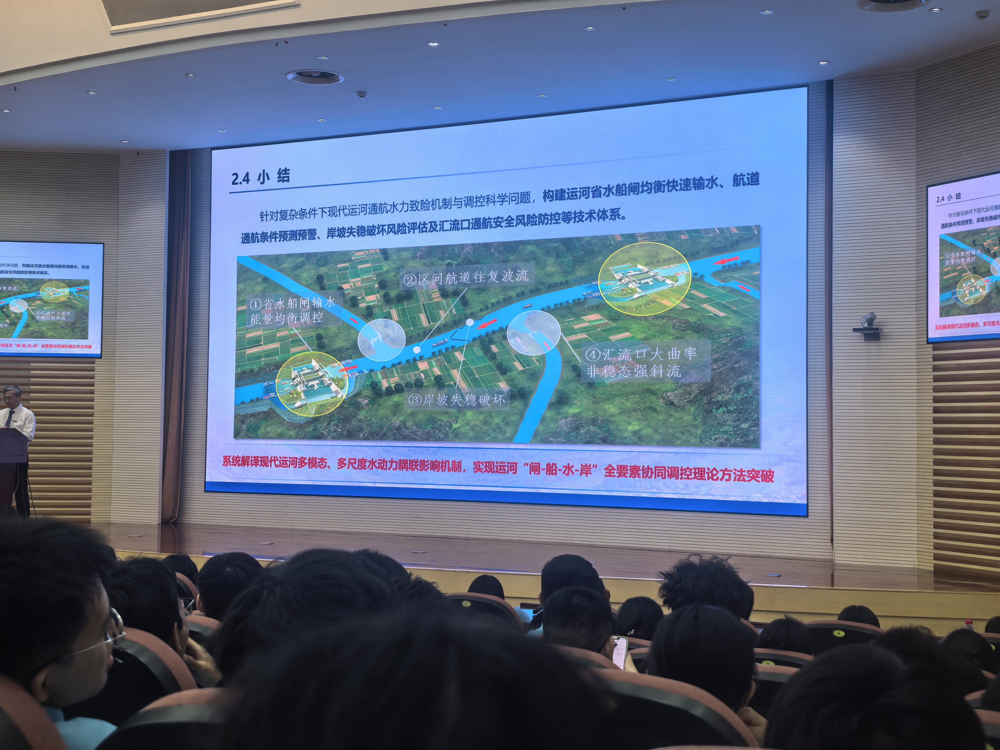
- **主标题**：2.4 小结
- **正文**：针对复杂条件下现代运河通航水力致险机制与调控科学问题，构建运河省水船闸均衡快速输水、航道通航条件预测预警、岸坡失稳破坏风险评估及汇流口通航安全风险防控等技术体系；系统解译“闸—船—水—岸”全要素协同调控理论方法突破。
- **视觉**：运河局部航拍与四个关键技术节点标注图。

### IMG_20260913_113101.jpg

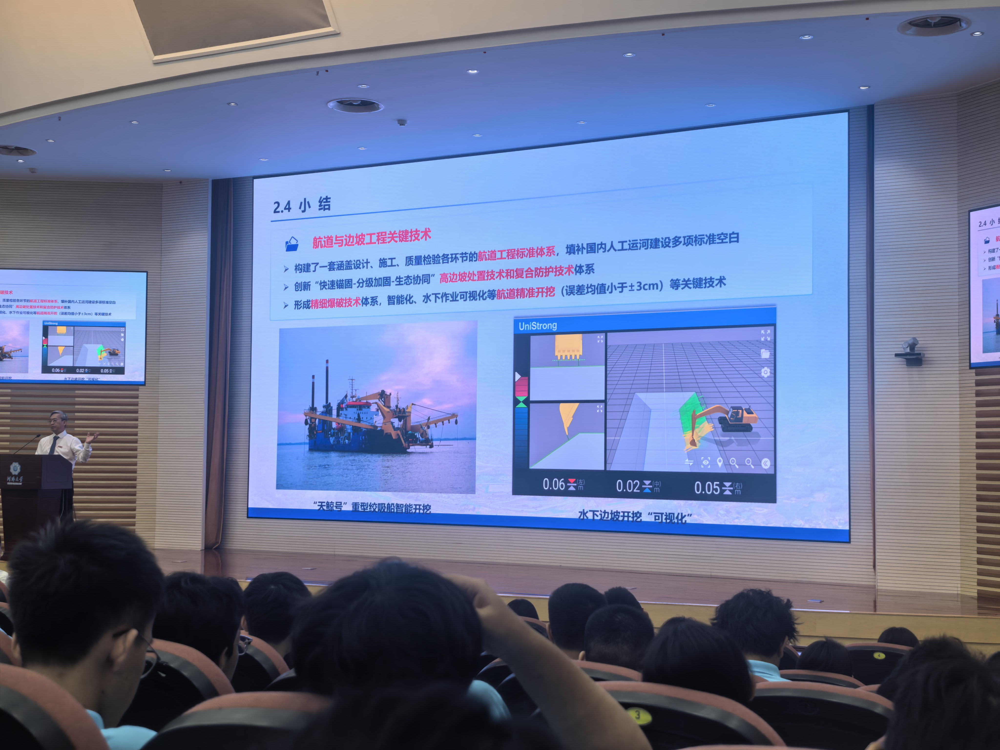
- **主标题**：2.4 小结——航道与边坡工程关键技术
- **正文**：构建涵盖设计、施工、质量检验各环节的航道工程标准体系，填补国内人工运河建设多项标准空白；创新“快速锚固—分级加固—生态协同”高边坡处置和复合防护技术体系；形成精细爆破、智能化、水下作业可视化等航道精准开挖技术。
- **关键数据**：误差均值小于±3 cm。
- **视觉**：“天鲸号”重型绞吸船智能开挖、水下边坡开挖“可视化”截图。

### IMG_20260913_113136.jpg

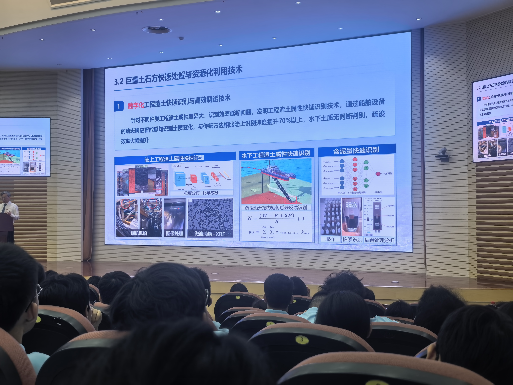
- **主标题**：3.2 巨量土石方快速处置与资源化利用技术（1）
- **正文**：数字化工程渣土快速识别与高效调运技术；针对不同种类工程渣土属性差异大、识别效率低等问题，发明工程渣土属性快速识别技术，通过船舶设备动态响应智能感知识别土质变化；陆上识别速度提升70%以上，水下土质无间断判别，疏浚效率大幅提升。
- **视觉**：相机抓拍、图像处理、微波消解+XRF、船载扭矩传感器、含泥量快速识别流程图。

### IMG_20260913_113239.jpg

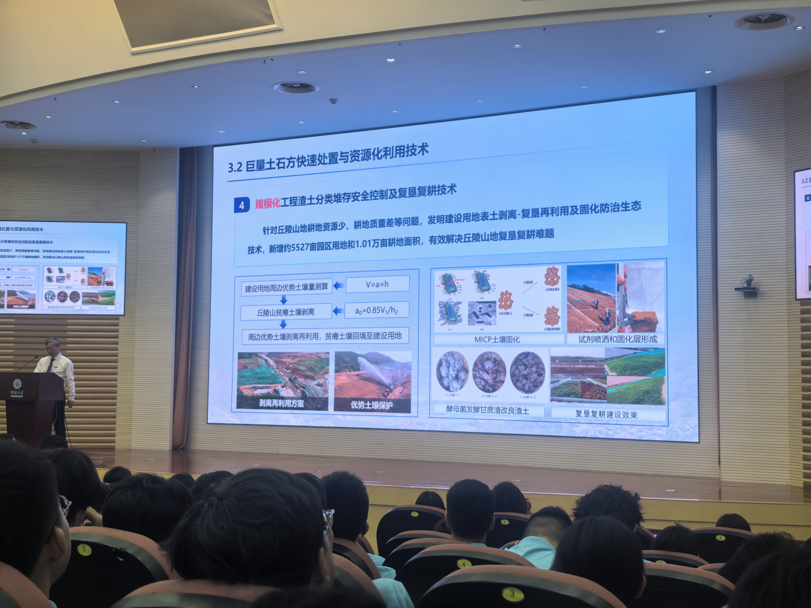
- **主标题**：3.2 巨量土石方快速处置与资源化利用技术（4）
- **正文**：规模化工程渣土分类堆存安全控制及复垦复耕技术；针对丘陵山地耕地资源少、耕地质量差等问题，发明建设用地表土剥离—复垦再利用及固化防治生态技术。
- **关键数据**：新增约5527亩园区用地和1.01万亩耕地面积，有效解决丘陵山地复垦复耕难题。
- **视觉**：表土剥离、MICP土壤固化、复垦复耕效果图。

### IMG_20260913_113334.jpg

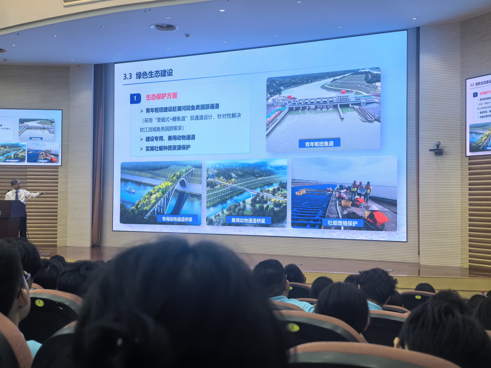
- **主标题**：3.3 绿色生态建设
- **正文**：生态保护方面——青年枢纽建设赶潮河段鱼类洄游通道，采用“竖缝式+鳗鱼道”双通道设计；建设专用、兼用动物通道；实施牡蛎种质资源保护。
- **视觉**：青年枢纽鱼道、专用/兼用动物通道桥梁、牡蛎增殖保护照片。

### IMG_20260913_113427.jpg

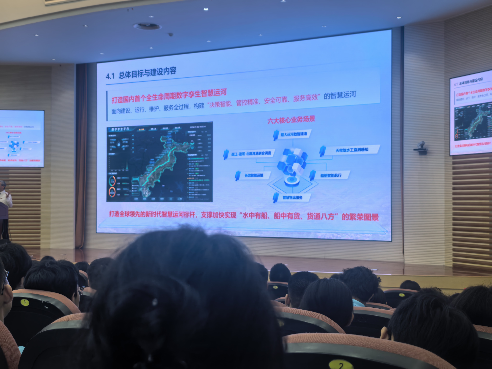
- **主标题**：4.1 总体目标与建设内容
- **正文**：打造国内首个全生命周期数字孪生智慧运河；面向建设、运行、维护、服务全过程，构建“决策智能、管控精准、安全可靠、服务高效”的智慧运河。
- **目标**：打造全球领先的新时代智慧运河标杆，支撑加快实现“水中有船、船中有货、货通八方”的繁荣愿景。
- **视觉**：数字孪生平台界面、六大核心业务场景（智慧建造、水文水工监测感知、船舶智能航行、智慧物流服务等）环形图。

### IMG_20260913_113500.jpg

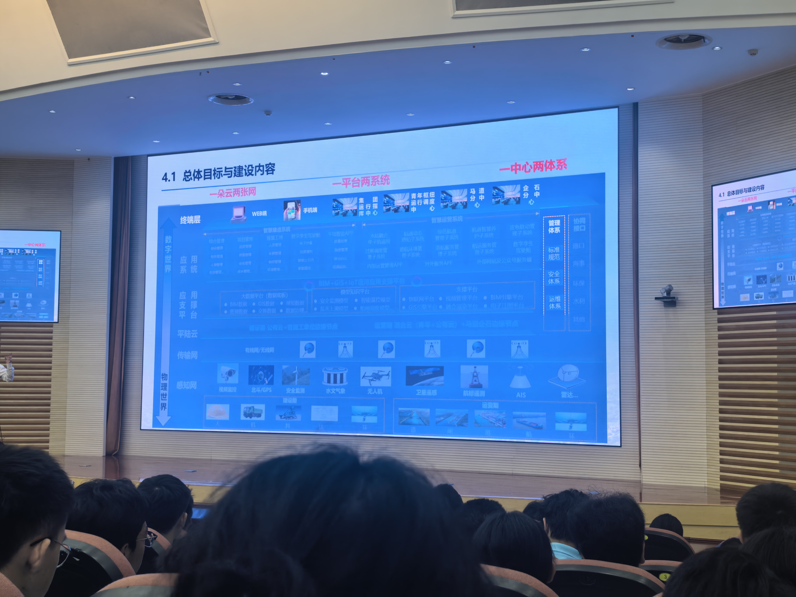
- **主标题**：4.1 总体目标与建设内容
- **正文**：智慧运河总体架构——“一朵云两张网、一平台两系统、一中心两体系”。
- **视觉**：物理世界—数字世界分层架构图（终端层、传输网、感知网、平台层、应用层、管理体系/标准规范/安全体系/运维体系）。

### IMG_20260913_113537.jpg

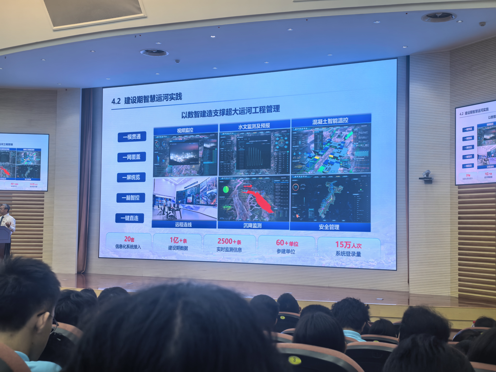
- **主标题**：4.2 建设期智慧运河实践
- **正文**：以数智建造支撑超大运河工程管理；实现“一横贯通、一网覆盖、一屏统览、一脑智控、一键直连”。
- **关键数据**：20套信息化系统接入、1亿+条建设期数据、2500+条实时监测信息、60+单位参建、15万人次系统登录量。
- **视觉**：视频监控、水文监测及预报、混凝土智能温控、远程连线、沉降监测、安全管理六大模块大屏。

### IMG_20260913_113613.jpg

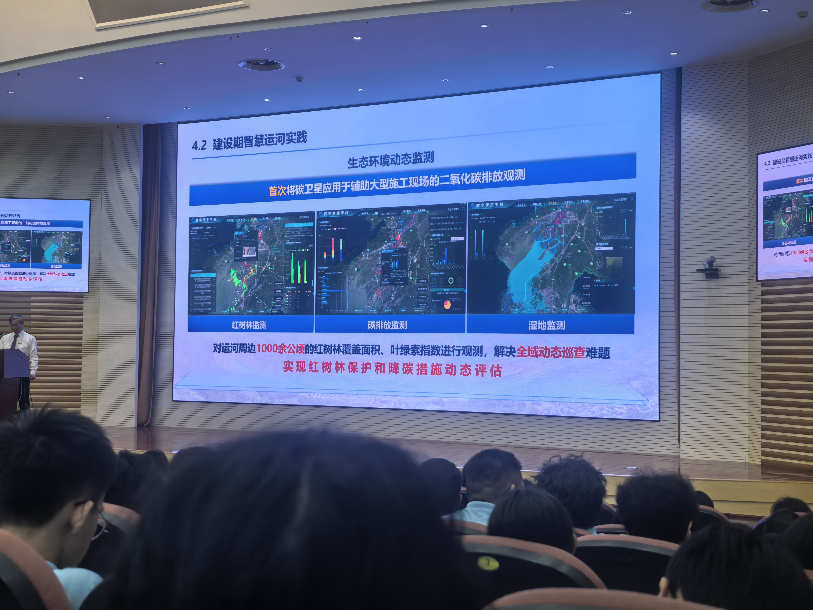
- **主标题**：4.2 建设期智慧运河实践——生态环境动态监测
- **正文**：首次将碳卫星应用于辅助大型施工现场的二氧化碳排放观测；对运河周边1000余公顷红树林覆盖面积、叶绿素指数进行观测，解决全域动态巡查难题，实现红树林保护和降碳措施动态评估。
- **视觉**：红树林监测、碳排放监测、湿地监测三屏卫星数据平台截图。

### IMG_20260913_113728.jpg

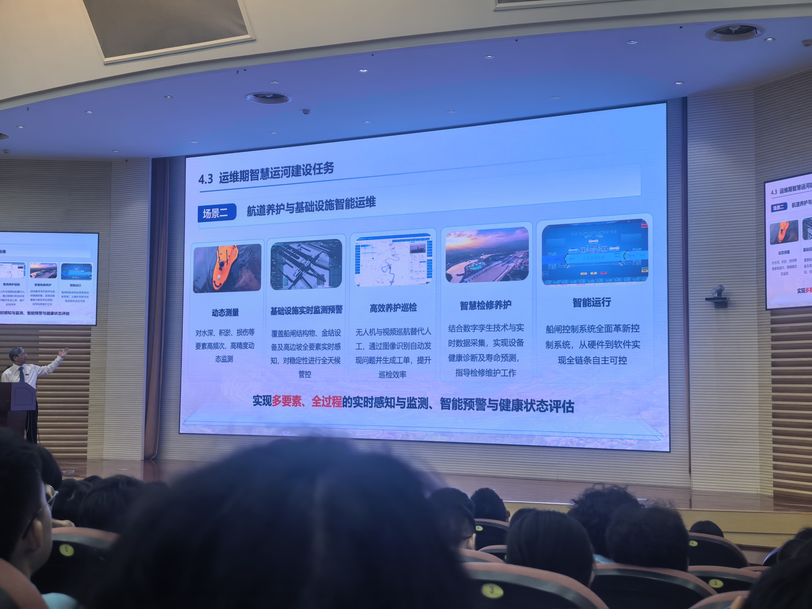
- **主标题**：4.3 运维期智慧运河建设任务（场景二）
- **正文**：航道养护与基础设施智能运维；动态测量、基础设施实时监测预警、高效养护巡检、智慧检修养护、智能运行；实现多要素、全过程的实时感知与监测、智能预警与健康状态评估。
- **视觉**：五个运维场景实景与系统界面拼图。

### IMG_20260913_113825.jpg

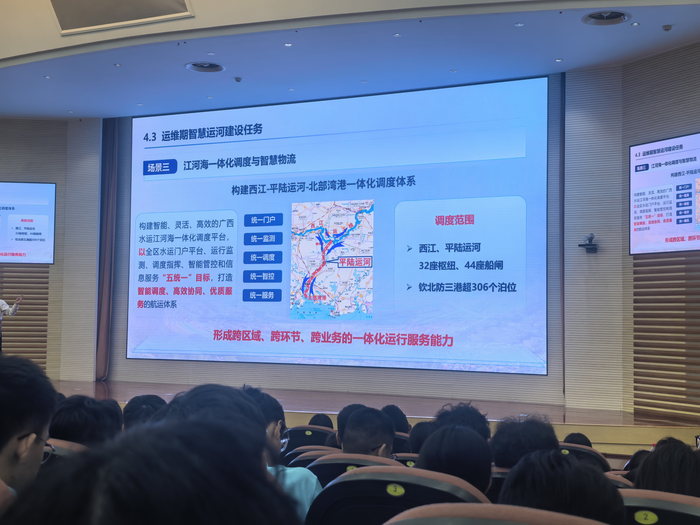
- **主标题**：4.3 运维期智慧运河建设任务（场景三）
- **正文**：江河海一体化调度与智慧物流；构建西江—平陆运河—北部湾港一体化调度体系；以全区水运水运门户平台、运行监测、调度指挥、智能管控和信息服务“五统一”目标，打造智能调度、高效协同、优质服务的航运体系。
- **调度范围**：西江、平陆运河，32座枢纽、44座船闸；钦北防三港超306个泊位。
- **目标**：形成跨区域、跨环节、跨业务的一体化运行服务能力。
- **视觉**：西江—平陆运河—北部湾港联运地图。

### IMG_20260913_114234.jpg

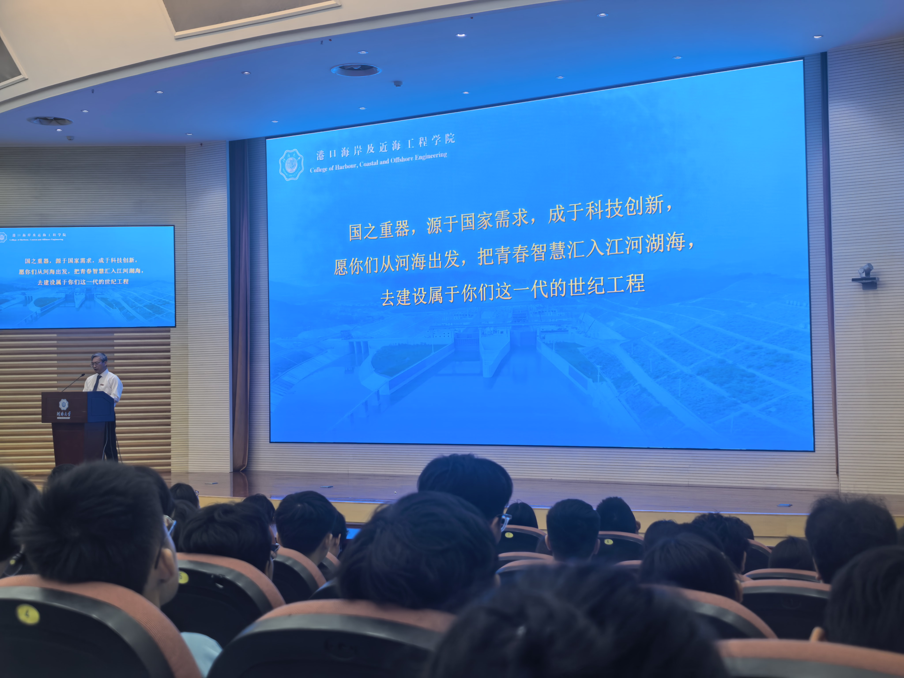
- **主标题**：结语寄语
- **寄语原文**：国之重器，源于国家需求，成于科技创新；愿你们从河海出发，把青春智慧汇入江河湖海，去建设属于你们这一代的世纪工程。
- **视觉**：蓝色结语屏与运河效果图，演讲人站在讲台前，全场新生聆听。

---

## 演讲逻辑大纲

1. **背景与战略意义**  
   国家综合立体交通网 → 内河水运战略地位 → 平陆运河工程概况
2. **技术挑战与攻关布局**  
   平陆运河六大技术特点 → 技术攻关体系（科研项目、示范应用、标准体系）
3. **核心工程技术创新**  
   通航建筑物选型 → 总体布置与水力设计 → 安全高效输水 → 区间航道波流预测 → 航道与边坡工程 → 土石方资源化利用 → 绿色生态建设
4. **智慧运河建设**  
   数字孪生总体目标与架构 → 建设期智慧实践 → 运维期智能调度与智慧物流
5. **结语寄语**  
   以“国之重器”勉励新生投身国家重大工程

---

## 核心内容要点

### 一、国家综合立体交通网与内河水运地位
- 国家综合交通网总里程已超600万公里，形成公路、铁路、水运“三位一体”物流网络。
- 我国内河货运量居全球第一，2025年内河货运总量71.34亿吨，占全球82.6%。
- 长江黄金水道货运量61.2亿吨，占全国85.79%、全球70.85%。
- “四纵四横两网”高等级航道流域经济带GDP占全国80%以上。

### 二、平陆运河工程概况
- 起于南宁横州西津库区平塘江口，经钦州灵山县陆屋镇入北部湾，全长**134.2 km**，总投资**727.19亿元**。
- 2022年8月开工，2026年9月建成通航。
- 功能多元：航运为主，兼顾供水、灌溉、防洪、改善水生态。
- 通航建筑物为**世界规模最大、水头最高的内河省水船闸**：水头29.64 m、闸室宽34 m、有效长度300 m，输水时间仍保持15 min。

### 三、六大技术特点
1. **省水船闸世界级难度**：输水流量、能量及变率远超巴拿马船闸。
2. **大尺度混凝土防裂与耐久**：船闸主体混凝土584.6万m³，单仓尺寸57 m×29.5 m×3 m。
3. **复杂地质与高边坡**：穿越丘陵、平原、滨海滩涂，最大边坡高度188 m。
4. **绿色低碳建设**：生态岸线、湿地疏浚、低影响穿越等技术挑战大。
5. **航道水力学复杂**：船闸充泄水在1 min内流量从零增至1200 m³/s，最大波高1.3 m，局部比降超1.8‰。
6. **全要素协同调控需求**：闸—船—水—岸多尺度水动力耦合。

### 四、关键技术创新
- **输水系统**：首创3级组合式省水池，枢纽平面宽度减少近100 m；单侧长廊道+闸室中心立体分流+四区段等惯性输水，保障5000 t级船舶停泊安全。
- **快速输水**：链式启闭技术使充泄水时间缩短2–2.5 min，效率提升12%以上。
- **耐磨防护**：激光熔覆Fe基合金涂层提高阀门轨道抗磨性能。
- **波流预测**：建立区间航道波动预测理论，全域水位误差≤9 cm。
- **边坡与航道**：航道精准开挖误差均值小于±3 cm，形成高标准航道工程标准体系。
- **土石方资源化**：数字化渣土识别效率提升70%以上；复垦新增5527亩园区用地、1.01万亩耕地。
- **生态保护**：竖缝式+鳗鱼道双通道鱼道、专用/兼用动物通道、牡蛎种质资源保护。

### 五、智慧运河
- 打造**国内首个全生命周期数字孪生智慧运河**。
- 建设期接入20+信息化系统、沉淀1亿+条数据、2500+条实时监测信息、60+参建单位、15万人次登录。
- 首次将碳卫星用于大型施工现场CO₂排放观测，监测1000余公顷红树林。
- 运维期构建西江—平陆运河—北部湾港一体化调度体系，覆盖32座枢纽、44座船闸、306个以上泊位。

---

## 重要数据与金句摘录

### 关键数据
- 国家综合交通网总里程：**>600万公里**
- 内河货运总量：**71.34亿吨**（占全球82.6%）
- 平陆运河长度/投资：**134.2 km / 727.19亿元**
- 船闸水头/闸室宽/有效长：**29.64 m / 34 m / 300 m**
- 船闸主体混凝土：**584.6万m³**
- 最大边坡高度：**188 m**
- 波流预测误差：**≤9 cm**
- 航道开挖误差均值：**<±3 cm**
- 新增耕地/园区用地：**1.01万亩 / 5527亩**
- 智慧运河建设期数据：**1亿+条**
- 碳卫星监测红树林面积：**1000余公顷**

### 金句
> “国之重器，源于国家需求，成于科技创新。”

> “愿你们从河海出发，把青春智慧汇入江河湖海，去建设属于你们这一代的世纪工程。”

---

## 视觉亮点

- **宏观地图与数据图**：国家立体交通网主骨架、长江经济带GDP与货运量对比、世界河流货运量对比表。
- **超级工程航拍**：三峡五级船闸、大藤峡、长洲四线船闸、京杭运河三线船闸、平陆运河高边坡与航道。
- **技术原理动画/示意图**：省水池开敞式与组合式布置、船闸输水系统立体分流、相继启闭与链式启闭流量曲线。
- **BIM与数字平台**：数字孪生智慧运河架构、建设期“一屏统览”大屏、碳卫星红树林监测界面。
- **生态与施工照片**：鱼道与动物通道桥梁、“天鲸号”智能疏浚、水下边坡可视化、牡蛎增殖保护。
- **结束寄语屏**：蓝色运河效果图搭配对新生的人文勉励。

---

## 个人思考与感悟

这场报告让我第一次如此直观地感受到“国家重大工程”四个字背后的分量。平陆运河不只是134公里的河道，它把西江与北部湾直接相连，把内陆腹地与国际海运打通，更把水利、交通、生态、材料、信息技术等多学科熔于一炉。胡亚安院士用一组组对比数据告诉我：中国的内河船闸技术已经从“跟跑”走向“领跑”，而领跑的代价是无数个“世界之最”必须被一一破解——29.64米水头、584万方混凝土、188米高边坡、每分钟1200立方米流量的剧烈波动。没有一项创新是孤立的，省水池布置、阀门快速启闭、波流预测、数字孪生，它们彼此咬合，构成了现代运河工程的系统解法。

作为河海大学的新生，我最大的触动来自结尾那句“愿你们从河海出发，把青春智慧汇入江河湖海”。报告里有高铁、有船闸、有碳卫星，但核心始终是“人”——是工程师在工地日夜攻关，是科研团队在模型里反复推演，是建设者把渣土变成耕地、把扰动区变成生态廊道。这让我意识到，大学四年的意义不只是学好水力学或结构力学，更是培养把国家需求转化为工程方案的能力。未来无论我走向航道设计、智能建造还是生态保护，我都希望自己能参与到“这一代人的世纪工程”中，把图纸上的线条变成江河里的通途。
