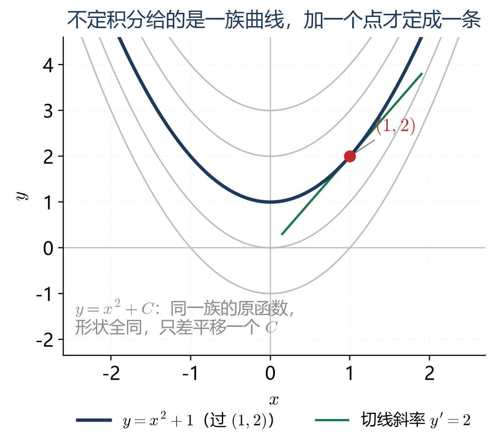
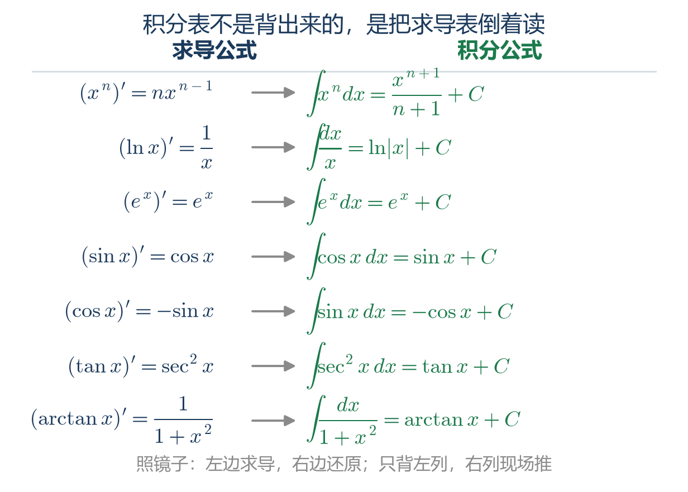
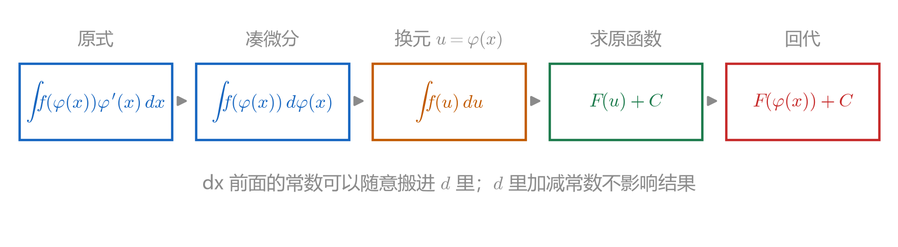

# 高等数学例题整理 · 不定积分（按题型分类）

本题集来自 2026-11-22 的手写笔记 4 页，覆盖 §4.1 不定积分的概念、基本积分表，§4.2 不定积分的性质，§4.3 第一换元积分法（凑微分法），共 **17 道题**。原笔记按课堂顺序书写，这里按**方法**重新归并：同一题型下集中呈现"题目 → 思路 → 解答 → 结论 → 知识点 → 批注"。

这一章和第二章的关系是倒过来的：第二章给函数求导数，第四章给导数找函数。所以整章的底层逻辑只有一句——**积分表就是把求导表倒着读**，剩下的全是变形技巧。

## 题源与题型地图

17 道题收进四类问题：**原函数与不定积分的概念**（题型一至二）、**基本积分表与幂函数**（题型三）、**先变形再逐项积分**（题型四至六）、**凑微分法**（题型七至八）。

| 题型 | 主题 | 核心方法 | 对应例题 |
|---|---|---|---|
| 一 | 由求导公式倒着读 | 找"谁的导数等于它"，末尾补 $C$ | 例 1、例 2 |
| 二 | 已知 $y'$ 与一点求曲线 | 先积出 $y=F(x)+C$，再代点定 $C$ | 例 3 |
| 三 | 幂函数积分 | 根式、分式统一写成 $x^{\mu }$，套 $\dfrac{x^{\mu +1}}{\mu +1}$ | 例 4、例 5、例 6 |
| 四 | 展开、除开后逐项积分 | 假分式先做带余除法，再拆成幂的和 | 例 7、例 8、例 9 |
| 五 | 三角恒等式 | 降次、化切为割、半角凑倍角 | 例 10、例 11、例 12 |
| 六 | 指数函数 | 并成一个底，或按线性性质拆项 | 例 13、例 14 |
| 七 | 一次式的凑微分 | 把系数搬进 $d$ 里，凑成 $\int \dfrac{du}{u}$ 型 | 例 15、例 16 |
| 八 | 换元后约成幂 | 令 $u=x+a$，展开、约分、回代 | 例 17 |

> [!info] 阅读约定
> 每题末尾的「批注」框记录原手写笔记中的**笔误、跳步与记号问题**，并给出正确写法；「知识点」只列本题真正用到的工具，不做百科式罗列。所有结果都可以用一句话自查：**把答案求导，能不能回到被积函数**。

## 一、原函数与不定积分的概念

这一节的题几乎不用算，考的是"概念清不清楚"。原笔记的引例只有一行：$(\sin x)'=\cos x$，反过来问"谁的导数是 $\cos x$"，答案 $\sin x+C$。**求不定积分就是求导的逆过程**，这一句立住了，后面的公式全都是查表。

### 题型一 由求导公式倒着读：找"谁的导数等于它"

已知某个函数的导数是 $f(x)$，要写 $\int f(x)dx$，做法只有两步：先认出那个"某函数"，再补 $C$。幂函数靠"指数加一、系数取倒数"，对数靠分段验证。

#### 例 1 · 求 ∫x²dx：指数加一，系数取倒数

**题目**

求 $\int x^{2}dx$。

**思路**

幂函数求导降一次幂：$(x^{3})'=3x^{2}$。现在要的是系数 1 而不是 3，把 3 除掉即可——$\left(\dfrac{1}{3}x^{3}\right)'=x^{2}$。原函数不唯一（加任何常数导数都不变），所以最后必须写 $+C$。

**解答**

$$
(x^{3})'=3x^{2}\ \Longrightarrow\ \left(\frac{1}{3}x^{3}\right)'=x^{2}
$$
$$
\therefore\ \int x^{2}dx=\frac{1}{3}x^{3}+C
$$

**结论**

推广一步：$\mu \neq -1$ 时
$$
\int x^{\mu }dx=\frac{x^{\mu +1}}{\mu +1}+C
$$
口诀是"指数加一，系数取倒数"。$\mu =-1$ 单独成一条（见例 2），因为分母会变成 0。

**知识点**

- 原函数定义：$F'(x)=f(x)$，则 $F$ 是 $f$ 的一个原函数
- 不定积分是**全体**原函数，所以 $C$ 不可省
- 幂函数积分公式（$\mu \neq -1$）

> [!note] 批注
> ① 原笔记先写 $(x^{n})'=nx^{n-1}$ 作铺垫，再举 $\left(\frac{1}{3}x^{3}\right)'=x^{2}$，这个顺序对：**先摆求导公式，再倒着用**。② 结果里的 $C$ 原笔记写得很小、贴着 $x^{3}$ 的右下角，远看像指数的一部分，抄录时以"$+\ C$ 是加在整个式子后面"为准。③ 原笔记没写"$C$ 表示全体原函数"这句话，概念题里这句常常是得分点，整理时补进结论。

#### 例 2 · 求 ∫dx/x：为什么要写绝对值

**题目**

求 $\int \dfrac{dx}{x}$。

**思路**

$x>0$ 时 $(\ln x)'=\dfrac{1}{x}$，直接可用；但 $x<0$ 时 $\ln x$ 没有定义，得换 $\ln(-x)$，此时链式法则多出一个 $-1$，正好把分母的负号消掉，导数仍是 $\dfrac{1}{x}$。两支合起来写成 $\ln|x|$。

**解答**

$$
\left(\ln x\right)'=\frac{1}{x}\quad (x>0),\qquad \left(\ln(-x)\right)'=\frac{1}{-x}\cdot(-1)=\frac{1}{x}\quad (x<0)
$$
$$
\therefore\ \int \frac{dx}{x}=\ln|x|+C
$$

**结论**

$\ln|x|$ 是把 $x>0$ 与 $x<0$ 两支拼起来的写法，不是"顺手加的绝对值"。基本积分表里只有这一条带绝对值，其余公式都不需要。

**知识点**

- 分段验证原函数（$x>0$ 与 $x<0$ 各算一遍）
- 链式法则：$(\ln(-x))'=\dfrac{1}{-x}\cdot(-1)$
- $\ln|x|$ 的定义域是 $x\neq 0$

> [!note] 批注
> ① 原笔记在 $(\ln(-x))'$ 后面直接写 $\dfrac{1}{x}$，中间省略了乘 $(-1)$ 这一步——这一步恰恰是本题的关键，不能省。② 原笔记把答案 $\ln|x|+C$ 框了起来，说明当时在强调绝对值；抄录时别把方框误读成取整符号。③ 原笔记在分母上先写 $\overline{x}$ 又补一道斜杠，是涂改痕迹，不是"平均"的意思。

### 题型二 已知 y' 与一点：从一族里挑出一条

不定积分给的是**一族**曲线，条件里给一个点，就能定下常数、挑出唯一一条。这类题在物理里就是"已知速度求位移、再代初始位置"。

#### 例 3 · 过 (1,2) 且 y'=2x：定常数 C

**题目**

已知曲线过点 $(1,2)$，且曲线上每点处的切线斜率为 $2x$，求曲线方程。

**思路**

斜率是 $2x$，说明 $y$ 是 $2x$ 的一个原函数：$y=x^{2}+C$，这是一族开口向上、顶点在 $y$ 轴上滑动的抛物线。把 $(1,2)$ 代进去解出 $C$。

**解答**

$$
y=\int 2x\,dx=x^{2}+C
$$
代入 $x=1$、$y=2$：
$$
2=1+C\ \Longrightarrow\ C=1
$$
$$
\therefore\ y=x^{2}+1
$$

**结论**

"不定积分 + 一个点 = 一条曲线"。几何上就是从上下平移的一族里挑出过该点的那条；代数上就是一个方程定一个未知常数。若再给一个条件（比如某点的导数值），还能继续定更高阶的常数。

**知识点**

- 先积分得通解，再代点得特解
- 原函数族的几何意义：形状相同、上下平移
- $\int 2x\,dx=x^{2}+C$ 是例 1 公式在 $\mu =1$ 时的特例

> [!note] 批注
> ① 原笔记写"解：$y=x^{2}+C$"，$C$ 的位置压在 $x^{2}$ 的右下方，容易被误读成 $x^{2+C}$；建议写成 $x^{2}+C$ 且留出间距。② 原笔记末行把"$y'=2x$"与"$y=x^{2}+C$"并排写，中间没有积分号，严格写法是 $y=\int 2x\,dx$；考试中直接写等式会被扣"跳步"。③ 原笔记"$\therefore y=x^{2}+1$"这一行的等号被涂改过一次，先把 $C=1$ 写成 $C=0$ 再改，抄录时以最终结果为准。

*图 1　同一条抛物线上下平移得到整族原函数；加上"过 $(1,2)$"这一个条件，就只剩加粗的那一条，而它在该点的切线斜率恰好是 $2x$ 在 $x=1$ 处的值 2。*

## 二、基本积分表与幂函数

基本积分表一共十几条，硬背性价比极低。**把它当成求导表倒着读**：每一行积分公式，右边都能找到一条对应的求导公式，唯一的变化是"求导降幂、积分升幂"以及末尾那个 $C$。

*图 2　左边是七条必背求导公式，右边是它们倒过来读的样子。记忆时只背左列，右列现场推；考试中真正容易错的不是公式本身，而是 $n=-1$ 那条要单独记成 $\ln|x|$。*

原笔记把这张表抄成 13 条，另加四条性质：
$$
\frac{d}{dx}\int f(x)dx=f(x),\qquad d\int f(x)dx=f(x)dx,\qquad \int F'(x)dx=F(x)+C,\qquad \int df(x)=f(x)+C
$$
最后一条的用法是"看到 $df(x)$ 就直接还原"，例如 $\int dx=x+C$（把 $f(x)$ 取成 $x$）。

### 题型三 幂函数：先把根式和分式统一写成幂

幂函数积分的唯一门槛是**形式统一**：$x^{3}$ 好办，$\dfrac{1}{x^{3}}$、$x\sqrt{x}$、$\dfrac{1}{x\sqrt[3]{x}}$ 都得先写成 $x^{\mu }$，否则套不进公式。

#### 例 4 · ∫dx/x³：负指数照公式走

**题目**

求 $\int \dfrac{dx}{x^{3}}$。

**思路**

$\dfrac{1}{x^{3}}=x^{-3}$，$\mu =-3$，指数加一得 $-2$，系数取倒数得 $-\dfrac{1}{2}$。指数是 $-3$ 而不是 $-1$，所以**不是** $\ln$。

**解答**

$$
\int \frac{dx}{x^{3}}=\int x^{-3}dx=\frac{x^{-2}}{-2}+C=-\frac{1}{2x^{2}}+C
$$

**结论**

负指数的结果一定还是负指数，别把 $-\dfrac{1}{2x^{2}}$ 写成 $-\dfrac{1}{2}x^{2}$。自查一下：$\left(-\dfrac{1}{2}x^{-2}\right)'=(-2)\cdot\left(-\dfrac{1}{2}\right)x^{-3}=x^{-3}$，回到被积函数，说明没错。

**知识点**

- $\dfrac{1}{x^{n}}=x^{-n}$
- 公式 $\dfrac{x^{\mu +1}}{\mu +1}$ 对负的 $\mu$ 同样成立（$\mu \neq -1$）
- 求导自查法

> [!note] 批注
> ① 原笔记中间那步写成 $\dfrac{x^{-2}}{-2}$，负号跟着分母走，远看像"除以 2"；建议直接写 $-\dfrac{1}{2}x^{-2}$，后面几步连乘时不容易丢符号。② 原笔记末行 $-\dfrac{1}{2x^{2}}+C$ 里的 $C$ 是后补的，墨色更浅，说明当时先写完答案才想起补常数。③ 原笔记没写"为什么不是 $\ln$"这一句，而这是本题唯一可能踩的坑，整理时补进思路。

#### 例 5 · ∫x√x dx：分数指数

**题目**

求 $\int x\sqrt{x}\,dx$。

**思路**

$x\cdot x^{1/2}=x^{3/2}$，$\mu =\dfrac{3}{2}$，指数加一得 $\dfrac{5}{2}$，系数取倒数是 $\dfrac{2}{5}$。

**解答**

$$
\int x\sqrt{x}\,dx=\int x^{3/2}dx=\frac{2}{5}x^{5/2}+C
$$

**结论**

结果可以写回根式：$\dfrac{2}{5}x^{2}\sqrt{x}$。分数指数的加法和整数一样，只是要通分：$\dfrac{3}{2}+1=\dfrac{5}{2}$。

**知识点**

- $\sqrt{x}=x^{1/2}$，$x^{a}x^{b}=x^{a+b}$
- 分数指数的加法要先通分
- 结果写成 $x^{5/2}$ 或 $x^{2}\sqrt{x}$ 都算对

> [!note] 批注
> ① 原笔记把 $\dfrac{3}{2}$ 写在 $x$ 的右上角偏高位置，远看像 $x^{5/2}$；抄录时以"$1+\frac{1}{2}=\frac{3}{2}$"为准。② 原笔记 $\dfrac{2}{7}x^{7/2}$ 与 $\dfrac{2}{5}x^{5/2}$ 在本页都出现过（前者是例 7），两个系数长得很像，回看时别串行。③ 原笔记这一步没有写中间式 $\int x^{3/2}dx$，直接跳到结果，考试中要补这一步。

#### 例 6 · ∫dx/(x∛x)：指数 −4/3

**题目**

求 $\int \dfrac{dx}{x\sqrt[3]{x}}$。

**思路**

分母 $x\cdot x^{1/3}=x^{4/3}$，被积函数是 $x^{-4/3}$。$\mu =-\dfrac{4}{3}$，加一得 $-\dfrac{1}{3}$，系数取倒数得 $-3$。

**解答**

$$
\int \frac{dx}{x\sqrt[3]{x}}=\int x^{-1}\cdot x^{-1/3}dx=\int x^{-4/3}dx=\frac{x^{-1/3}}{-1/3}+C=-3x^{-1/3}+C
$$

**结论**

写成根式是 $-\dfrac{3}{\sqrt[3]{x}}+C$。判断要不要用 $\ln$ 的唯一标准是：$\mu +1$ 是否等于 0，也就是 $\mu$ 是否等于 $-1$。$-4/3$ 不是 $-1$，照公式走。

**知识点**

- $\sqrt[3]{x}=x^{1/3}$，$\dfrac{1}{x\sqrt[3]{x}}=x^{-4/3}$
- $\mu =-4/3$ 时 $\mu +1=-1/3$，取倒数得 $-3$
- "要不要用 $\ln$"只看 $\mu$ 是否为 $-1$

> [!note] 批注
> ① 原笔记末行只写到 $-3x^{-1/3}$ 就收笔，**漏了 $+C$**；不定积分漏常数等于答案错，这是本批最硬的一处笔误。② 原笔记在 $\int x^{-4/3}$ 前面多写了一个积分号，出现了 $\int\int$ 的重复，是涂改没擦干净。③ 原笔记把 $-1/3$ 的分母写成一行，与指数 $-1/3$ 几乎同形，建议写成 $\dfrac{x^{-1/3}}{-1/3}$ 并加括号。

## 三、先变形，再逐项积分

基本积分表只认"幂、指数、三角"这几种标准形，遇到乘积、商、平方就积不动。这一节的八道题全是同一个思路：**先用代数或三角恒等式把被积函数改成标准形的和**，再逐项套表。用的核心性质只有两条：
$$
\int \left[f(x)\pm g(x)\right]dx=\int f(x)dx\pm \int g(x)dx,\qquad \int kf(x)dx=k\int f(x)dx
$$
原笔记把这两条叫"不定积分的性质"，并且强调了一句：**能拆就拆，拆完再算**。

### 题型四 展开、除开：把积化成幂的和

看到"多项式乘多项式""多项式除以多项式""分子次数不低于分母"，第一反应都是展开或做除法，把被积函数变成一串幂函数。

#### 例 7 · ∫√x(x²−5)dx：乘开后逐项积

**题目**

求 $\int \sqrt{x}\left(x^{2}-5\right)dx$。

**思路**

把 $\sqrt{x}$ 乘进括号：$x^{5/2}-5x^{1/2}$，两项都是幂函数，逐项套公式，常数 5 提到积分号外。

**解答**

$$
\int \sqrt{x}\left(x^{2}-5\right)dx=\int \left(x^{5/2}-5x^{1/2}\right)dx=\int x^{5/2}dx-5\int x^{1/2}dx
$$
$$
=\frac{2}{7}x^{7/2}-5\cdot\frac{2}{3}x^{3/2}+C=\frac{2}{7}x^{7/2}-\frac{10}{3}x^{3/2}+C
$$

**结论**

这类题没有技巧，就是"乘开 + 查表"。注意两个系数不要写混：$x^{5/2}$ 对应 $\dfrac{2}{7}$，$x^{1/2}$ 对应 $\dfrac{2}{3}$，指数越大系数分母越大。

**知识点**

- 分配律把积化成和
- 线性性质：$\int (f-g)=\int f-\int g$，$\int kf=k\int f$
- 分数指数运算法则

> [!note] 批注
> ① 原笔记第二行把被积函数写成 $\left(\sqrt{x}\cdot x^{2}-5\sqrt{x}\right)$，$5$ 后面那个 $\sqrt{x}$ 一度被涂掉又补上，抄录时按"$5\sqrt{x}$"理解。② 原笔记最后一项停在 $5\cdot\dfrac{2}{3}x^{3/2}$，没有乘成 $\dfrac{10}{3}$，正式作答要化到最简。③ 原笔记的 $+C$ 是用红笔后加的，还画了圈；这笔加得对，但不能只加在最后一项上——$C$ 属于整个式子。

#### 例 8 · ∫(x−1)³/x² dx：分子展开后逐项除

**题目**

求 $\int \dfrac{(x-1)^{3}}{x^{2}}dx$。

**思路**

分子是三次式、分母是二次式，直接除不干净，先把分子展开成 $x^{3}-3x^{2}+3x-1$，再逐项除以 $x^{2}$，得到 $x-3+\dfrac{3}{x}-\dfrac{1}{x^{2}}$ 四项——全是标准形。

**解答**

$$
\frac{(x-1)^{3}}{x^{2}}=\frac{x^{3}-3x^{2}+3x-1}{x^{2}}=x-3+\frac{3}{x}-\frac{1}{x^{2}}
$$
$$
\int \left(x-3+\frac{3}{x}-\frac{1}{x^{2}}\right)dx=\frac{1}{2}x^{2}-3x+3\ln|x|+\frac{1}{x}+C
$$

**结论**

两个易错点：$\int \dfrac{3}{x}dx=3\ln|x|$（不是 $\dfrac{3}{x}\ln|x|$，也不是 $\ln|3x|$）；$\int \left(-\dfrac{1}{x^{2}}\right)dx=+\dfrac{1}{x}$（两个负号相乘）。整道题只有 $\dfrac{1}{x}$ 那一项产生 $\ln$。

**知识点**

- 二项式展开 $(a-b)^{3}=a^{3}-3a^{2}b+3ab^{2}-b^{3}$
- $\int x^{-2}dx=-x^{-1}$
- $\int \dfrac{dx}{x}=\ln|x|$（例 2）

> [!note] 批注
> ① 原笔记把 $\int \left(-\dfrac{1}{x^{2}}\right)dx=+\dfrac{1}{x}$ 这一步直接写好，中间没有任何过渡，读者容易以为抄错了符号；整理稿补上"两个负号相乘"的说明。② 原笔记 $3\ln|x|$ 中间那个乘号写得像逗号，注意是乘法不是列举。③ 原笔记把四项拆开时，$-\dfrac{1}{x^{2}}$ 的负号写在分数线左侧偏上，容易读成指数上的负号，抄录时以"整项为负"为准。

#### 例 9 · ∫(2x⁴+x²+3)/(x²+1)dx：假分式先做除法

**题目**

求 $\int \dfrac{2x^{4}+x^{2}+3}{x^{2}+1}dx$。

**思路**

分子 4 次、分母 2 次，是**假分式**，先做带余除法，把它变成"多项式 + 真分式"。凑法：$2x^{4}+x^{2}+3=2x^{2}\left(x^{2}+1\right)-\left(x^{2}+1\right)+4$，即商 $2x^{2}-1$、余 $4$。

**解答**

$$
\frac{2x^{4}+x^{2}+3}{x^{2}+1}=\frac{2x^{2}\left(x^{2}+1\right)-\left(x^{2}+1\right)+4}{x^{2}+1}=2x^{2}-1+\frac{4}{x^{2}+1}
$$
$$
\int \left(2x^{2}-1+\frac{4}{x^{2}+1}\right)dx=\frac{2}{3}x^{3}-x+4\arctan x+C
$$

**结论**

判据：**分子次数 ≥ 分母次数，就先除**。除完剩下的真分式如果分母是 $x^{2}+1$，那就是 $\arctan$ 的标准形；如果是 $x^{2}-1$，才轮到拆部分分式。这一条区分清楚了，有理函数积分就不会乱。

**知识点**

- 多项式带余除法：被除式 = 除式 × 商 + 余式
- $\int \dfrac{dx}{1+x^{2}}=\arctan x+C$
- 假分式必须先化真分式

> [!note] 批注
> ① 原笔记把拆分写成 $2x^{4}+2x^{2}-x^{2}-1+4$，四项挤在一个分数线上、没有括号，读者很难看出它是"$2x^{2}(x^{2}+1)-(x^{2}+1)+4$"三步；整理稿加了括号。② 原笔记在本题下方用蓝笔写"注意三角公式使用"，与本题（有理函数）无关，应是留给下一节凑微分的提醒，位置容易误导。③ 结果 $\dfrac{2}{3}x^{3}$ 的系数原笔记写得像 $\dfrac{1}{3}$，按 $2x^{2}$ 积分应得 $\dfrac{2}{3}x^{3}$，注意分辨。

### 题型五 三角恒等式：降次与化切为割

三角函数的积分基本表只有四条（$\sin$、$\cos$、$\sec^{2}$、$\csc^{2}$），所以凡是平方、切、割，都要先用恒等式换成这四条能处理的形式。常用三件工具：$1+\tan^{2}x=\sec^{2}x$、$\sin^{2}\theta =\dfrac{1-\cos 2\theta }{2}$、$\sin 2\theta =2\sin \theta \cos \theta$。

#### 例 10 · ∫tan²x dx：借 sec² 减 1

**题目**

求 $\int \tan^{2}x\,dx$。

**思路**

$\tan^{2}x$ 不在表里，但 $1+\tan^{2}x=\sec^{2}x$，于是 $\tan^{2}x=\sec^{2}x-1$，两项都能直接积。

**解答**

$$
\int \tan^{2}x\,dx=\int \left(\sec^{2}x-1\right)dx=\int \sec^{2}x\,dx-\int dx=\tan x-x+C
$$

**结论**

$\tan^{2}$ 必须借 $\sec^{2}$，$\cot^{2}$ 同理借 $\csc^{2}$：$\cot^{2}x=\csc^{2}x-1$。结果里的 $-x$ 不能漏，它是"减 1"积出来的。

**知识点**

- 平方关系 $1+\tan^{2}x=\sec^{2}x$、$1+\cot^{2}x=\csc^{2}x$
- $\int \sec^{2}x\,dx=\tan x+C$
- 逐项积分

> [!note] 批注
> ① 原笔记在 $\tan^{2}x$ 的 2 和 $\sec^{2}x$ 的 2 下面各画了一道红线，提示"这是平方、不是乘 2"，这个标记很关键，整理稿保留在思路里。② 原笔记第二行把 $\int 1\,dx$ 写成 $\int dx$，是简写，不算错；但要记得它的结果是 $x$ 而不是 $0$。③ 原笔记结果 $\tan x-x+C$ 的 $-x$ 写得与 $+C$ 很近，容易被读成 $\tan(x-x)+C$。

#### 例 11 · ∫sin²(x/2)dx：半角降次

**题目**

求 $\int \sin^{2}\dfrac{x}{2}dx$。

**思路**

$\sin^{2}\theta =\dfrac{1-\cos 2\theta }{2}$，取 $\theta =\dfrac{x}{2}$ 得 $\sin^{2}\dfrac{x}{2}=\dfrac{1-\cos x}{2}$。二次降成一次，就能逐项积了。

**解答**

$$
\int \sin^{2}\frac{x}{2}dx=\int \frac{1}{2}\left(1-\cos x\right)dx=\frac{1}{2}\int dx-\frac{1}{2}\int \cos x\,dx=\frac{1}{2}x-\frac{1}{2}\sin x+C
$$

**结论**

偶次幂三角函数的通用套路：**降次 → 逐项积**。$\sin^{4}$、$\cos^{4}$ 要连降两次，$\sin^{2}\cos^{2}$ 先用倍角（见例 12）。看到偶数次幂，先想降次，别想分部。

**知识点**

- 半角/降幂公式 $\sin^{2}\theta =\dfrac{1-\cos 2\theta }{2}$
- 线性性质拆分
- $\int \cos x\,dx=\sin x+C$

> [!note] 批注
> ① 原笔记第二行把 $\dfrac{1}{2}\int \left(1-\cos x\right)dx$ 展开成 $\dfrac{1}{2}\left(\int dx-\int \cos x\,dx\right)$，括号里第一项只写了 $\int dx$，形式上没错，但要清楚它等于 $x$。② 原笔记结果 $\dfrac{1}{2}x-\dfrac{1}{2}\sin x$ 两个 $\dfrac{1}{2}$ 上下错开，容易误读成 $\dfrac{1}{2}\left(x-\sin x\right)$——其实两者等价，但书写上应保持统一。③ 原笔记没有写出"取 $\theta =\frac{x}{2}$"这一步，直接从 $\sin^{2}\frac{x}{2}$ 跳到 $\frac{1}{2}(1-\cos x)$，属于跳步。

#### 例 12 · ∫dx/(sin²(x/2)cos²(x/2))：半角积凑成倍角

**题目**

求 $\int \dfrac{dx}{\sin^{2}\dfrac{x}{2}\cos^{2}\dfrac{x}{2}}$。

**思路**

分母是"半角的正弦乘余弦"，正好是倍角公式的左边：$\sin x=2\sin\dfrac{x}{2}\cos\dfrac{x}{2}$，两边平方得 $\sin^{2}\dfrac{x}{2}\cos^{2}\dfrac{x}{2}=\dfrac{1}{4}\sin^{2}x$。于是被积函数变成 $\dfrac{4}{\sin^{2}x}=4\csc^{2}x$，一步进表。

**解答**

$$
\int \frac{dx}{\sin^{2}\frac{x}{2}\cos^{2}\frac{x}{2}}=\int \frac{4\,dx}{\left(2\sin\frac{x}{2}\cos\frac{x}{2}\right)^{2}}=\int \frac{4\,dx}{\sin^{2}x}=4\int \csc^{2}x\,dx=-4\cot x+C
$$

**结论**

系数 4 来自 $\left(\dfrac{1}{4}\right)$ 的倒数，别丢。这类"半角积"的题，凑成倍角比分部积分快得多。判断依据：分母出现 $\sin \theta \cos \theta$（同角、同倍角），就该想到倍角公式。

**知识点**

- 倍角公式 $\sin 2\theta =2\sin \theta \cos \theta$
- $\dfrac{1}{\sin^{2}x}=\csc^{2}x$
- $\int \csc^{2}x\,dx=-\cot x+C$

> [!note] 批注
> ① 原笔记倒数第二行写成 $4\int \csc x\,dx$，**漏了平方**；但最后结果 $-4\cot x$ 是按 $\csc^{2}x$ 算的，前后不一致。严格写必须是 $\csc^{2}x$，否则 $\int \csc x\,dx=\ln\left|\csc x-\cot x\right|+C$，结果完全不同。② 原笔记把 $2\sin\frac{x}{2}\cos\frac{x}{2}$ 整体加括号再平方，这一步做对了；漏括号的话会变成 $2\sin^{2}\frac{x}{2}\cos^{2}\frac{x}{2}$，差一个因子 2。③ 原笔记分子上的 4 与分母括号外的平方位置靠得很近，抄录时注意 4 在分子上。

### 题型六 指数函数：并底与拆项

指数函数的积分只有两条公式：$\int e^{x}dx=e^{x}+C$、$\int a^{x}dx=\dfrac{a^{x}}{\ln a}+C$。不同底的乘积要先并成一个底；没有乘积的，按线性性质拆开逐项积。

#### 例 13 · ∫2^x·e^x dx：并成一个底

**题目**

求 $\int 2^{x}e^{x}dx$。

**思路**

$2^{x}e^{x}=(2e)^{x}$，两个底并成一个底 $a=2e$，套 $\int a^{x}dx=\dfrac{a^{x}}{\ln a}$。最后把 $\ln(2e)=\ln 2+1$ 拆开，答案更干净。

**解答**

$$
\int 2^{x}e^{x}dx=\int (2e)^{x}dx=\frac{(2e)^{x}}{\ln(2e)}+C=\frac{2^{x}e^{x}}{\ln 2+1}+C
$$

**结论**

两个易错点：不能拆成 $\int 2^{x}dx\cdot\int e^{x}dx$（积分对乘法**没有**分配律）；分母是 $\ln a$ 而不是 $a$。化到 $\dfrac{2^{x}e^{x}}{1+\ln 2}$ 这一形式即可收笔，不必再把 $2^{x}e^{x}$ 合并。

**知识点**

- $a^{x}b^{x}=(ab)^{x}$
- $\int a^{x}dx=\dfrac{a^{x}}{\ln a}+C$（$a>0$，$a\neq 1$）
- $\ln(2e)=\ln 2+\ln e=\ln 2+1$

> [!note] 批注
> ① 原笔记先写 $\dfrac{(2e)^{x}}{\ln 2e}+C$，划掉后又重写成 $\dfrac{2^{x}e^{x}}{\ln 2+1}+C$，两次写法都留在纸上；正式作答写后一种即可。② 原笔记中间还出现一个 $\dfrac{2^{x}e^{x}}{1+\ln 2}$ 的过渡式，与最终形式只差分母顺序，属于重复书写。③ 原笔记没写"$\ln 2e$"里 $2e$ 要加括号，读成 $\ln 2\cdot e$ 就错了。

#### 例 14 · e^x−3cos x：纯线性，拆开就完

**题目**

求 $\int \left(e^{x}-3\cos x\right)dx$。

**思路**

没有乘积、没有复合，两项都是表里的标准形：$e^{x}$ 自己，$\cos x$ 积成 $\sin x$。常数 3 提到积分号外。

**解答**

$$
\int \left(e^{x}-3\cos x\right)dx=\int e^{x}dx-3\int \cos x\,dx=e^{x}-3\sin x+C
$$

**结论**

最简单的一类，但也是考场上最容易写错符号的一类：$-\int \cos x\,dx=-\sin x$，负号要跟着走。判断"能不能直接拆"的标准是：被积函数是**和差**形式，且每一项都在表里。

**知识点**

- 线性性质（和差与常数倍）
- $\int e^{x}dx=e^{x}+C$、$\int \cos x\,dx=\sin x+C$
- 积分对乘积、商**没有**分配律

> [!note] 批注
> ① 原笔记这一步没有错，但把 $C$ 写得与 $\sin x$ 同高、紧贴其后，容易被误读成 $\sin\left(x+C\right)$；常数要写在整式末尾、略低于分数线。② 原笔记把 $3\int \cos x\,dx$ 的 3 写在积分号正下方，看起来像下标；提到积分号外时写在左侧更清楚。

## 四、凑微分法（第一换元积分法）

前面所有题的被积函数都是"标准形"，这一节开始出现**复合**：$\cos 2x$、$\dfrac{1}{3+2x}$、$\dfrac{x^{2}}{(x+2)^{3}}$。处理它们的方法叫凑微分，本质是把 $\varphi '(x)dx$ 认成 $d\varphi (x)$，从而把复合结构"塞进" $d$ 里面，变成基本积分表能认的样子：
$$
\int f(\varphi (x))\varphi '(x)dx=\int f(\varphi (x))d\varphi (x)=\int f(u)du
$$

*图 3　凑微分的五步链条。前两步是"变形"，第三步是"换元"，后两步是"算完再换回来"。原笔记在 $u=\varphi (x)$ 与 $\varphi (x)$ 之间画了双向箭头、标"求导"，在 $\int f(u)du$ 下方标"原函数"，正是这条链的两个方向。*

原笔记给了两句口诀，值得照抄：**"全部整体替换，常数项不用管"**、**"$d$ 里面可以任意加减常数"**。前一句说的是"把整个 $\varphi (x)$ 当一个 $u$"，后一句说的是 $d(x+2)=dx$、$d(3+2x)=2dx$ 这类等式里，加减的常数不影响结果。

### 题型七 一次式：把系数搬进 d 里

$\varphi (x)$ 是一次式 $ax+b$ 时，$d(ax+b)=a\,dx$，所以被积函数里必须**凑出这个 $a$**。缺了就乘、多了就提，原则是"只调常数，不动函数"。

#### 例 15 · ∫2cos2x dx：那个 2 正好是 d(2x)

**题目**

求 $\int 2\cos 2x\,dx$。

**思路**

目标是 $\int \cos u\,du$。因为 $d(2x)=2dx$，所以 $2\cos 2x\,dx=\cos 2x\,d(2x)$——被积函数里那个 2 正好是 $d(2x)$ 需要的系数，一步到位。

**解答**

$$
\int 2\cos 2x\,dx=\int \cos 2x\cdot 2\,dx=\int \cos (2x)\,d(2x)=\sin 2x+C
$$

**结论**

如果题目是 $\int \cos 2x\,dx$（前面没有 2），就要反过来补 $\dfrac{1}{2}$：$\int \cos 2x\,dx=\dfrac{1}{2}\sin 2x+C$。**凑微分就是凑系数**，多退少补，一分不差。

**知识点**

- $d(2x)=2dx$
- $\int \cos u\,du=\sin u+C$
- 系数不够就补、多了就提

> [!note] 批注
> ① 原笔记第二行把 2 写在 $dx$ 前面（$\cos 2x\cdot 2\cdot dx$），再用箭头指向 $d(2x)$，这一步把"$2dx=d(2x)$"演示得很清楚，是本页最值得保留的写法。② 原笔记在下方用蓝笔写"全部整体替换，常数项不用管"，箭头指向 $d(2x)$——这句口诀的意思是"$d(2x)$ 里的 2 不用再往外提"，不是"所有常数都不用管"，容易误读。③ 原笔记结果 $\sin 2x+C$ 前面没有系数，正确；若抄成 $\dfrac{1}{2}\sin 2x$ 就是把"补系数"的方向搞反了。

#### 例 16 · ∫dx/(3+2x)：系数是 1/a

**题目**

求 $\int \dfrac{dx}{3+2x}$。

**思路**

$d(3+2x)=2dx$，所以 $dx=\dfrac{1}{2}d(3+2x)$。把 $\dfrac{1}{2}$ 提出来，剩下的正好是 $\int \dfrac{du}{u}=\ln|u|$。

**解答**

$$
\int \frac{dx}{3+2x}=\int \frac{1}{2}\cdot \frac{2\,dx}{3+2x}=\frac{1}{2}\int \frac{d(3+2x)}{3+2x}=\frac{1}{2}\ln|3+2x|+C
$$

**结论**

一次式 $ax+b$ 的凑微分，外面的系数永远是 $\dfrac{1}{a}$。$d$ 里面**可以**任意加减常数（$d(3+2x)=d(2x)$），但乘除的系数必须提到积分号外。结果带绝对值，因为 $3+2x$ 可正可负。

**知识点**

- $\int \dfrac{du}{u}=\ln|u|+C$
- $d(ax+b)=a\,dx$，故 $dx=\dfrac{1}{a}d(ax+b)$
- $d(3+2x)=d(2x)=2dx$

> [!note] 批注
> ① 原笔记在 $d(3+2x)$ 右边补了 "$d(3+2x)=d(2x)=2dx$" 这条链式等式，内容正确，但写在行末很容易被当成结果的一部分，建议单独列一行。② 原笔记中间那步写成 $\int \dfrac{1}{2}\cdot\dfrac{2}{3+2x}dx$，分子上的 2 与 $\dfrac{1}{2}$ 相隔较远，读起来像 $\dfrac{1}{2}\cdot\dfrac{2}{3+2x}$ 还是 $\dfrac{1}{2+2x}$ 需要辨认。③ 结果为 $\dfrac{1}{2}\ln|3+2x|+C$，原笔记漏写绝对值符号，$3+2x<0$ 时 $\ln(3+2x)$ 无定义。

### 题型八 换元后约成幂

当 $\varphi (x)$ 不是一次式的一次方，而是 $(x+a)^{n}$ 时，直接凑微分往往会剩下一个分子，这时改用**第二类换元的思路**：令 $u=x+a$，把 $x$ 也换掉，展开后约分，让每一项都变成 $u$ 的幂。

#### 例 17 · ∫x²/(x+2)³dx：令 u=x+2，展开约分

**题目**

求 $\int \dfrac{x^{2}}{(x+2)^{3}}dx$。

**思路**

分母是 $(x+2)^{3}$，令 $u=x+2$，则 $x=u-2$、$dx=du$。分子变成 $(u-2)^{2}=u^{2}-4u+4$，逐项除以 $u^{3}$，得 $\dfrac{1}{u}-\dfrac{4}{u^{2}}+\dfrac{4}{u^{3}}$ 三项，全是幂函数。算完把 $u$ 换回 $x+2$。

**解答**

令 $u=x+2$，则 $x=u-2$，$dx=du$，于是
$$
\int \frac{x^{2}}{(x+2)^{3}}dx=\int \frac{(u-2)^{2}}{u^{3}}du=\int \frac{u^{2}-4u+4}{u^{3}}du=\int \left(\frac{1}{u}-\frac{4}{u^{2}}+\frac{4}{u^{3}}\right)du
$$
逐项积分：
$$
\int \left(\frac{1}{u}-\frac{4}{u^{2}}+\frac{4}{u^{3}}\right)du=\ln|u|+4\cdot\frac{1}{u}-2\cdot\frac{1}{u^{2}}+C
$$
将 $u=x+2$ 代回：
$$
\ln|x+2|+\frac{4}{x+2}-\frac{2}{(x+2)^{2}}+C
$$

**结论**

换元后能不能"约成幂"，是判断换元选得对不对的标准。这里选 $u=x+2$ 而不是 $u=(x+2)^{3}$，是因为前者的 $dx=du$ 最干净；选后者会多出 $u^{2/3}$ 的麻烦。最后**必须回代**，答案里不能留 $u$。

**知识点**

- 换元三件事：$u=\varphi (x)$、$x=\varphi ^{-1}(u)$、$dx=\varphi ^{-1}{}'(u)du$
- $\int u^{-2}du=-u^{-1}$、$\int u^{-3}du=-\dfrac{1}{2}u^{-2}$
- 结果必须回代成原变量

> [!note] 批注
> ① 原笔记在 $\int \left(\dfrac{1}{u}-\dfrac{4}{u^{2}}+\dfrac{4}{u^{3}}\right)du$ 之后写了两行中间结果："$\ln|u|+4\cdot\dfrac{1}{u}+(-2)u^{-2}$"再"$\ln|u|+\dfrac{4}{u}-\dfrac{2}{u^{2}}+C$"，把"系数乘原函数"的过程留在纸上，这一步跳得厉害，考试中要写 $\int \left(-4u^{-2}\right)du=4u^{-1}$。② 原笔记的"回代 $(x+2)$"写在行内，正式作答要写成"将 $u=x+2$ 代回"。③ 原笔记令 $x+2=u$ 之后又写 $dx=d(u-2)=du$，这条等式对，但 $d(u-2)=du$ 的理由是"常数微分为 0"，值得在旁边注一句。

## 方法论小结

把 8 个题型压成一张"看到什么用什么"的对照表：

| 看到的信号 | 应调用的工具 | 关键动作 |
|---|---|---|
| 问"谁的导数是它"，被积函数是 $x^{\mu }$ | 幂函数公式 | 指数加一、系数取倒数，末尾补 $C$ |
| 被积函数是 $\dfrac{1}{x}$ | 对数公式 | 答案写 $\ln\vert x\vert$，绝对值不能丢 |
| 已知 $y'$ 且给一个点 | 先积分再代点 | 先得 $F(x)+C$，代点解 $C$ |
| 根式、分式、负指数混在一起 | 统一成 $x^{\mu }$ | 通分算指数，再套公式 |
| 多项式乘多项式、分子次数 ≥ 分母次数 | 展开或带余除法 | 化成"幂的和"再逐项积 |
| 分母是 $x^{2}+1$ | $\arctan$ 公式 | 分子凑成常数倍 |
| $\tan^{2}$、$\cot^{2}$ | 平方关系 | 换成 $\sec^{2}-1$、$\csc^{2}-1$ |
| 三角函数的偶次幂 | 降幂公式 | $\sin^{2}\theta =\dfrac{1-\cos 2\theta }{2}$，降到一次 |
| 分母出现 $\sin \theta \cos \theta$（同倍角） | 倍角公式 | 凑成 $\dfrac{1}{4}\sin^{2}2\theta$，转 $\csc^{2}$ |
| 不同底的指数相乘 | 并底 | $a^{x}b^{x}=(ab)^{x}$，再套 $\dfrac{a^{x}}{\ln a}$ |
| 被积函数是和差、每项都在表里 | 线性性质 | 直接拆开逐项积 |
| $dx$ 旁边缺一个常数因子 | 凑微分 | 乘除常数凑出 $d(ax+b)=a\,dx$ |
| 分母是 $(x+a)^{n}$、分子是多项式 | 令 $u=x+a$ | 展开、逐项除、约成幂，最后回代 |
| 拿不准结果对不对 | 求导自查 | 对答案求导，看能否回到被积函数 |

四条贯穿性经验：

- **积分是求导的逆运算**。所有公式都不用背，从求导表倒着读；拿不准时对答案求导，一步验证。
- **$+C$ 不是装饰**。不定积分是全体原函数，漏 $C$ 与算错等价；$C$ 属于整个式子，不属于最后一项。
- **先变形，再积分**。展开、除开、降次、并底——四条路都通向"幂、指数、三角"这三种标准形。变形的目的是把不认识的变成认识的。
- **凑微分的本质是凑系数**。$d\varphi (x)=\varphi '(x)dx$，缺什么补什么，多什么提什么；$d$ 里加减常数随便，乘除系数必须提到外面。

## 题号对照与缺口说明

本批 4 页全是课堂例题，原笔记只在页 2 标了"例 1、例 2、例 3"、页 3 标了 13 条积分表与 3 个例题、页 4–5 各标"例"，没有教材题号。本文按**方法**重新编号，对应关系如下：

| 本文件编号 | 原笔记位置 | 所在小节 |
|---|---|---|
| 例 1 | 第 2 页（原标 例 1） | §4.1 不定积分的概念 |
| 例 2 | 第 2 页（原标 例 2） | §4.1 不定积分的概念 |
| 例 3 | 第 2 页（原标 例 3，过 (1,2) 求曲线） | §4.1 不定积分的概念 |
| 例 4 | 第 3 页末（原标 例 1） | §4.1 基本积分表 |
| 例 5 | 第 3 页末（原标 例 2） | §4.1 基本积分表 |
| 例 6 | 第 3 页末（原标 例 3） | §4.1 基本积分表 |
| 例 7 | 第 4 页（$\sqrt{x}(x^{2}-5)$） | §4.2 不定积分的性质 |
| 例 8 | 第 4 页（$\dfrac{(x-1)^{3}}{x^{2}}$） | §4.2 不定积分的性质 |
| 例 9 | 第 5 页首（$\dfrac{2x^{4}+x^{2}+3}{x^{2}+1}$） | §4.2 不定积分的性质 |
| 例 10 | 第 4 页（$\tan^{2}x$） | §4.2 不定积分的性质 |
| 例 11 | 第 4 页（$\sin^{2}\dfrac{x}{2}$） | §4.2 不定积分的性质 |
| 例 12 | 第 4 页末（$\sin^{2}\dfrac{x}{2}\cos^{2}\dfrac{x}{2}$） | §4.2 不定积分的性质 |
| 例 13 | 第 4 页（$2^{x}e^{x}$） | §4.2 不定积分的性质 |
| 例 14 | 第 4 页（$e^{x}-3\cos x$） | §4.2 不定积分的性质 |
| 例 15 | 第 5 页（$2\cos 2x$） | §4.3 第一换元积分法 |
| 例 16 | 第 5 页（$\dfrac{1}{3+2x}$） | §4.3 第一换元积分法 |
| 例 17 | 第 5 页末（$\dfrac{x^{2}}{(x+2)^{3}}$） | §4.3 第一换元积分法 |

> [!info] 缺口
> 本批只有 4 页，止于 §4.3 的第一换元积分法开头，**没有**第二类换元（三角代换、根式代换）、分部积分法、有理函数积分的内容，也**没有**出现书中 §4.1 末尾的原函数存在定理证明。等后续批次补拍后，按"分部积分""第二类换元"各开新板块续写，不需要改动现有编号。
> 另有第 1 页独立成题：曲线 $xy=1$ 在 $(1,1)$ 处的曲率，属第二章末的曲率公式，已按题型归入《高等数学例题整理_导数与极限》的题型二十八，不与本册混编。

## 附：源文件位置

- 原始手写笔记（本批）：`数学学习笔记/原始笔记/IMG_20261122_200656.heic等5项文件/`（5 张 HEIC，第 2–5 页为不定积分）
- 配套图示：`数学学习笔记/图像汇总/例题整理/fig21_原函数族.png`、`fig22_积分表对照.png`、`fig23_凑微分链.png`
- 曲率配图：`数学学习笔记/图像汇总/例题整理/fig20_曲率圆.png`（用于导数与极限分册）
- 本文件同期产出：PDF 版、HTML 折叠目录版（见 `例题整理-整理笔记/` 与 `例题整理-整理笔记_HTML/`）
- 姊妹分册：《高等数学例题整理_导数与极限》（40 题 / 28 题型，2026-11-06 至 11-22）

## 相关笔记

- 姊妹分册：[[高等数学例题整理_导数与极限]]
- 本文件夹索引：[[高等数学例题集]]
- 承上：第二章的求导公式与微分（[[高等数学例题整理_导数与极限#五、求导技术的综合运用|求导技术综合运用]]）——积分表就是这些公式倒过来读
