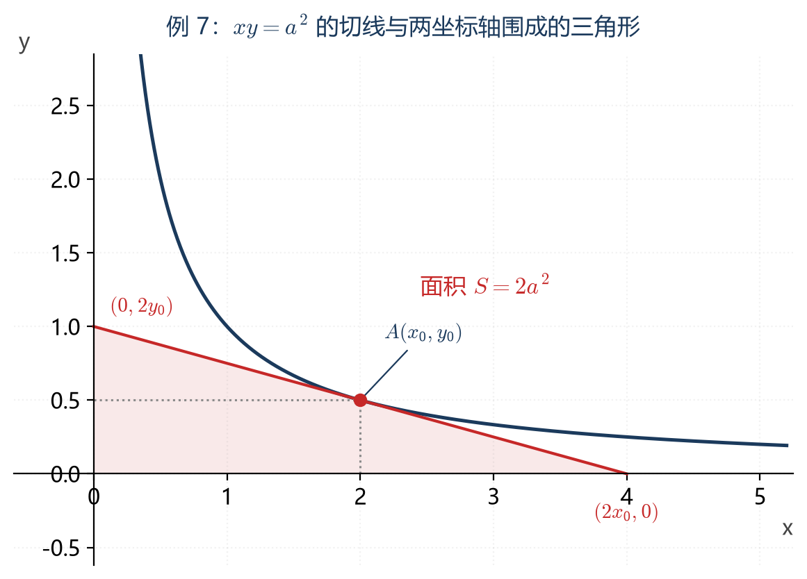
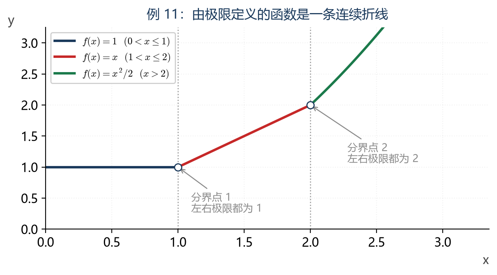
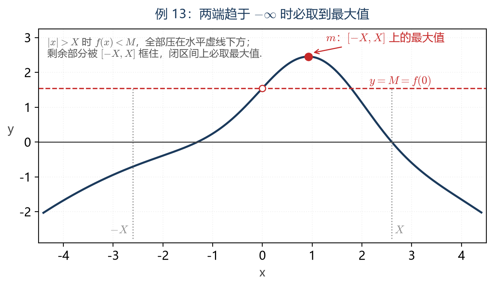
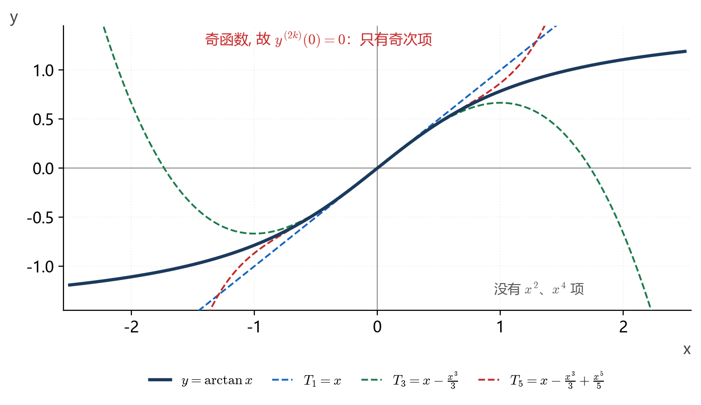
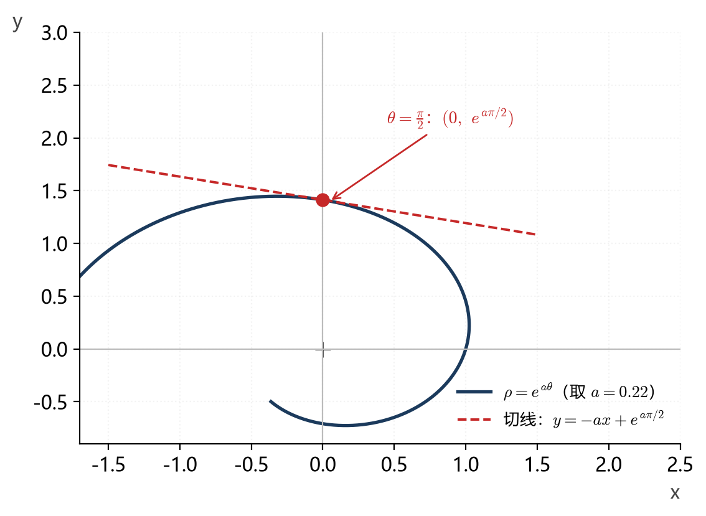

# 高等数学例题整理 · 导数与极限（按题型分类）

本题集来自三批手写笔记：2026-11-06 的 9 页（教材 P72 习题与总习题一，13 题）、2026-11-11 的 6 页（高阶导数与反函数求导课堂例题，4 题）、2026-11-13 的 9 页（求导技术综合练习，7 题），共 **24 道题**。原笔记按页码顺序书写，这里打散后**按题型重新归并**：同一题型下集中呈现"题目 → 思路 → 解答 → 知识点 → 批注"，便于对照方法、复用套路。

## 题源与题型地图

先看整体骨架。24 道题可以收进五类问题：**导数在接缝处的判定**（题型一至四）、**导数的应用与极限计算**（题型五至七）、**连续性与连续函数定理**（题型八至十）、**高阶导数的计算**（题型十一至十四，2026-11-11 新增）、**求导技术的综合运用**（题型十五至二十一，2026-11-13 新增）。

| 题型 | 主题 | 核心方法 | 对应例题 |
|---|---|---|---|
| 一 | 分段函数在接缝处的连续与可导 | 差商极限 + 有界×无穷小 | 例 1、例 2 |
| 二 | 含绝对值函数的可导性 | 左右导数分类讨论 | 例 3 |
| 三 | 抽象函数的导数 | 先凑定义式，再化简 | 例 4、例 5 |
| 四 | 分界点可导反求参数 | 可导⇒连续定 a，导数值相等定 b | 例 6 |
| 五 | 导数的几何应用 | 切线 → 截距 → 面积 | 例 7 |
| 六 | 幂指型极限（$1$ 的无穷次幂） | 取指数 + $\ln(1+u)\sim u$ | 例 8 |
| 七 | 已知阶的关系反求参数 | 等价无穷小替换 | 例 9 |
| 八 | 间断点类型判定 | 约分后求左右极限 | 例 10 |
| 九 | 由极限定义的函数 | 先求极限化为分段函数 | 例 11 |
| 十 | 闭区间连续函数性质 | 局部保号性 + 零点/最值定理 | 例 12、例 13 |
| 十一 | 有理分式的高阶导数 | 部分分式拆项 + $1/(x-a)$ 公式 | 例 14 |
| 十二 | 三角幂的高阶导数 | 立方和恒等式降幂成 $\cos 4x$ | 例 15 |
| 十三 | 乘积形式的高阶导数 | 莱布尼茨公式 + 递推 | 例 16 |
| 十四 | 反函数的二阶导数 | 换自变量（$dx/dy=1/y'$） | 例 17 |
| 十五 | 莱布尼茨 + 代特殊点 | 多项式因子截断，只留三项 | 例 18 |
| 十六 | 分段函数的高阶可导性 | 逐阶回定义算左右导数 | 例 19 |
| 十七 | 分子带 $x$ 的分式 | 凑成常数 $-(1+x)$ 后相消 | 例 20 |
| 十八 | 幂积商的对数求导 | 取对数把乘除变加减 | 例 21 |
| 十九 | 参数方程的二阶导 | 再除一次 $dx/dt$ | 例 22 |
| 二十 | 极坐标曲线的切线 | 转参数方程后对 $\theta$ 求导 | 例 23 |
| 二十一 | $e^{x}\cos x$ 型的高阶导 | 欧拉公式化复指数，或泰勒系数 | 例 24 |

> [!info] 阅读约定
> 每题末尾的「批注」框记录原手写笔记中的**笔误、跳步与记号问题**，并给出正确写法；「知识点」只列本题真正用到的工具，不做百科式罗列。

## 一、导数在接缝处的判定

这一部分是全章最容易丢分的地带：分段点、绝对值点、含参零点。共同原则只有一条——**接缝处不套公式，一律回到导数定义**。

### 题型一 分段函数在接缝处的连续与可导

#### 例 1 · x^a·sin(1/x) 型：连续与可导的分界

**题目**

设 $a$ 为任意实数，
$$
f(x)=x^{a}\sin\frac{1}{x}\quad (x\neq 0),\qquad f(0)=0
$$
讨论 $f(x)$ 在 $x=0$ 处的连续性与可导性。

**思路**

接缝处两个问题都用定义回答：连续看 $\lim_{x\to 0}f(x)$ 是否等于 $f(0)$；可导看差商 $\frac{f(x)-f(0)}{x-0}$ 的极限是否存在。核心工具是"有界函数 × 无穷小 = 无穷小"。

**解答**

第 1 步，连续性。当 $a>0$ 时 $x^{a}\to 0$，而 $\left|\sin\frac{1}{x}\right|\leq 1$ 有界，故
$$
\lim_{x\to 0}x^{a}\sin\frac{1}{x}=0=f(0)
$$
所以 $f$ 在 $x=0$ 处连续。

当 $a\leq 0$ 时，$a=0$ 使 $x^{0}=1$、函数退化为 $\sin\frac{1}{x}$；$a<0$ 使 $x^{a}\to+\infty$。两种情形下 $x\to 0$ 的极限都不存在，故不连续。

第 2 步，可导性。按定义
$$
f'(0)=\lim_{x\to 0}\frac{f(x)-f(0)}{x-0}=\lim_{x\to 0}\frac{x^{a}\sin\frac{1}{x}}{x}
$$
约去分母中的一个 $x$，得
$$
f'(0)=\lim_{x\to 0}x^{a-1}\sin\frac{1}{x}
$$
再对指数 $a-1$ 用一次"有界 × 无穷小"：

- 当 $a-1>0$，即 $a>1$ 时，$f'(0)=0$，可导；
- 当 $a\leq 1$ 时，$x^{a-1}$ 无界，差商极限不存在，不可导（$a=1$ 时左右差商分别趋于 $-1$ 与 $1$，是典型的尖点）。

**结论**

$a>1$ 时连续且可导；$0<a\leq 1$ 时连续但不可导；$a\leq 0$ 时不连续。这条结论是"连续推不出可导"的标准反例族。

**知识点**

- 导数定义：$f'(x_{0})=\lim_{\Delta x\to 0}\frac{f(x_{0}+\Delta x)-f(x_{0})}{\Delta x}$
- 有界函数与无穷小之积仍为无穷小
- $x^{a}\sin(1/x)$ 在 $a$ 的不同取值下给出"不连续 / 连续不可导 / 可导"三种状态

> [!note] 批注
> 原笔记第 ① 条写「$a=0$ 时 $f(x)=0$，于 $x=0$ 处连续且可导」，与后续推导矛盾：$a=0$ 时 $x^{0}=1$，$f(x)=\sin\frac{1}{x}$ 在原点附近剧烈振荡，极限不存在，既不连续更不可导。正确分界是 $a>0$ 连续、$a>1$ 可导。

*图 1　$x^{1/2}\sin(1/x)$ 的振荡被 $\pm x^{1/2}$ 夹住：曲线整体压向 0，故连续；但差商中出现 $x^{-1/2}$，故不可导。*

#### 例 2 · 分段函数求导：两侧套公式，接缝用定义

**题目**

设 $f(x)=\sin x\ (x<0)$，$f(x)=x\ (x\geq 0)$，求 $f'(x)$。

**思路**

两侧各自是初等函数，直接套求导公式；唯独 $x=0$ 是接缝，必须用定义分左右算，再判断是否相等。

**解答**

$x<0$ 时 $f'(x)=\cos x$；$x>0$ 时 $f'(x)=1$。

$x=0$ 处用定义：
$$
f'_{-}(0)=\lim_{x\to 0^{-}}\frac{\sin x-0}{x}=1,\qquad f'_{+}(0)=\lim_{x\to 0^{+}}\frac{x-0}{x}=1
$$
左右导数相等，故 $f'(0)=1$。合并写成
$$
f'(x)=\cos x\ (x<0),\qquad f'(x)=1\ (x\geq 0)
$$

**知识点**

- 分段点必须用定义，不能对两段分别求导后直接拼接
- 可导 ⇔ 左导数与右导数都存在且相等
- 分段函数求导后仍是分段函数，分界点的归属要统一（本题把 $x=0$ 归入右段）

> [!note] 批注
> 原笔记最后的分段结论有反复涂改，同时留下「$1,\ x\geq 0$」与「$1,\ x\neq 0$」两版。正确结果只有一版：$x<0$ 用 $\cos x$，$x\geq 0$ 用 $1$，$x=0$ 处取 $1$。

### 题型二 含绝对值函数的可导性

绝对值在零点处是"符号开关"，可导性一律靠左右导数是否同号来判断。

#### 例 3 · (x−a)φ(x) 与 |x−a|φ(x)

**题目**

设 $\varphi(x)$ 在 $x=a$ 处连续，$f(x)=(x-a)\varphi(x)$。

（1）证明 $f(x)$ 在 $x=a$ 处可导；

（2）若 $g(x)=|x-a|\varphi(x)$，问 $\varphi$ 满足什么条件时 $g$ 在 $x=a$ 处可导。

**思路**

两问都从差商出发。$f$ 的差商里 $(x-a)$ 恰好约掉，只剩 $\varphi(x)$；$g$ 的差商里留下 $\frac{|x-a|}{x-a}$，它在 $a$ 两侧分别等于 $+1$ 与 $-1$。

**解答**

（1）因 $f(a)=0$，
$$
\frac{f(x)-f(a)}{x-a}=\frac{(x-a)\varphi(x)}{x-a}=\varphi(x)
$$
由 $\varphi$ 在 $a$ 处连续，$\lim_{x\to a}\varphi(x)=\varphi(a)$，故 $f'(a)=\varphi(a)$ 存在，即 $f$ 在 $x=a$ 处可导。

（2）因 $g(a)=0$，差商为
$$
\frac{g(x)-g(a)}{x-a}=\frac{|x-a|}{x-a}\varphi(x)
$$
分左右两侧：

- $x>a$ 时 $\frac{|x-a|}{x-a}=1$，故 $g'_{+}(a)=\varphi(a)$；
- $x<a$ 时 $\frac{|x-a|}{x-a}=-1$，故 $g'_{-}(a)=-\varphi(a)$。

可导要求 $g'_{+}(a)=g'_{-}(a)$，即 $\varphi(a)=-\varphi(a)$，等价于 $\varphi(a)=0$。

**结论**

$\varphi(a)=0$ 时 $g$ 在 $a$ 处可导且 $g'(a)=0$；$\varphi(a)\neq 0$ 时左右导数差一个符号，$g$ 在 $a$ 处不可导。

**知识点**

- $|u|$ 在 $u=0$ 处左右导数异号，是可导性的天然障碍
- $|x-a|$ 与连续函数相乘后，只有当连续函数在该点取零，才能"压住"符号跳变
- 记号规范：这里算的是**导数** $g'_{\pm}(a)$，不是函数极限

> [!note] 批注
> 原笔记写「$\lim_{x\to a}g(x)=\pm\varphi(a)$」，记号有误——该处求的是左右导数而非函数极限，应写成 $g'_{\pm}(a)=\pm\varphi(a)$。结论（$\varphi(a)=0$ 才可导）本身正确。

### 题型三 抽象函数的导数：先凑定义，再化简

题目不给具体表达式时，唯一可用的工具就是导数定义。技巧在于"凑"：把差商整理成已知极限的形式。

#### 例 4 · 乘积型：f(0)=0 时用 f'(0)=lim f(x)/x

**题目**

设 $f(x)=(e^{x}-1)(e^{2x}-2)\cdots(e^{nx}-n)$，求 $f'(0)$（$n$ 为正整数）。

**思路**

$n$ 个因子连乘，展开不现实。注意 $f(0)=0$（第一个因子为零），于是差商可以写成 $\frac{f(x)}{x}$，再用等价无穷小把第一个因子换掉。

**解答**

$f(0)=(1-1)\cdot(\cdots)=0$，故
$$
f'(0)=\lim_{x\to 0}\frac{f(x)-f(0)}{x}=\lim_{x\to 0}\frac{(e^{x}-1)(e^{2x}-2)\cdots(e^{nx}-n)}{x}
$$
用等价无穷小 $e^{x}-1\sim x$：
$$
f'(0)=\lim_{x\to 0}\frac{x}{x}\cdot(e^{2x}-2)(e^{3x}-3)\cdots(e^{nx}-n)
$$
等价无穷小只在乘除因子中替换，第一个因子恰好与分母相消，剩下
$$
f'(0)=\lim_{x\to 0}(e^{2x}-2)(e^{3x}-3)\cdots(e^{nx}-n)
$$
各因子在 $x=0$ 处连续，直接代入 $x=0$：
$$
f'(0)=(-1)\cdot(-2)\cdots(-(n-1))=(-1)^{n-1}(n-1)!
$$

**知识点**

- $f(0)=0$ 时 $f'(0)=\lim_{x\to 0}\frac{f(x)}{x}$，这是乘积型求 $f'(0)$ 的常用捷径
- 等价无穷小替换只能作用于乘除因子，不能对加减项整体替换
- 连乘求值：把 $x=0$ 代入每个"剩余因子"，符号由负因子个数决定

> [!note] 批注
> 两个提醒。① 原笔记把首因子写成 $1\cdot(-2)$，应为 $(-1)\cdot(-2)$：$e^{2\cdot 0}-2=-1$，漏掉负号会让结果符号整体错位（正确结果为 $(-1)^{n-1}(n-1)!$）。② 能直接写 $\lim f(x)/x$ 的前提是 $f(0)=0$，若把 $e^{x}-1$ 换成 $e^{x}+1$ 就不再成立。

#### 例 5 · 对称型：偶函数在原点导数为零

**题目**

设 $f(x)$ 为偶函数，且 $f'(0)$ 存在，证明 $f'(0)=0$。

**思路**

偶性给出 $f(x)=f(-x)$，把它代入差商后换元 $t=-x$，会得到一个关于 $f'(0)$ 的方程。

**解答**

由 $f$ 为偶函数，$f(x)=f(-x)$，于是
$$
f'(0)=\lim_{x\to 0}\frac{f(x)-f(0)}{x}=\lim_{x\to 0}\frac{f(-x)-f(0)}{x}
$$
在右端令 $t=-x$（$x\to 0$ 时 $t\to 0$，分母同时变号）：
$$
\lim_{x\to 0}\frac{f(-x)-f(0)}{x}=\lim_{t\to 0}\frac{f(t)-f(0)}{-t}=-f'(0)
$$
故 $f'(0)=-f'(0)$，即 $2f'(0)=0$，所以 $f'(0)=0$，证毕。

**知识点**

- 换元时分子分母必须同时换：$x=-t$ 使分母出现负号
- 几何解释：偶函数图象关于 $y$ 轴对称，原点处切线只能水平
- 对偶结论：奇函数若 $f'(0)$ 存在，则 $f'(0)$ 可不为零；但奇函数的二阶导数（若存在）在原点为零

> [!note] 批注
> 证明里最容易漏的是分母的负号。若把 $\frac{f(-x)-f(0)}{x}$ 中的分母直接当成 $t$，会得到 $f'(0)=f'(0)$ 的空结论，整个证明失去意义。

### 题型四 分界点可导 ⇒ 反求参数

#### 例 6 · 先用连续定 a，再用左右导数定 b

**题目**

设 $f(x)=\ln(x^{2}+a)\ (x>1)$，$f(x)=\sin b(x-1)\ (x\leq 1)$。已知 $f$ 在 $(0,+\infty)$ 上可导，求 $a,b$。

**思路**

两段各自是初等函数，在其定义区间内天然可导，唯一的风险点是接缝 $x=1$。而"可导 ⇒ 连续"，所以先用**连续性**定出 $a$，再用**左右导数相等**定出 $b$。两个条件，两个参数，顺序不能颠倒。

**解答**

第 1 步，用连续性定 $a$。$f(1)=\sin 0=0$，而右极限
$$
\lim_{x\to 1^{+}}f(x)=\ln(1+a)
$$
连续要求 $\ln(1+a)=0$，故 $a=0$。

第 2 步，求右导数。此时 $x>1$ 时 $f(x)=\ln x^{2}=2\ln x$，
$$
f'_{+}(1)=\lim_{x\to 1^{+}}\frac{2\ln x-0}{x-1}=\lim_{x\to 1^{+}}\frac{2\ln(1+(x-1))}{x-1}=2
$$
第 3 步，求左导数。
$$
f'_{-}(1)=\lim_{x\to 1^{-}}\frac{\sin b(x-1)-0}{x-1}=b
$$
可导要求 $f'_{+}(1)=f'_{-}(1)$，故 $b=2$。

**结论**

$a=0,\ b=2$。

**知识点**

- 可导 ⇒ 连续，这是"先定参数"的第一步；反过来连续推不出可导
- 差商在具体点上常可化为标准极限：$\lim_{t\to 0}\frac{\ln(1+t)}{t}=1$
- 同类的正弦型标准极限：$\lim_{t\to 0}\frac{\sin bt}{t}=b$
- 两段含参时，通常"连续给一个方程、可导再给一个方程"

> [!note] 批注
> 原笔记同一题内把括号写成 $\ln(x^{2}+a)$ 与 $\ln(x^{2}+a^{2})$ 两种形式，虽然都得到 $a=0$，但题目必须统一写法。另外求左导数时直接写 $=b$，实质是用 $\lim_{t\to 0}\frac{\sin bt}{t}=b$，答题时点明这一步更稳妥。

## 二、导数的应用与极限计算

这一部分把导数用出去：一是几何应用（切线、截距、面积），二是极限计算中的两类固定套路（$1^{\infty}$ 型、已知阶反求参数）。

### 题型五 导数的几何应用：切线 → 截距 → 面积

#### 例 7 · 双曲线切线与坐标轴围成的三角形

**题目**

证明双曲线 $xy=a^{2}$（$a>0$）上任一点处的切线与两条坐标轴围成的三角形面积恒等于 $2a^{2}$。

**思路**

三步走：写出切线方程 → 分别令 $y=0$、$x=0$ 求两个截距 → 用 $\frac{1}{2}\times$ 两截距求面积。题眼在于把 $\frac{a^{2}}{x_{0}}$ 用 $y_{0}$ 替换（因为 $x_{0}y_{0}=a^{2}$）。

**解答**

设切点为 $A(x_{0},y_{0})$，则 $x_{0}y_{0}=a^{2}$。由 $y=\frac{a^{2}}{x}$ 得 $y'=-\frac{a^{2}}{x^{2}}$，故切线斜率为 $-\frac{a^{2}}{x_{0}^{2}}$，切线方程
$$
y-y_{0}=-\frac{a^{2}}{x_{0}^{2}}(x-x_{0})
$$
求两个截距。令 $y=0$：
$$
x=x_{0}+\frac{x_{0}^{2}y_{0}}{a^{2}}=x_{0}+x_{0}=2x_{0}
$$
令 $x=0$：
$$
y=y_{0}+\frac{a^{2}}{x_{0}}=y_{0}+y_{0}=2y_{0}
$$
于是三角形面积
$$
S=\frac{1}{2}\cdot 2x_{0}\cdot 2y_{0}=2x_{0}y_{0}=2a^{2}
$$
与切点位置无关，证毕。

**知识点**

- 切线方程的点斜式；斜率由隐函数或显函数求导得到
- 用约束 $x_{0}y_{0}=a^{2}$ 化简截距，是本题的关键一步
- 结论的几何意义：双曲线任意切线截出的三角形面积是常数，属于"包络"性质的初等体现

> [!note] 批注
> 原笔记最后一步写成 $2x_{0}y_{0}=a^{2}$，漏掉了系数 2。由 $x_{0}y_{0}=a^{2}$ 应得 $2x_{0}y_{0}=2a^{2}$。这一步正是全题要证的结论，系数错则整题错。

*图 2　切点 $A(x_{0},y_{0})$ 处的切线截两轴于 $(2x_{0},0)$ 与 $(0,2y_{0})$，三角形面积恒为 $2a^{2}$。*

### 题型六 1^∞ 型极限

#### 例 8 · 加权平均底的幂指函数

**题目**

求极限

$$
\lim_{x\to 0}\left(\frac{a^{x}+3b^{x}+5c^{x}}{9}\right)^{\frac{1}{x}}
$$

其中 $a,b,c>0$。

**思路**

底数趋于 $\frac{1+3+5}{9}=1$，指数趋于无穷，属 $1^{\infty}$ 型。标准做法是改写为 $e$ 的指数形式，把"幂"降成"乘"，再用 $\ln(1+u)\sim u$ 把对数拆开。

**解答**

原式
$$
=\lim_{x\to 0}\exp\left[\frac{1}{x}\ln\frac{a^{x}+3b^{x}+5c^{x}}{9}\right]
$$
把分子写成 $9$ 加上一个无穷小：
$$
=\lim_{x\to 0}\exp\left[\frac{1}{x}\ln\left(1+\frac{a^{x}+3b^{x}+5c^{x}-9}{9}\right)\right]
$$
用 $\ln(1+u)\sim u$（$u\to 0$）：
$$
=\lim_{x\to 0}\exp\left[\frac{1}{x}\cdot\frac{a^{x}-1+3(b^{x}-1)+5(c^{x}-1)}{9}\right]
$$
拆成三个标准极限：
$$
=\lim_{x\to 0}\exp\left[\frac{1}{9}\left(\frac{a^{x}-1}{x}+3\cdot\frac{b^{x}-1}{x}+5\cdot\frac{c^{x}-1}{x}\right)\right]
$$
由 $\lim_{t\to 0}\frac{a^{t}-1}{t}=\ln a$ 得
$$
=\exp\left[\frac{1}{9}(\ln a+3\ln b+5\ln c)\right]=\exp\left[\frac{1}{9}\ln(ab^{3}c^{5})\right]
$$
故原式 $=(ab^{3}c^{5})^{\frac{1}{9}}$，也可写作 $\sqrt[9]{ab^{3}c^{5}}$。

**知识点**

- $1^{\infty}$ 型：$u^{v}=e^{v\ln u}$，再对 $\ln u$ 用 $\ln(1+(u-1))\sim u-1$
- 标准极限 $\lim_{t\to 0}\frac{a^{t}-1}{t}=\ln a$
- 加权形式：$\lim_{x\to 0}\left(\frac{a_{1}^{x}+\cdots+a_{k}^{x}}{k}\right)^{\frac{1}{x}}=(a_{1}\cdots a_{k})^{\frac{1}{k}}$；本题权重 $1:3:5$、总权重 9，故指数为 $\frac{1}{9}$

> [!note] 批注
> 中间把 $a^{x}+3b^{x}+5c^{x}-9$ 拆成 $a^{x}-1+3(b^{x}-1)+5(c^{x}-1)$，是全题最关键的一步（因为 $1+3+5=9$ 恰好被减去）。原笔记这一步写对了，但没说明为什么这样拆——它对应"每一项各自减去自己的权重"，理解这一点才能在系数改变时不出错。

### 题型七 已知阶的关系反求参数

#### 例 9 · 由极限值反推等价无穷小的系数与次数

**题目**

设 $\lim_{x\to 0}\frac{\sqrt{1+\frac{f(x)}{x}}-1}{x^{2}}=A$，确定 $a,b$，使 $x\to 0$ 时 $f(x)\sim ax^{b}$。

**思路**

先把根式用 $\sqrt{1+u}-1\sim\frac{u}{2}$ 打开，得到 $\frac{f(x)}{2x^{3}}\to A$，由此读出 $f$ 的主部；再与 $f(x)\sim ax^{b}$ 比对系数与次数。

**解答**

因 $\frac{f(x)}{x}\to 0$，用 $\sqrt{1+u}-1\sim\frac{u}{2}$：
$$
\lim_{x\to 0}\frac{\frac{1}{2}\cdot\frac{f(x)}{x}}{x^{2}}=\lim_{x\to 0}\frac{f(x)}{2x^{3}}=A
$$
即 $f(x)\sim 2Ax^{3}$。又已知 $f(x)\sim ax^{b}$，两个等价无穷小之比的极限为 1：
$$
\lim_{x\to 0}\frac{ax^{b}}{2Ax^{3}}=1
$$
故必须 $b=3$ 且 $a=2A$。

**结论**

$a=2A,\ b=3$。

**知识点**

- $\sqrt{1+u}-1\sim\frac{u}{2}$、$\ln(1+u)\sim u$、$e^{u}-1\sim u$ 三个常用等价无穷小
- 等价无穷小"同阶同系数"：$f\sim g$ 与 $f\sim h$ 蕴含 $g\sim h$，故系数与次数唯一
- 量纲检验：分母是 $x^{2}$，根式内部分母是 $x$，故 $f$ 必须是三阶

> [!note] 批注
> 隐含条件 $A\neq 0$：若 $A=0$，则 $f(x)=o(x^{3})$，此时"$f(x)\sim ax^{b}$"中的 $b$ 不再唯一（任何 $b<3$ 都能配出等价的 $ax^{b}$）。答题时补一句"因 $f(x)\sim ax^{b}$ 是等价无穷小，故 $A\neq 0$"更严密。

## 三、连续性与连续函数的性质

这一部分从"点"走向"区间"：先判断间断点类型，再由极限定义出函数讨论连续性，最后用闭区间上连续函数的三大定理做证明。

### 题型八 间断点类型判定

#### 例 10 · 约分后逐点判别

**题目**

设 $f(x)=\frac{(x+1)\sin x}{|x|(x^{2}-1)}$，求其间断点并判别类型。

**思路**

间断点来自分母为零的点，即 $x=0$ 与 $x=\pm 1$。判别类型只看**该点的（左右）极限**：极限存在且有限为可去，左右极限存在但不等为跳跃，出现无穷为无穷间断。含 $|x|$ 时左右极限必须分开算。

**解答**

先因式分解并约分：$x^{2}-1=(x-1)(x+1)$，故当 $x\neq\pm 1$ 时
$$
f(x)=\frac{\sin x}{|x|(x-1)}
$$
间断点为 $x=-1,\ x=0,\ x=1$。

（1）$x=-1$。约分后该点无定义，但极限存在：
$$
\lim_{x\to -1}f(x)=\frac{\sin(-1)}{|-1|\cdot(-2)}=\frac{-\sin 1}{-2}=\frac{\sin 1}{2}
$$
极限存在且有限，故 $x=-1$ 是**可去间断点**。

（2）$x=0$。左右极限要分开算（$|x|$ 在两侧符号不同）：
$$
\lim_{x\to 0^{+}}f(x)=\lim_{x\to 0^{+}}\frac{\sin x}{x}\cdot\frac{1}{x-1}=1\cdot(-1)=-1
$$
$$
\lim_{x\to 0^{-}}f(x)=\lim_{x\to 0^{-}}\frac{\sin x}{x}\cdot\frac{1}{-(x-1)}=1\cdot 1=1
$$
左右极限都存在但不相等（$-1\neq 1$），故 $x=0$ 是**跳跃间断点**。

（3）$x=1$。分子 $\sin 1\neq 0$，分母趋于零：
$$
\lim_{x\to 1^{+}}f(x)=+\infty,\qquad \lim_{x\to 1^{-}}f(x)=-\infty
$$
极限为无穷大，故 $x=1$ 是**无穷间断点**（第二类）。

**知识点**

- 间断点分类只看极限：可去（极限存在）、跳跃（左右极限存在但不等）、无穷与振荡（第二类）
- 先约分再判型：$x=-1$ 是约分后才暴露的可去间断点，若不约分会误判
- $|x|$ 在 $0$ 处使左右表达式差一个负号，是产生跳跃的常见来源

> [!note] 批注
> 原笔记在 $x=0$ 的左侧极限里用 $\frac{1}{-(x-1)}$，等价于把 $|x|$ 换成 $-x$，符号处理是对的；但要写清"当 $x<0$ 时 $|x|=-x$"，否则读者无法判断负号的来源。另外原笔记把 $x=-1$ 的结果写成 $\frac{1}{2}\sin(-1)$，建议统一写成 $-\frac{\sin 1}{2}$，符号更清楚。

### 题型九 由极限定义的函数

#### 例 11 · 先求极限化为分段函数，再查分界点

**题目**

设 $f(x)=\lim_{n\to\infty}\sqrt[n]{1+x^{n}+\left(\frac{x^{2}}{2}\right)^{n}}$（$x>0$），讨论 $f(x)$ 的连续性。

**思路**

$n$ 次根号内是三个数列的 $n$ 次幂之和，极限等于三者中的最大者。先把它化成 $\max$ 形式，再比较大小得到分段表达式，最后只需检查分界点。

**解答**

设 $a_{1}=1,\ a_{2}=x,\ a_{3}=\frac{x^{2}}{2}$，由 $\lim_{n\to\infty}\sqrt[n]{a_{1}^{n}+a_{2}^{n}+a_{3}^{n}}=\max\{a_{1},a_{2},a_{3}\}$（各 $a_{i}>0$），得
$$
f(x)=\max\left\{1,\ x,\ \frac{x^{2}}{2}\right\}
$$
比较三者大小，得分段表达式
$$
f(x)=1\ (0<x\leq 1),\qquad f(x)=x\ (1<x\leq 2)
$$
$$
f(x)=\frac{x^{2}}{2}\ (x>2)
$$
分界点只有 $x=1$ 与 $x=2$，逐一检查：
$$
\lim_{x\to 1^{-}}f(x)=1,\qquad \lim_{x\to 1^{+}}f(x)=\lim_{x\to 1^{+}}x=1
$$
$$
\lim_{x\to 2^{-}}f(x)=\lim_{x\to 2^{-}}x=2,\qquad \lim_{x\to 2^{+}}f(x)=\lim_{x\to 2^{+}}\frac{x^{2}}{2}=2
$$
两个分界点处左右极限都相等，且各段内部为初等函数连续，故 $f$ 在 $(0,+\infty)$ 上连续。

**知识点**

- 三明治式结论：$\sqrt[n]{\sum a_{i}^{n}}\to\max a_{i}$（$a_{i}>0$）
- 分界点的来历：$1$ 与 $x$ 相等给出 $x=1$；$x$ 与 $\frac{x^{2}}{2}$ 相等给出 $x=2$
- 分段函数连续性只需查分界点，段内用初等函数连续性直接交代

> [!note] 批注
> 原笔记直接写出分段结果 $1\ /\ x\ /\ \frac{x^{2}}{2}$ 并只检查了 $x=1$ 与 $x=2$，缺少"分界点从哪来"的说明。补充比较过程：$x$ 与 $\frac{x^{2}}{2}$ 的大小关系在 $x=2$ 翻转，$1$ 与 $x$ 在 $x=1$ 翻转，这才是分段的依据。

*图 3　由极限定义的函数化成三段折线，两个接缝处左右极限相同，整条曲线连续。*

### 题型十 闭区间上连续函数的性质

这两道题的骨架完全相同：**先用极限把区间"截断"，再在截断后的闭区间上使用定理**。区别只在于用哪一条定理。

#### 例 12 · 零点定理（一端趋于 +∞、一端趋于 −∞）

**题目**

设 $f(x)$ 在 $(a,b)$ 内连续，且 $\lim_{x\to a^{+}}f(x)=+\infty$，$\lim_{x\to b^{-}}f(x)=-\infty$，证明 $f(x)$ 在 $(a,b)$ 内至少有一个零点。

**思路**

零点定理要求"闭区间上连续 + 两端异号"，而题设只给了开区间。所以必须先往区间内部挪两个点，造出异号，再在这两点之间用定理。挪点的依据是**极限的局部保号性**。

**解答**

第 1 步，造出函数值为正的点。由 $\lim_{x\to a^{+}}f(x)=+\infty$，对任意正数 $M$（取 $M=1$）存在 $x_{1}\in(a,b)$ 足够靠近 $a$，使
$$
f(x_{1})>1>0
$$
第 2 步，造出函数值为负的点。同理由 $\lim_{x\to b^{-}}f(x)=-\infty$，存在 $x_{2}\in(a,b)$ 足够靠近 $b$，使
$$
f(x_{2})<-1<0
$$
第 3 步，调整次序。不妨设 $x_{1}<x_{2}$（若相反，交换记号即可）。

第 4 步，用零点定理。因 $[x_{1},x_{2}]\subset(a,b)$，$f$ 在 $(a,b)$ 内连续故在 $[x_{1},x_{2}]$ 上连续；又
$$
f(x_{1})\cdot f(x_{2})<0
$$
据零点定理，存在 $\xi\in(x_{1},x_{2})$ 使 $f(\xi)=0$。而 $(x_{1},x_{2})\subset(a,b)$，故 $\xi\in(a,b)$，证毕。

**知识点**

- 极限局部保号性：$\lim_{x\to a^{+}}f=+\infty$ 蕴含"在 $a$ 右侧附近 $f>0$"
- 零点定理：$f$ 在 $[x_{1},x_{2}]$ 上连续且两端异号 ⇒ 内部存在零点
- 区间归属：结论要落在 $(a,b)$ 内，所以必须说明 $\xi\in(x_{1},x_{2})\subset(a,b)$

> [!note] 批注
> 两个易错点。① 题目只说"$(a,b)$ 内连续"，端点处可能无定义，绝不能直接在 $[a,b]$ 上用零点定理，必须"往里挪"出 $x_{1},x_{2}$。② $x_{1}<x_{2}$ 要交代"不妨设"，否则无法确定区间 $[x_{1},x_{2}]$ 的方向，异号条件的表述也就失去意义。

*图 4　$a^{+}$ 端函数值趋于 $+\infty$、$b^{-}$ 端趋于 $-\infty$，中间必穿过 $x$ 轴，即存在 $\xi$ 使 $f(\xi)=0$。*

#### 例 13 · 最值定理（两端趋于 −∞ 时必取到最大值）

**题目**

设 $f(x)$ 在 $(-\infty,+\infty)$ 上连续，且 $\lim_{x\to\infty}f(x)=-\infty$，证明 $f(x)$ 在 $(-\infty,+\infty)$ 内必取到最大值。

**思路**

与例 12 同构。取一个具体的函数值 $M=f(0)$ 作门槛，用极限把"足够远"的部分切掉（那里 $f<M$），剩下的部分是一个闭区间，在最值定理下必有最大值 $m\geq M$，而 $m$ 同时压住被切掉的部分，即为全局最大值。

**解答**

第 1 步，取门槛值 $M=f(0)$。

第 2 步，切掉远处。由 $\lim_{x\to\infty}f(x)=-\infty$，存在 $X>0$，使当 $|x|>X$ 时
$$
f(x)<M=f(0)
$$
第 3 步，在剩余闭区间上取最大值。$f$ 在 $[-X,X]$ 上连续，由最值定理，存在 $\xi\in[-X,X]$ 使
$$
m=f(\xi)=\max_{[-X,X]}f\geq f(0)=M
$$
第 4 步，说明 $m$ 是全局最大值。任取 $x\in(-\infty,+\infty)$：

- 若 $|x|\leq X$，则 $f(x)\leq m$（$m$ 是该区间上的最大值）；
- 若 $|x|>X$，则 $f(x)<M\leq m$。

两种情形都有 $f(x)\leq m$，且 $m$ 在 $\xi$ 处取到，故 $m$ 就是最大值，证毕。

**知识点**

- 最值定理：闭区间上连续的函数必取到最大值与最小值
- 手段：用"充分远处函数值小"把无穷区间截成有限闭区间
- $M=f(0)$ 只是中间桥梁，真正起作用的是 $m\geq M$ 这一步，它保证被切掉的部分不会超过 $m$

> [!note] 批注
> 原笔记写"有最大值设为 $m$，且满足 $m\geq f(0)$"，这个不等式正是第 4 步成立的关键——若漏掉它，就无法说明 $|x|>X$ 的部分不超过 $m$。另外标题处原笔记直接跳到第 15 题，中间的第 14 题未出现在本次拍摄范围内。

*图 5　两端趋于 $-\infty$ 时，$[-X,X]$ 之外的函数值都低于 $M=f(0)$，剩余部分的最大值即为全局最大值。*

## 四、高阶导数的计算

这一板块的四道题，本质是四条"把 $n$ 阶导算出来"的路线：**拆项**（有理分式）、**降幂**（三角幂）、**莱布尼茨 + 递推**（乘积形式）、**换自变量**（反函数）。共同前提只有一条：都别指望一阶一阶往下求。

### 题型十一 有理分式：先拆项，再套 1/(x−a) 的公式

#### 例 14 · 分母可因式分解的分式

**题目**

设 $y=\frac{1}{x^{2}-3x+2}$，求 $y^{(n)}$。

**思路**

一般分式没有 $n$ 阶导公式，但 $1/(x-a)$ 有：它的 $n$ 阶导是 $(-1)^{n}n!/(x-a)^{n+1}$。所以任务就变成把分式拆成若干个 $1/(x-a)$ 之和——这是部分分式分解，两次因式分解加待定系数即可。

**解答**

分母分解：$x^{2}-3x+2=(x-1)(x-2)$。设
$$
y=\frac{A}{x-1}+\frac{B}{x-2}=\frac{A(x-2)+B(x-1)}{(x-1)(x-2)}
$$
分母已通分一致，比较分子：
$$
Ax-2A+Bx-B\equiv 1
$$
比较系数得
$$
A+B=0,\qquad -2A-B=1
$$
解得 $A=-1$、$B=1$，于是
$$
y=-\frac{1}{x-1}+\frac{1}{x-2}=\frac{1}{1-x}+\frac{1}{x-2}
$$
逐项求 $n$ 阶导：
$$
\left(\frac{1}{1-x}\right)^{(n)}=\frac{n!}{(1-x)^{n+1}},\qquad \left(\frac{1}{x-2}\right)^{(n)}=\frac{(-1)^{n}n!}{(x-2)^{n+1}}
$$
把两项相加，并把 $1/(1-x)^{n+1}$ 换成 $(-1)^{n+1}/(x-1)^{n+1}$，可合并成一个括号：
$$
y^{(n)}=\frac{n!}{(1-x)^{n+1}}+\frac{(-1)^{n}n!}{(x-2)^{n+1}}=(-1)^{n}n!\left[\frac{1}{(x-2)^{n+1}}-\frac{1}{(x-1)^{n+1}}\right]
$$

**知识点**

- 部分分式分解：真分式拆成若干个 $1/(x-a)$ 的一次项之和
- 基本公式 $\left(\frac{1}{x-a}\right)^{(n)}=\frac{(-1)^{n}n!}{(x-a)^{n+1}}$
- 导数的线性性：和的导数等于导数的和，可以逐项处理

> [!note] 批注
> 原笔记把 $-\frac{1}{x-1}$ 改写成 $\frac{1}{1-x}$ 时没交代依据（就是用 $\frac{1}{1-x}=-\frac{1}{x-1}$）。改写本身是对的、而且更省事：$\frac{1}{1-x}$ 的各阶导数都不带 $(-1)^{n}$ 符号，直接是 $\frac{n!}{(1-x)^{n+1}}$。但两项形式不统一时最容易漏符号，建议按上面的写法合并成一个括号。
> 另外公式对 $n\geq 1$ 成立；$n=0$ 时它恰好还原原函数，写答案时可以一并注明。

*图 6　拆项前一条曲线管两个奇点，$n$ 阶导无处下手；拆项后每支只剩一个奇点，直接套 $\frac{1}{x-a}$ 的公式。*

### 题型十二 三角幂：先降幂成一次式，再求 n 阶导

#### 例 15 · sin⁶x + cos⁶x 型

**题目**

设 $y=\sin^{6}x+\cos^{6}x$，求 $y^{(n)}$。

**思路**

高次三角幂没有 $n$ 阶导公式，能直接求的只有 $\cos(ax+b)$：它的 $n$ 阶导是 $a^{n}\cos(ax+b+n\pi/2)$。所以先把 6 次幂降成 $\cos 4x$ 的一次式。降幂的抓手是把 $\sin^{2}x$、$\cos^{2}x$ 当成 $a$、$b$ 用立方和恒等式——因为 $a+b=1$，恒等式会大幅简化。

**解答**

令 $a=\sin^{2}x$、$b=\cos^{2}x$，则 $a+b=1$：
$$
y=a^{3}+b^{3}=(a+b)^{3}-3ab(a+b)=1-3\sin^{2}x\cos^{2}x
$$
降幂：由 $\sin x\cos x=\frac{1}{2}\sin 2x$ 得 $\sin^{2}x\cos^{2}x=\frac{1}{4}\sin^{2}2x$；再用半角 $\sin^{2}2x=\frac{1-\cos 4x}{2}$：
$$
y=1-\frac{3}{4}\cdot\frac{1-\cos 4x}{2}=\frac{5}{8}+\frac{3}{8}\cos 4x
$$
常数项求导为零，故当 $n\geq 1$ 时
$$
y^{(n)}=\frac{3}{8}\cdot 4^{n}\cos\left(4x+\frac{n\pi}{2}\right)
$$

**知识点**

- 立方和恒等式 $a^{3}+b^{3}=(a+b)^{3}-3ab(a+b)$；$a+b=1$ 时一步到位，比 $(a+b)(a^{2}-ab+b^{2})$ 少一次配方
- 倍角与半角降幂：$\sin 2x=2\sin x\cos x$、$\sin^{2}\theta=\frac{1-\cos 2\theta}{2}$
- $\left(\cos(ax+b)\right)^{(n)}=a^{n}\cos(ax+b+n\pi/2)$

> [!note] 批注
> 原笔记在常数 $\frac{5}{8}$ 下面标了「常数为 0」，意思是求导后消失——但这个说法只对 $n\geq 1$ 成立，$n=0$ 时 $y$ 本身就含 $\frac{5}{8}$，写答案时要交代范围。
> 另：原笔记先用立方和分解、再配方求 $\sin^{4}x+\cos^{4}x$，绕了一圈；方法二直接套 $(a+b)^{3}-3ab(a+b)$ 一步到位。两条路都对，考试选短的。

### 题型十三 乘积形式：莱布尼茨公式 + 递推

#### 例 16 · arctan x 在 0 处的 n 阶导数

**题目**

设 $y=\arctan x$，求 $y^{(n)}(0)$。

**思路**

$\arctan x$ 逐阶求导只会越来越复杂（分母幂次一路上升），硬求 $n$ 阶不可能。破局点是把 $y'$ 改写成"乘积等于常数"：由 $y'=\frac{1}{1+x^{2}}$ 得 $(1+x^{2})y'=1$。两边求 $n-1$ 阶导，用莱布尼茨公式——因为 $1+x^{2}$ 只有前三阶导数非零，无穷项求和自动截断成三项。再令 $x=0$，就得到一个只含 $y^{(n)}(0)$ 与 $y^{(n-2)}(0)$ 的递推式。

**解答**

由 $y'=\frac{1}{1+x^{2}}$ 得
$$
(1+x^{2})y'=1
$$
记 $u=1+x^{2}$、$v=y'$，则 $u'=2x$、$u''=2$、$u^{(k)}=0\ (k\geq 3)$。

两边求 $n-1$ 阶导（$n\geq 2$）：
$$
(1+x^{2})y^{(n)}+(n-1)\cdot 2x\cdot y^{(n-1)}+\frac{(n-1)(n-2)}{2}\cdot 2\cdot y^{(n-2)}=0
$$
令 $x=0$，含 $x$ 的中间项消失：
$$
y^{(n)}(0)+(n-1)(n-2)\,y^{(n-2)}(0)=0
$$
即得递推式
$$
y^{(n)}(0)=-(n-1)(n-2)\,y^{(n-2)}(0)
$$

初值：$y(0)=0$、$y'(0)=1$。

**偶数阶**：递推两步就落到 $y(0)$，故 $y^{(2k)}(0)=0$。

**奇数阶**：一路落到 $y'(0)=1$，每步带一个负号，共 $\frac{n-1}{2}$ 个负号；系数连乘 $(n-1)(n-2)\cdots 2\cdot 1=(n-1)!$，故
$$
y^{(2k+1)}(0)=(-1)^{k}(2k)!
$$
以 $n=7$ 验算：$y^{(7)}(0)=-(6\cdot 5)\cdot(-4\cdot 3)\cdot(-2\cdot 1)\cdot 1=-720=(-1)^{3}\cdot 6!$。

综上
$$
y^{(2k)}(0)=0,\qquad y^{(2k+1)}(0)=(-1)^{k}(2k)!
$$

**知识点**

- 莱布尼茨公式 $(uv)^{(m)}=\sum_{k=0}^{m}C_{m}^{k}u^{(k)}v^{(m-k)}$
- 多项式因子只有有限项非零 ⇒ 求和自动截断，这是本题能算出来的关键
- 递推 + 初值：偶数阶归到 $y(0)$、奇数阶归到 $y'(0)$，两类分别成链
- 与泰勒系数对照：$a_{2k+1}=\frac{y^{(2k+1)}(0)}{(2k+1)!}=\frac{(-1)^{k}}{2k+1}$，正是 $\arctan x$ 的展开式

> [!note] 批注
> 三处记号要改：① 莱布尼茨展开的第一项原笔记写成 $y^{n}$（上标），会被读成 $n$ 次幂，正确是 $y^{(n)}$；② 左边记作 $P(n)$ 不妥，它其实是"求 $n-1$ 阶导之后的等式"，建议直接令右边为 $0$，或记作 $E_{n}$；③ 结论式只对奇数阶成立：原笔记写的 $(-1)^{(n-1)/2}(n-1)!$ 里的 $n$ 只能是奇数，旁注「实际上只对次数」表述含糊，应明确写成「$n$ 为奇数」。
> 数值验算部分（$y^{(7)}$ 的三层符号、$m=7$ 时「有 3 个 $-1$」）是对的。

*图 7　$\arctan x$ 是奇函数，偶数阶导数在 $0$ 处全为 $0$：截断多项式 $T_{1}$、$T_{3}$、$T_{5}$ 里始终没有 $x^{2}$、$x^{4}$ 项。*

### 题型十四 反函数的二阶导数

#### 例 17 · 证明 d²x/dy² = −y″/(y′)³

**题目**

设 $y=f(x)$ 二阶可导且 $f'(x)\neq 0$，$x=\varphi(y)$ 为其反函数。证明
$$
\frac{d^{2}x}{dy^{2}}=-\frac{y''}{(y')^{3}}
$$

**思路**

一阶公式好办：$\frac{dx}{dy}=\frac{1}{y'}$。难点在二阶——$\frac{1}{y'}$ 是 $x$ 的函数，而我们要的是它对 $y$ 的导数，中间必须用 $dy=y'dx$ 把自变量换回来。三条路殊途同归：链式法则硬换、微分形式、把 $\frac{1}{y'}$ 看成 $y'$ 的函数。

**解答（方法一：链式法则）**

$$
\frac{d^{2}x}{dy^{2}}=\frac{d}{dy}\left(\frac{1}{y'}\right)=\frac{d}{dx}\left(\frac{1}{y'}\right)\cdot\frac{dx}{dy}
$$
先对 $x$ 求导：
$$
\frac{d}{dx}\left(\frac{1}{y'}\right)=-\frac{y''}{(y')^{2}}
$$
再乘 $\frac{dx}{dy}=\frac{1}{y'}$：
$$
\frac{d^{2}x}{dy^{2}}=-\frac{y''}{(y')^{2}}\cdot\frac{1}{y'}=-\frac{y''}{(y')^{3}}
$$

**解答（方法二：微分形式）**

由 $d\left(\frac{1}{y'}\right)=-\frac{1}{(y')^{2}}\,d(y')$，又 $d(y')=y''\,dx$，两个式子代进去：
$$
\frac{d^{2}x}{dy^{2}}=\frac{d(1/y')}{dy}=\frac{-\frac{1}{(y')^{2}}\,y''\,dx}{dy}=-\frac{y''}{(y')^{2}}\cdot\frac{dx}{dy}=-\frac{y''}{(y')^{3}}
$$
最后一步用了题目给的一阶公式 $\frac{dx}{dy}=\frac{1}{y'}$。

**解答（方法三：把 $\frac{1}{y'}$ 视为 $y'$ 的函数）**

先对 $y'$ 求导得 $-\frac{1}{(y')^{2}}$，再让 $y'$ 对 $y$ 求导：$\frac{d(y')}{dy}=y''\cdot\frac{dx}{dy}=y''\cdot\frac{1}{y'}$。两者相乘：
$$
\frac{d^{2}x}{dy^{2}}=-\frac{1}{(y')^{2}}\cdot y''\cdot\frac{1}{y'}=-\frac{y''}{(y')^{3}}
$$

**知识点**

- 反函数一阶公式 $\frac{dx}{dy}=\frac{1}{dy/dx}$
- 换自变量：对 $y$ 求导要先对 $x$ 求导、再乘 $\frac{dx}{dy}$，这个因子一步都不能省
- 微分形式不变性：$d\left(\frac{1}{u}\right)=-\frac{du}{u^{2}}$，其中 $u$ 可以是任何可导量（$y'$ 也行）
- $\frac{d^{2}x}{dy^{2}}$ 是整体记号，不能当分数约分

> [!note] 批注
> 两处记法要挑明：① 原笔记写 $\left(\frac{1}{y'}\right)'_{y}=-\frac{1}{(y')^{2}}\cdot(y')'_{y}$，随后把 $(y')'_{y}$ 展开成 $y''\cdot\frac{dx}{dy}$。展开本身正确，但 $(y')'_{y}$ 极易被误读成 $y''$（对 $x$ 的二阶导），考试时建议直接写 $\frac{d(y')}{dy}=y''\cdot\frac{dx}{dy}$，不留歧义；② 方法三里 $d\left(\frac{1}{y'}\right)=\left(\frac{1}{y'}\right)'d(y')$ 的这个 $\left(\frac{1}{y'}\right)'$ 是"对 $y'$ 求导"，不是对 $x$ 求导，不标明会差一个因子。

## 五、求导技术的综合运用

2026-11-13 的 9 页笔记主题比较散：从 $n$ 阶导的截断技巧，到分段函数能导到第几阶，再到对数求导、参数方程与极坐标。共同点只有一条——**先看结构，再选工具**：乘积看莱布尼茨，乘除看取对数，带参数看链式，极坐标先转参数，复数看欧拉公式。

### 题型十五 莱布尼茨公式 + 代特殊点：多项式因子只留三项

#### 例 18 · $y=x^{2}\ln(1+x)$ 在 $x=0$ 处的 $n$ 阶导

**题目**

设 $y=x^{2}\ln(1+x)$，求 $y^{(n)}(0)$（$n\geq 1$）。

**思路**

$x^{2}$ 与 $\ln(1+x)$ 相乘，直接求 $n$ 阶导要靠莱布尼茨公式；但本题只要 $x=0$ 处的值。$u=x^{2}$ 求到三阶导就恒为 $0$，展开式中 $k\geq 3$ 的项全部消失，只剩前面三项；再代 $x=0$，$u(0)=u'(0)=0$ 又把两项干掉，最后只剩一项。

**解答**

取 $u=x^{2}$、$v=\ln(1+x)$，则
$$
u'=2x,\qquad u''=2,\qquad u^{(k)}=0\quad(k\geq 3)
$$
$v$ 的 $k$ 阶导为 $v^{(k)}(x)=\frac{(-1)^{k-1}(k-1)!}{(1+x)^{k}}$，故 $v^{(k)}(0)=(-1)^{k-1}(k-1)!$。

莱布尼茨公式，代入 $u^{(k)}=0\ (k\geq 3)$ 后只剩三项：
$$
y^{(n)}=C_{n}^{0}uv^{(n)}+C_{n}^{1}u'v^{(n-1)}+C_{n}^{2}u''v^{(n-2)}
$$
令 $x=0$，前两项因 $u(0)=0$、$u'(0)=0$ 归零，于是
$$
y^{(n)}(0)=C_{n}^{2}\cdot 2\cdot v^{(n-2)}(0)=\frac{n(n-1)}{2}\cdot 2\cdot(-1)^{n-3}(n-3)!
$$
即
$$
y^{(n)}(0)=(-1)^{n-3}\,n(n-1)(n-3)!\qquad(n\geq 3)
$$
$n=1,2$ 时公式失效，单独算：

$$
y'(0)=\left[2x\ln(1+x)+\frac{x^{2}}{1+x}\right]_{x=0}=0
$$
$$
y''(0)=\left[2\ln(1+x)+\frac{2x}{1+x}+\frac{2x+x^{2}}{(1+x)^{2}}\right]_{x=0}=0
$$

**知识点**

- 莱布尼茨公式 $(uv)^{(n)}=\sum_{k=0}^{n}C_{n}^{k}u^{(k)}v^{(n-k)}$
- 多项式因子只有有限项非零：$u=x^{2}$ 把和式截成 $k=0,1,2$ 三项
- $\left[\ln(1+x)\right]^{(k)}=\frac{(-1)^{k-1}(k-1)!}{(1+x)^{k}}$，在 $x=0$ 处化为 $(-1)^{k-1}(k-1)!$
- 符号等价：$(-1)^{n-3}=(-1)^{n-1}$，两种写法都行
- 结论的适用范围 $n\geq 3$ 不能省

> [!note] 批注
> 三处要交代：① 原笔记的答案 $(-1)^{n-3}n(n-1)(n-3)!$ 没写适用范围。$n=1,2$ 代进去会得到 $(-1)^{-1}\cdot 2\cdot(-1)!$，阶乘与负指数都无意义——本题必须分 $n=1,2$ 与 $n\geq 3$ 两段。② 原笔记把 $v^{(n-2)}(0)$ 的符号直接写成 $(-1)^{n-3}$，这一步是对的（$(n-2)-1=n-3$），但看上去像"少了个负号"，中间写一行 $(n-2)-1$ 更稳。③ 展开式第三项的系数，原笔记用 $\frac{n(n-1)}{2}$ 代替 $C_{n}^{2}$，两种写法等价，但后面乘 $2$ 之后要立刻约掉，别把 $2$ 带进最终答案。

### 题型十六 分段函数的高阶可导性：一阶一阶回定义

#### 例 19 · 分段函数能导到第几阶

**题目**

设
$$
f(x)=e^{x}\ (x\geq 0),\qquad f(x)=\frac{x^{2}}{2}+x+1\ (x<0)
$$
求 $f^{(n)}(x)$，并指出 $f$ 在 $x=0$ 处最高可导到几阶。

**思路**

两段各自是初等函数，段内求导没有障碍，全部麻烦都在接缝 $x=0$。每升一阶都要在 $0$ 处重算左右导数，且必须用定义——把两段的导函数直接代 $x=0$ 等于先假设了可导，是循环论证。

**解答（一阶）**

段内：$f'(x)=e^{x}\ (x>0)$，$f'(x)=x+1\ (x<0)$。接缝处用定义：
$$
f'_{+}(0)=\lim_{x\to 0^{+}}\frac{e^{x}-1}{x}=1
$$
$$
f'_{-}(0)=\lim_{x\to 0^{-}}\frac{\frac{x^{2}}{2}+x+1-1}{x}=\lim_{x\to 0^{-}}\left(\frac{x}{2}+1\right)=1
$$
左右相等，故 $f'(0)=1$，
$$
f'(x)=e^{x}\ (x\geq 0),\qquad f'(x)=x+1\ (x<0)
$$

**解答（二阶）**

$f'$ 仍是分段函数，接缝处的差商分子换成 $f'(x)-f'(0)$：
$$
f''_{+}(0)=\lim_{x\to 0^{+}}\frac{e^{x}-1}{x}=1,\qquad f''_{-}(0)=\lim_{x\to 0^{-}}\frac{(x+1)-1}{x}=1
$$
左右相等，故 $f''(0)=1$，
$$
f''(x)=e^{x}\ (x\geq 0),\qquad f''(x)=1\ (x<0)
$$

**解答（三阶）**

$$
f'''_{+}(0)=\lim_{x\to 0^{+}}\frac{e^{x}-1}{x}=1,\qquad f'''_{-}(0)=\lim_{x\to 0^{-}}\frac{1-1}{x}=0
$$
左右不等，$x=0$ 处三阶导数不存在。于是 $n\geq 3$ 时
$$
f^{(n)}(x)=e^{x}\ (x>0),\qquad f^{(n)}(x)=0\ (x<0)
$$
而 $x=0$ 处 $f^{(n)}(0)$ 不存在。结论：**$f$ 在 $x=0$ 处最高二阶可导**。

*图 8　左：f 在接缝 (0, 1) 处两段相切，一阶导、二阶导都连续；右：三阶导左段恒为 0、右段为 e^x，在 0 处跳断，可导性就停在这一阶。*

**知识点**

- 分段点求高阶导：每阶都回定义，$f^{(k)}(0)=\lim_{x\to 0}\frac{f^{(k-1)}(x)-f^{(k-1)}(0)}{x}$
- $e^{x}$ 在 $0$ 处各阶导数都等于 $1$
- 右段 $\frac{x^{2}}{2}+x+1$ 的二阶导是常数 $1$，三阶导是 $0$——常数与非常数相撞，断点就出现在这一阶
- 判断"最高可导阶数"：从左往右逐阶查，第一个左右不等的阶就是终点

> [!note] 批注
> ① 原笔记在 $x=0$ 处的二、三阶只写了 $\lim\frac{x+1-1}{x}$、$\lim\frac{1-1}{x}$ 这样的式子，没写明分子是 $f^{(k-1)}(x)-f^{(k-1)}(0)$，容易被误读成在算 $f$ 本身。② 原笔记一行写 $f'''(x)=1$、下一行写 $f'''(x)=\lim\frac{1-1}{x}=0$，两个 $f'''$ 其实是**右导数**与**左导数**，应写成 $f'''_{+}(0)$、$f'''_{-}(0)$，否则自相矛盾。③ 结论"阶数 $n=2$"指的是最高可导阶数，不是"二阶导为常数"，措辞要改。④ 页边批注"方法相同，逐级求导 + 拐点导数判断"，"拐点"应为"**分段点**"，与拐点（凹凸性改变的点）不是一回事。

### 题型十七 有理分式（二）：分子带 $x$，先凑相消

#### 例 20 · $y=\frac{1-x}{1+x}$ 求 $n$ 阶导

**题目**

设 $y=\frac{1-x}{1+x}$，求 $y^{(n)}$。

**思路**

分子带 $x$ 的分式没有现成的 $n$ 阶导公式，但可以把分子配成 $\lambda-(1+x)$ 的形状：除下来是一个常数加一个 $\frac{1}{1+x}$。前者求一次导即消，后者直接套公式。比部分分式待定系数快得多。

**解答**

$$
y=\frac{1-x}{1+x}=\frac{2-(1+x)}{1+x}=\frac{2}{1+x}-1
$$
由 $\left(\frac{1}{1+x}\right)^{(n)}=\frac{(-1)^{n}n!}{(1+x)^{n+1}}$，得
$$
y^{(n)}=2\cdot\frac{(-1)^{n}n!}{(1+x)^{n+1}}\qquad(n\geq 1)
$$
常数项 $-1$ 求一次导即为 $0$，所以 $n\geq 1$ 时不出现在答案里；$n=0$ 时它必须保留。

**知识点**

- $\left(\frac{1}{x+a}\right)^{(n)}=\frac{(-1)^{n}n!}{(x+a)^{n+1}}$，与 $\left(\frac{1}{x-a}\right)^{(n)}$ 只差符号规律，别背混
- 分子带 $x$ 时的标准动作：凑成"常数 $-(1+x)$"，一次除法就拆完
- 常数项在 $n\geq 1$ 时自动消失，答案必须标 $n\geq 1$

> [!note] 批注
> ① 原笔记写成 $\frac{1-x-1+1}{1+x}$，靠强行 $+1-1$ 配凑，能通但绕；直接写 $2-(1+x)$ 一步到位。② 答案没标 $n\geq 1$。$n=0$ 时 $y^{(0)}=y$ 里还有那个 $-1$，漏掉范围就会错。③ 原笔记在分子上划线并批注"原上分子有 $x$，想办法去掉它"，这一步思路已经抓住了本题的核心。

### 题型十八 对数求导法：幂、积、商一次拆平

#### 例 21 · 四个因子的幂积商

**题目**

设 $y=\frac{(x+5)^{2}(x-4)^{1/3}}{(x+2)^{5}(x+4)^{1/2}}$，求 $y'$。

**思路**

四个因子乘除、还带分数指数，直接用商的求导法则要连算三层，几乎必错。取对数把乘除变加减、把指数变系数，一条式子拉平成四项之和；求完再把 $y$ 乘回去。

**解答**

两边取对数：
$$
\ln y=2\ln(x+5)+\frac{1}{3}\ln(x-4)-5\ln(x+2)-\frac{1}{2}\ln(x+4)
$$
两边对 $x$ 求导：
$$
\frac{y'}{y}=\frac{2}{x+5}+\frac{1}{3(x-4)}-\frac{5}{x+2}-\frac{1}{2(x+4)}
$$
乘回 $y$：
$$
y'=\frac{(x+5)^{2}(x-4)^{1/3}}{(x+2)^{5}(x+4)^{1/2}}\left[\frac{2}{x+5}+\frac{1}{3(x-4)}-\frac{5}{x+2}-\frac{1}{2(x+4)}\right]
$$

**知识点**

- 取对数求导：$(\ln y)'=\frac{y'}{y}$，适用于"幂的乘积与商"
- 三条对数性质：$\ln(ab)=\ln a+\ln b$、$\ln\frac{a}{b}=\ln a-\ln b$、$\ln a^{r}=r\ln a$
- 求导对象要写清：$\frac{y'}{y}$ 是"对 $x$ 求导"，不是对 $y$
- 定义域：$y$ 可能为负时先对 $|y|$ 取对数，$(\ln|y|)'=\frac{y'}{y}$ 结论不变

> [!note] 批注
> ① 原笔记写了一句"注意写明求导对象！"——这句话是对的，$\frac{y'}{y}$ 与 $\frac{1}{y}\cdot\frac{dy}{dx}$ 是同一件事，但只有在写成 $y'/y$ 之后，下一步才不会误把 $y$ 当自变量。② 原笔记把中括号里的结果写成 $(…)$ 没展开，考试这样写要扣分，四个分式必须落到实处。③ 开分数次幂时 $x<-5$、$-5<x<-4$ 等区间上 $y$ 可能为负或不存在，严格说应对 $|y|$ 取对数；原笔记直接取 $\ln y$，属于默认 $y>0$ 的简化。

### 题型十九 参数方程求二阶导

#### 例 22 · $x=f'(t)$、$y=tf'(t)-f(t)$ 的二阶导

**题目**

设 $x=f'(t)$、$y=tf'(t)-f(t)$，且 $f''(t)\neq 0$，求 $\frac{dy}{dx}$ 与 $\frac{d^{2}y}{dx^{2}}$。

**思路**

参数方程求导的通用套路：$\frac{dy}{dx}=\frac{dy/dt}{dx/dt}$，一次就能把参数 $t$ 约掉。真正的陷阱在二阶——得到 $\frac{dy}{dx}=t$ 之后还要再对 $x$ 求一次导，而 $t$ 是参数，必须再除一次 $\frac{dx}{dt}$。

**解答（一阶）**

$$
\frac{dy}{dx}=\frac{\frac{dy}{dt}}{\frac{dx}{dt}}=\frac{f'(t)+tf''(t)-f'(t)}{f''(t)}=\frac{tf''(t)}{f''(t)}=t
$$

**解答（二阶）**

$$
\frac{d^{2}y}{dx^{2}}=\frac{d}{dx}\left(\frac{dy}{dx}\right)=\frac{\frac{d}{dt}(t)}{\frac{dx}{dt}}=\frac{1}{f''(t)}
$$

*图 9　取 f(t)=sin t 时的曲线 x=cos t、y=t·cos t−sin t；任一点的切线斜率恰为参数值 t，t=π/3 处斜率就是 π/3。*

**知识点**

- 参数方程一阶导 $\frac{dy}{dx}=\frac{\psi'(t)}{\varphi'(t)}$
- 二阶导：先写出 $\frac{dy}{dx}$ 关于 $t$ 的表达式，再对 $t$ 求导、再除一次 $\varphi'(t)$；展开即通用式 $\frac{\psi''\varphi'-\psi'\varphi''}{(\varphi')^{3}}$
- 条件 $f''(t)\neq 0$ 双重作用：保证 $x=f'(t)$ 单调（反函数存在）、保证分母不为零

> [!note] 批注
> ① 原笔记写"设 $\varphi(x)=f'(t)$、$\psi(t)=tf'(t)-f(t)$"，左边函数名用 $x$、右边自变量用 $t$，混了；应写成 $x=\varphi(t)=f'(t)$。② 二阶导那步写成 $\frac{d}{dx}\left(\frac{dy}{dx}\right)=\frac{d(dy/dx)/dt}{dx/dt}$，括号位置含糊——分子是"对 $t$ 求导"，必须写成 $\frac{d}{dt}\left(\frac{dy}{dx}\right)$，否则会被读成对 $x$ 求导。③ 结果 $\frac{d^{2}y}{dx^{2}}=\frac{1}{f''(t)}$ 仍带参数 $t$，这是参数方程答案的正常形态，不必换回 $x$。

### 题型二十 极坐标曲线的切线

#### 例 23 · $\rho=e^{a\theta}$ 在 $\theta=\frac{\pi}{2}$ 处的切线

**题目**

曲线 $\rho=e^{a\theta}$（$a\neq 0$），求 $\theta=\frac{\pi}{2}$ 处的切线方程。

**思路**

极坐标给的是 $\rho$ 与 $\theta$ 的关系，没有直接的 $y'$。标准破法是转参数方程：$x=\rho(\theta)\cos\theta$、$y=\rho(\theta)\sin\theta$，以 $\theta$ 为参数，再走参数方程求导。切点坐标、切线斜率都只需代 $\theta=\frac{\pi}{2}$。

画草图用描点法：以 $\rho=1+\cos\theta$ 为例，取 $\theta=0,\frac{\pi}{2},\pi$ 得 $\rho=2,1,0$，三点连出心形线的一半，对称补全即"心形"。

**解答**

参数化：
$$
x=e^{a\theta}\cos\theta,\qquad y=e^{a\theta}\sin\theta
$$
切点：$\theta=\frac{\pi}{2}$ 时
$$
x=e^{a\pi/2}\cos\frac{\pi}{2}=0,\qquad y=e^{a\pi/2}\sin\frac{\pi}{2}=e^{a\pi/2}
$$
即 $\left(0,\ e^{a\pi/2}\right)$。

斜率：
$$
\frac{dy}{dx}=\frac{ae^{a\theta}\sin\theta+e^{a\theta}\cos\theta}{ae^{a\theta}\cos\theta-e^{a\theta}\sin\theta}=\frac{a\sin\theta+\cos\theta}{a\cos\theta-\sin\theta}
$$
代 $\theta=\frac{\pi}{2}$：
$$
k=\frac{a\cdot 1+0}{a\cdot 0-1}=-a
$$
切线方程：
$$
y-e^{a\pi/2}=-a(x-0)\quad\Longrightarrow\quad ax+y=e^{a\pi/2}
$$

*图 10　ρ=e^{aθ}（取 a=0.22）是一条对数螺旋；θ=π/2 处切点落在 y 轴上，切线斜率恰为 −a。*

**知识点**

- 极坐标转参数方程：$x=\rho(\theta)\cos\theta$、$y=\rho(\theta)\sin\theta$
- 极坐标切线斜率公式 $k=\frac{\rho'\sin\theta+\rho\cos\theta}{\rho'\cos\theta-\rho\sin\theta}$，可由参数方程直接推出，可背
- 求导对象是 $\theta$：$\rho'=\frac{d\rho}{d\theta}$，不是 $\frac{d\rho}{dx}$
- 切线整理成 $ax+y=e^{a\pi/2}$ 比 $y=-ax+e^{a\pi/2}$ 简洁

> [!note] 批注
> ① 原笔记的斜率公式写成 $\frac{\rho'\sin\theta+\rho\cos\theta}{\rho'\cos\theta+(-\rho\sin\theta)}$，括号里的 $+(-\rho\sin\theta)$ 就是 $-\rho\sin\theta$，绕但没错。② 原笔记批注"转为参数方程后再对 $\theta$ 进行求导"，这一步抓住了极坐标题的通用破法。③ 切点计算里原笔记写 $x=e^{a\pi/2}\cos\frac{\pi}{2}=0$ 后直接给 $(0,e^{a\pi/2})$，省掉了 $y$ 的中间步骤，结论无误但过程跳了一步。

### 题型二十一 欧拉公式与复数法求 $n$ 阶导

#### 例 24 · $y=e^{x}\cos x$ 的 $n$ 阶导

**题目**

设 $y=e^{x}\cos x$，求 $y^{(n)}(x)$。

**思路**

两个因子相乘、又含三角函数，用莱布尼茨会得到一个越来越长的和式，越算越乱。改用欧拉公式把 $\cos x$ 拆成两个复指数，$y$ 变成两个指数函数之和，而 $e^{\lambda x}$ 的 $n$ 阶导就是 $\lambda^{n}e^{\lambda x}$——一步到位。另一条路是泰勒系数法，慢一些，但能顺带算出 $y^{(n)}(0)$ 的闭式。

**解答（方法一：欧拉公式 + 复数法）**

$$
\cos x=\frac{e^{ix}+e^{-ix}}{2}\quad\Longrightarrow\quad y=\frac{1}{2}\left[e^{(1+i)x}+e^{(1-i)x}\right]
$$
由 $\left(e^{\lambda x}\right)^{(n)}=\lambda^{n}e^{\lambda x}$，
$$
y^{(n)}=\frac{1}{2}\left[(1+i)^{n}e^{(1+i)x}+(1-i)^{n}e^{(1-i)x}\right]
$$
把 $1\pm i$ 化为指数形式：模 $r=\sqrt{1^{2}+1^{2}}=\sqrt{2}$，辐角 $\theta=\arctan\frac{1}{1}=\frac{\pi}{4}$，故
$$
1+i=\sqrt{2}\,e^{i\pi/4},\qquad 1-i=\sqrt{2}\,e^{-i\pi/4}
$$
$$
(1+i)^{n}=2^{n/2}e^{in\pi/4},\qquad (1-i)^{n}=2^{n/2}e^{-in\pi/4}
$$
代回并提取公因子：
$$
y^{(n)}=\frac{1}{2}\cdot 2^{n/2}e^{x}\left[e^{i\left(x+\frac{n\pi}{4}\right)}+e^{-i\left(x+\frac{n\pi}{4}\right)}\right]
$$
方括号是一对共轭复指数之和，等于 $2\cos\left(x+\frac{n\pi}{4}\right)$，于是
$$
y^{(n)}=2^{n/2}e^{x}\cos\left(x+\frac{n\pi}{4}\right)
$$

**解答（方法二：泰勒系数法）**

$$
e^{x}=\sum_{k=0}^{\infty}\frac{x^{k}}{k!},\qquad \cos x=\sum_{m=0}^{\infty}\frac{(-1)^{m}x^{2m}}{(2m)!}
$$
两式相乘，$x^{n}$ 项来自 $k+2m=n$，即 $k=n-2m$；由 $k\geq 0$ 得 $2m\leq n$，故
$$
a_{n}=\sum_{m=0}^{[n/2]}\frac{(-1)^{m}}{(n-2m)!\,(2m)!}
$$
再由 $f^{(n)}(0)=n!\,a_{n}$：
$$
y^{(n)}(0)=\sum_{m=0}^{[n/2]}(-1)^{m}\frac{n!}{(n-2m)!\,(2m)!}=\sum_{m=0}^{[n/2]}(-1)^{m}C_{n}^{2m}
$$
顺带得到副产品：$\sum_{m}(-1)^{m}C_{n}^{2m}=2^{n/2}\cos\frac{n\pi}{4}$。

**知识点**

- 欧拉公式 $e^{ix}=\cos x+i\sin x$，特例 $e^{i\pi}+1=0$
- 复指数求导：$\left(e^{\lambda x}\right)^{(n)}=\lambda^{n}e^{\lambda x}$，$\lambda$ 可以是复数
- 复数化指数形式：$r=\sqrt{a^{2}+b^{2}}$、$\tan\theta=\frac{b}{a}$、$z=re^{i\theta}$
- 共轭相加取实部：$z+\bar{z}=2\mathrm{Re}\,z$，虚部自动抵消
- 和角公式 $\cos(\alpha+\beta)=\cos\alpha\cos\beta-\sin\alpha\sin\beta$
- 泰勒系数法：$f^{(n)}(0)=n!a_{n}$，专用于"求某点的 $n$ 阶导"

> [!note] 批注
> ① 原笔记写"求 $n$ 阶导时，直接用 $(1\pm i)^{n}$ 会求死"，这句话是本题的分水岭——不转指数形式，$(1+i)^{n}$ 展开成二项式后无法合并。② 原笔记只把 $1+i$ 的极坐标形式写全（$\sqrt{2}e^{i\pi/4}$），$1-i$ 那一步跳过了，下一页却直接使用 $(1-i)^{n}=(\sqrt{2})^{n}e^{-in\pi/4}$，中间少一行推导，读者容易跟不上。③ 最后换 $\cos$ 形式时，原笔记写 $\cos x\cos\frac{n\pi}{4}-\sin x\sin\frac{n\pi}{4}$，正是 $\cos\left(x+\frac{n\pi}{4}\right)$，没有错；只是既然已经认出和角公式，直接合并即可，不必先展开。

## 方法论小结

把 21 个题型压成一张"遇到什么用什么"的对照表：

| 遇到的信号 | 应调用的工具 | 关键动作 |
|---|---|---|
| 分段点、绝对值点、$f(0)=0$ 的乘积式 | 导数定义 | 写差商，不套公式 |
| 分段函数含参数且已知可导 | 可导 ⇒ 连续 | 先连续定一个参数，再导数相等定另一个 |
| 求切线相关问题 | 点斜式 + 约束条件 | 先求斜率，再用曲线方程化简截距 |
| 底数趋于 1、指数趋于无穷 | 幂指型（$1$ 的无穷次幂） | 取 $e$ 的指数，$\ln(1+u)\sim u$ |
| 已知极限值反求 $f(x)\sim ax^{b}$ | 等价无穷小 | 先化简到 $\frac{f(x)}{cx^{k}}\to A$，再比系数 |
| 分母含 $\vert x-a\vert$、$(x-a)$ | 左右极限分开算 | 判可去 / 跳跃 / 无穷 |
| $n$ 次根号内是幂和 | 取最大项（根式极限） | 比较各项大小，最大者决定结果 |
| 开区间 + 端点极限为 $\pm\infty$ | 局部保号性 + 闭区间定理 | 先往内挪点，再用定理 |
| 分母能因式分解的分式，求 $n$ 阶导 | 部分分式 | 拆成 $\frac{1}{x-a}$ 之和，逐项套公式 |
| $\sin$、$\cos$ 的高次幂求 $n$ 阶导 | 降幂 | 立方和/倍角/半角，降到 $\cos kx$ 一次式 |
| 乘积型、含多项式因子的 $n$ 阶导 | 莱布尼茨 + 递推 | 让多项式只有有限项非零，再取特殊点 |
| 反函数求二阶导 | 换自变量 | 先对 $x$ 求导，再乘 $\frac{dx}{dy}=\frac{1}{y'}$ |
| 乘积型且只问某点的 $n$ 阶导 | 莱布尼茨 + 代点 | 多项式因子只有有限项，代点后只剩一项 |
| 分段函数问能导到第几阶 | 逐阶定义 | 一阶一阶查左右导数，第一个不等的就是终点 |
| 分式、分子带 $x$ | 凑相消 | 写成 $\frac{\lambda-(1+x)}{1+x}$，常数项求导即消 |
| 多个因子乘除、带分数指数 | 对数求导 | 取对数拆成加减，求完乘回 $y$ |
| 参数方程求二阶导 | 链式再除一次 | $\frac{d}{dt}$ 后用 $\frac{dx}{dt}$ 除，别忘这一步 |
| 极坐标曲线求切线 | 先转参数方程 | $x=\rho\cos\theta$、$y=\rho\sin\theta$，对 $\theta$ 求导 |
| $e^{ax}\cos bx$、$e^{ax}\sin bx$ 求 $n$ 阶导 | 欧拉公式 | 拆成 $e^{(a\pm bi)x}$，套 $\lambda^{n}e^{\lambda x}$ |

四条贯穿性经验：

- **接缝处永远回到定义**。套公式只对区间内部有效，凡是"分界"的地方，差商或左右极限才是唯一判据。
- **可导比连续强一级**。含参分段题几乎都是"连续给一个方程、可导给第二个方程"，顺序不能倒。
- **无穷区间靠"截断"变成闭区间**。零点定理、最值定理、介值定理都只在闭区间成立，证明的第一步一定是造出闭区间。
- **$n$ 阶导数靠结构，不靠硬算**。分式拆项、三角降幂、乘积莱布尼茨、反函数换元——四种结构四条路，看清结构再动手。

## 题号对照与缺口说明

为便于回查原笔记与教材，列出本次 24 道题的原题号对应关系：

| 本文件编号 | 原笔记题号 | 所在部分 |
|---|---|---|
| 例 1 | P72 第 (4) 题 | 教材习题 |
| 例 2 | P72 第 5 题 | 教材习题 |
| 例 3 | P72 第 7 题 | 教材习题 |
| 例 4 | P72 第 9 题 | 教材习题 |
| 例 5 | P72 第 8 题 | 教材习题 |
| 例 6 | P72 第 10 题 | 教材习题 |
| 例 7 | P72 第 11 题 | 教材习题 |
| 例 8 | 总习题一 第 (10) 题 | 总习题一 |
| 例 9 | 总习题一 第 9 题 | 总习题一 |
| 例 10 | 总习题一 第 10(1) 题 | 总习题一 |
| 例 11 | 总习题一 第 12 题 | 总习题一 |
| 例 12 | 总习题一 第 13 题 | 总习题一 |
| 例 13 | 总习题一 第 15 题 | 总习题一 |
| 例 14 | 课堂例题（高阶导数） | 手写笔记 2026-11-11 |
| 例 15 | 课堂例题（高阶导数） | 手写笔记 2026-11-11 |
| 例 16 | 课堂例题（高阶导数） | 手写笔记 2026-11-11 |
| 例 17 | 课堂例题（反函数求导） | 手写笔记 2026-11-11 |
| 例 18 | 课堂例题（莱布尼茨） | 手写笔记 2026-11-13 第 1 页 |
| 例 19 | 课堂例题（分段可导阶数） | 手写笔记 2026-11-13 第 1–2 页 |
| 例 20 | 原笔记标 4.(1) | 手写笔记 2026-11-13 第 2 页 |
| 例 21 | 课堂例题（对数求导） | 手写笔记 2026-11-13 第 3 页 |
| 例 22 | 课堂例题（参数方程） | 手写笔记 2026-11-13 第 3–4 页 |
| 例 23 | 课堂例题（极坐标切线） | 手写笔记 2026-11-13 第 4–6 页 |
| 例 24 | 原笔记标 4.(3) | 手写笔记 2026-11-13 第 6–9 页 |

> [!info] 缺口
> 第一批（2026-11-06）原笔记未包含 **P72 第 6 题**、**总习题一 第 11 题**、**第 14 题**，若后续补拍到，可按上述题型归入对应小节。
> 第二批（2026-11-11）的 6 页是课堂例题，与教材习题不同源，没有教材题号；其中例 17 是一道证明题，原笔记给了三种证法，本文保留了完整三条。
> 第三批（2026-11-13）的 9 页同样是课堂例题，原笔记只在两处标了「4.(1)」「4.(3)」这样的习题册编号，其余题目没有编号，本文按拍摄顺序重新编为例 18–例 24。例 24 在原笔记中横跨第 6 至第 9 页，中间夹了一段欧拉公式的推导铺垫，本文把它整理成正文的「方法二」。

## 附：源文件位置

- 原始手写笔记（第一批）：`数学学习笔记/例题整理-原始笔记/IMG_20261106_111957.heic等9项文件/`（9 张 HEIC）
- 原始手写笔记（第二批）：`数学学习笔记/例题整理-原始笔记/IMG_20261111_131939.heic等6项文件/`（6 张 HEIC）
- 原始手写笔记（第三批）：`数学学习笔记/例题整理-原始笔记/IMG_20261113_124015.heic等9项文件/`（9 张 HEIC）
- 配套图示：`数学学习笔记/图像汇总/例题整理/`（10 张 PNG）
- 本文件同期产出：PDF 版、HTML 折叠目录版（见 `例题整理-整理笔记/` 与 `例题整理-整理笔记_HTML/`）

## 相关笔记

- 章节笔记：[[曲线的凹凸性与函数的极值]]、[[微分中值定理与洛必达法则]]、[[导数的概念与求导法则]]、[[高阶导数与隐函数求导]]
- 本文件夹索引：[[高等数学例题集]]
